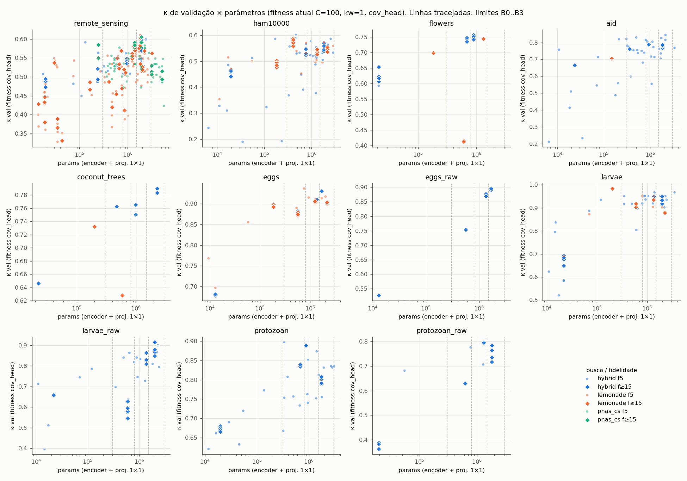
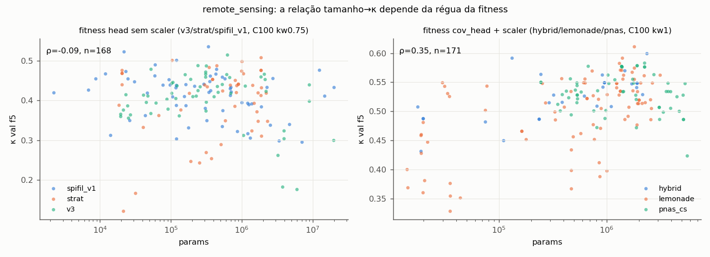
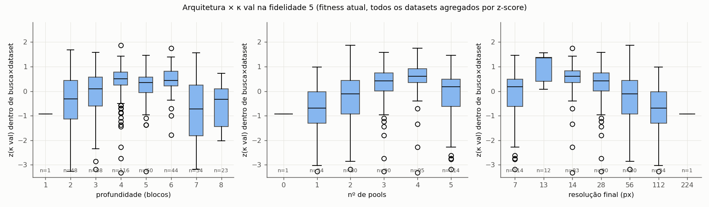
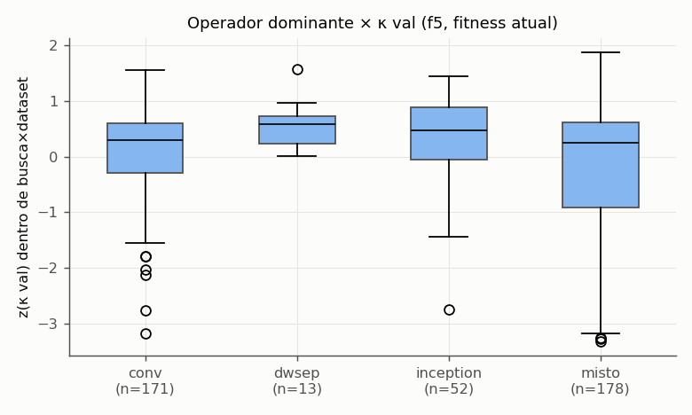
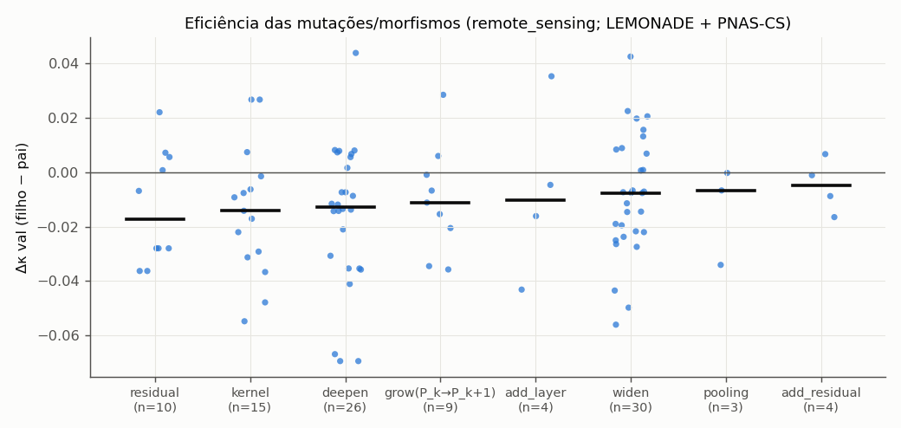
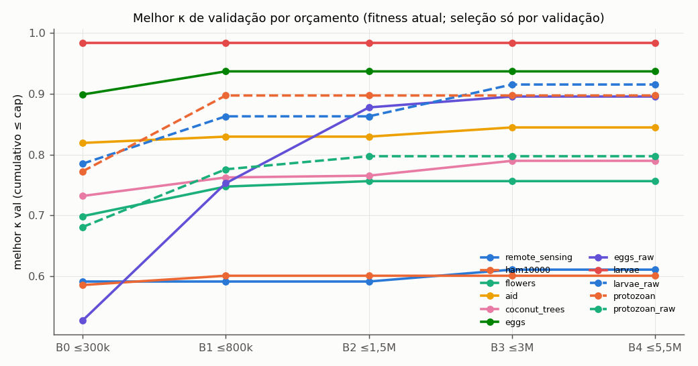
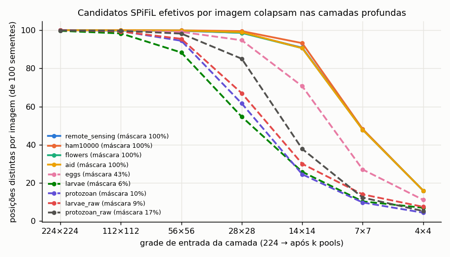
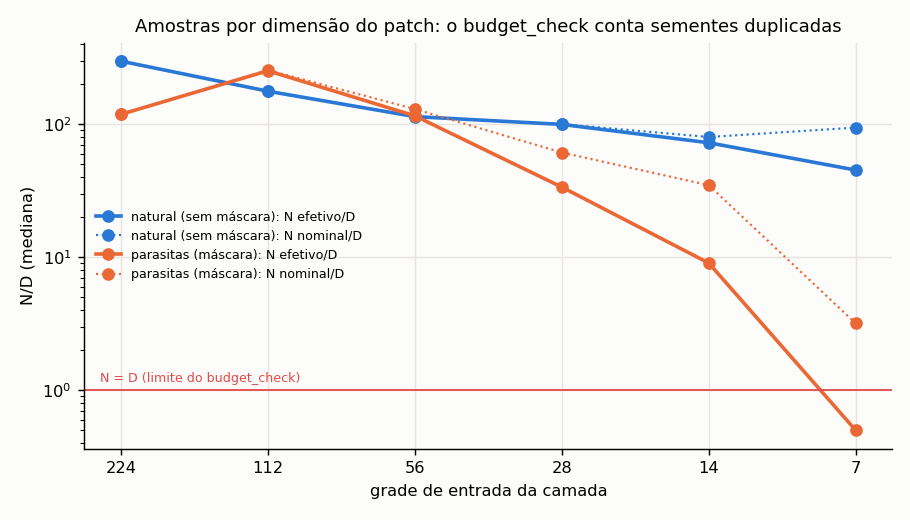
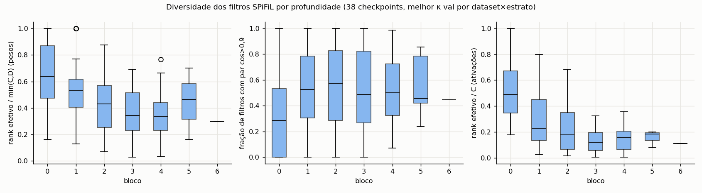

# A1a — Auditoria: Arquitetura (A) e Inicialização SPiFiL (B) + análises quantitativas 1, 3, 5 e 6

_Agente 1a, 17/11/2026. Somente leitura e CPU (`OMP_NUM_THREADS=4 nice -n 15 CUDA_VISIBLE_DEVICES=""`). Nada de produção foi alterado, nenhum treino foi feito. A inferência em CPU (16 imagens de treino por checkpoint) serviu só para medir ativações._

Legenda das afirmações: **[M]** = medido nos artefatos; **[C]** = correlação (sem controle causal); **[H]** = hipótese testável (não comprovada). Todo κ de resultado vem de uma única execução (split 1, seed 42, pct 100). Nenhum resultado tem repetição de seed.

## 0. Dados, rastreabilidade e réguas

| arquivo | conteúdo |
|---|---|
| `agent1/parts/A1a_data.csv` | 1 linha por job (1722 linhas): 1435 ok + 248 falhos de todos os `search_state.json` em `artifacts/modehb_*/*/state/seed42/` (inclusive `*_C01_*`, `*oomfail*`, `strat_*`, `v3*`, `spifil`) + PNAS-CS do athena (bundle). Também 40 linhas `ok(athena_test_only)`: buscas do athena cujo `search_state` não está no bundle e que só existem como linhas testadas. Colunas: host, run, kind, dataset, fitness_sig, cand_id, fidelidade, op (tipo/morfismo/pai/layer_map), params, FLOPs, profundidade, larguras, n_pools, resolução final, contagem por operador, ipc/n_images SPiFiL, κ val, WiSE, `test_kappa_orig`, `test_kappa_cov`, checkpoint e fonte. |
| `A1a_layers.csv` / `A1a_layers_neff.csv` | 1 linha por camada × job (3842 linhas): origem (spifil/inherited/fp_*), N = patch_count, D = patch_dim, largura pedida × efetiva, grade de entrada; na versão `_neff`, também o N efetivo estimado. |
| `A1a_pairs_parent_child.csv` | 102 pares pai→filho (LEMONADE/PNAS-CS) com Δκ val, Δparams, Δprofundidade e layer_map. |
| `A1a_best_by_budget.csv` | Melhor checkpoint por orçamento B0–B4 (seleção só por validação). |
| `A1a_seed_distinct.csv` | Sementes SPiFiL distintas por imagem e por grade (simulação exata do caminho `build_layer0`, CPU). |
| `A1a_filter_stats.csv`, `A1a_activation_stats.csv` | 38 checkpoints: estatísticas dos bancos de filtros (âncora, SSL e final) e das ativações. |
| `figs/F1…F8*.png` | Figuras citadas abaixo. |

Como os testes foram ligados aos jobs: pela chave `(run, dataset, cand, fidelidade, assinatura C/kw)` de `ga_search/modehb/reports/test_svm_C100.jsonl` (Jaci) e de `…/bundle/athena/reports/test_svm_C100.jsonl`, **exigindo κ val idêntico (|Δ| < 1e-6)**. O mesmo caminho `artifacts/modehb_hybrid/larvae` existe nas duas máquinas, e só o κ val idêntico garante que é o mesmo job. Resultado: 273 jobs com teste. Ficou sem ligação 1 linha legada da Jaci (RS c00003 f200, κ val diferente).

**Assinatura de fitness (crítico) [M].** O `search_state.json` não guarda o bloco `eval`. Li a assinatura em `config_resolved.yaml` de cada estado:

- **atual** `C100_kw1_cov_head_standard_mt4000` (hybrid, lemonade, PNAS-CS);
- **arquivada** `C0.1_kw0.75_cov_head…` (`*_C01_*`, `fullepoch`, `pre_aesched`);
- **legada** `C100_kw0.75_head_none` (modehb_spifil, v3, v3_old, strat_*).

Consequência: **o κ de validação usado como fitness atual é lido no `cov_head` (2ª ordem por bloco, PCA k=64 por bloco, + embedding 1280) com StandardScaler** (`ga_search/config/modehb/search_v3.yaml:142-143`; `pooling_head.py:321-380`). **Não é a régua ORIG** (head 1280, sem scaler) do teste reportado. Por isso nunca comparo κ val entre assinaturas, e as tabelas trazem a assinatura.

### T0 — Cobertura (jobs ok, role=search)

| dataset | busca | fitness | host | n | n f5 | n f≥45 | n com teste | κ val máx | params máx |
|---|---|---|---|---|---|---|---|---|---|
| remote_sensing | hybrid / lemonade / pnas_cs | C100_kw1_cov | jaci/jaci/athena | 43 / 129 / 79 | 27/85/59 | 12/12/15 | 18/42/9 | 0.599 / 0.611 / 0.605 | 2.4M / 3.2M / 5.6M |
| remote_sensing | hybrid / lemonade | C0.1_kw0.75_cov | jaci | 152 / 182 | 81/82 | 36/42 | 20/65 | 0.605 / 0.591 | 3.1M / 3.4M |
| remote_sensing | spifil_v1 / strat / v3 | C100_kw0.75_head | jaci | 247 / 75 / 56 | 63/49/56 | 94/19/0 | 0 | 0.572 / 0.517 / 0.514 | 20M / 2.3M / 20M |
| ham10000 | hybrid / lemonade | C100_kw1_cov | jaci | 59 / 37 | 43/21 | 12/12 | 10/13 | 0.601 / 0.587 | 2.9M |
| aid | hybrid | C100_kw1_cov | jaci | 59 | 43 | 12 | 13 | 0.845 | 3.4M |
| flowers | hybrid (+ lemonade athena 4) | C100_kw1_cov | jaci | 15 | 3 | 9 | 2 | 0.757 | 0.9M |
| eggs | lemonade (+ hybrid athena 6) | C100_kw1_cov | jaci | 35 | 19 | 12 | 3 | 0.937 | 2.2M |
| larvae | hybrid / lemonade | C100_kw1_cov | jaci | 47 / 30 | 31/14 | 12/12 | 6/10 | 0.967 / 0.984 | 3.5M / 2.2M |
| larvae_raw / protozoan / protozoan_raw | hybrid | C100_kw1_cov | jaci | 42 / 47 / 27 | 26/31/11 | 12/12/12 | 8/7/1 | 0.915 / 0.897 / 0.797 | ≤3.0M |
| coconut_trees, eggs_raw | hybrid (athena) | C100_kw1_cov | athena (só testados) | 7 / 6 | 0 | 7/6 | 7/6 | 0.790 / 0.896 | 2.3M / 1.7M |

A tabela completa está em `A1a_data.csv`. Falhas: 248 jobs, quase todos nas buscas antigas: `BudgetExhausted` N≤D (71 em modehb_spifil), `build_filters needs at least one selected` (19, v3/v3_old, antes da rota exact_small), OOM e `lejepa requires a regularizer`.

**[M] Quase não houve evolução nas buscas MO-DEHB atuais.** Em 8 dos 9 datasets do `modehb_hybrid` (C100), a população é formada só por `seed` (16 sementes em pirâmide), `calibration` (20 jobs: 4 representantes × 5 fidelidades) e `random` (5 a 22 jobs). Os registros não têm nenhum job `de`, nenhum `parent_id` e nenhuma `promotion`. Promoções e DE só aparecem em `modehb_hybrid_C01_final/remote_sensing` (arquivado, C=0,1) e em `modehb_lemonade*_/remote_sensing`. Pares pai→filho (morph/mutation/grow) **existem apenas em remote_sensing**: LEMONADE 78 pares e PNAS-CS 24. Nos demais datasets do LEMONADE só há descendentes das 3 receitas (seed+morfismo) sem herança registrada.

---

## A. Arquitetura

### A1. κ val × params / FLOPs / profundidade / largura (análise 1)

**T1 — Spearman ρ(κ val, X) na fidelidade 5** (n ≥ 12; f5 é a fidelidade em que todos os candidatos foram avaliados, sem viés de promoção). A coluna "ρ prof. | params" é a correlação parcial de postos com log(params) controlado.

| dataset | busca | fitness | n | params | FLOPs | prof. | larg. máx | n_pools | ipc | prof. \| params | ipc \| params |
|---|---|---|---|---|---|---|---|---|---|---|---|
| remote_sensing | hybrid | C100_kw1_cov | 27 | **0.65** | 0.53 | 0.08 | 0.64 | 0.22 | 0.49 | −0.14 | 0.25 |
| remote_sensing | lemonade | C100_kw1_cov | 85 | **0.48** | 0.54 | −0.37 | 0.64 | −0.23 | 0.02 | **−0.53** | −0.08 |
| remote_sensing | pnas_cs | C100_kw1_cov | 59 | −0.13 | −0.61 | 0.18 | 0.24 | 0.30 | −0.02 | 0.32 | −0.05 |
| remote_sensing | hybrid | C0.1_kw0.75_cov | 81 | 0.48 | 0.59 | −0.27 | 0.58 | −0.22 | 0.13 | −0.38 | 0.05 |
| remote_sensing | lemonade | C0.1_kw0.75_cov | 82 | 0.42 | 0.30 | 0.02 | 0.45 | 0.12 | 0.28 | −0.21 | 0.15 |
| remote_sensing | spifil_v1 | C100_kw0.75_**head** | 63 | **−0.30** | −0.01 | −0.43 | −0.19 | −0.37 | 0.01 | −0.32 | 0.16 |
| remote_sensing | strat | C100_kw0.75_**head** | 49 | 0.10 | 0.37 | −0.52 | 0.19 | −0.46 | −0.36 | −0.57 | −0.38 |
| remote_sensing | v3 | C100_kw0.75_**head** (mt10000) | 36 | −0.05 | −0.01 | −0.26 | 0.03 | −0.20 | −0.04 | −0.34 | −0.03 |
| ham10000 | hybrid | C100_kw1_cov | 43 | 0.48 | 0.55 | −0.05 | 0.58 | 0.09 | 0.29 | −0.28 | 0.17 |
| ham10000 | lemonade | C100_kw1_cov | 21 | 0.62 | 0.05 | 0.58 | 0.59 | 0.56 | 0.46 | 0.15 | 0.33 |
| flowers | spifil_v1 | C100_kw0.75_head | 24 | 0.32 | 0.53 | −0.16 | 0.21 | −0.26 | 0.09 | −0.30 | −0.19 |
| aid | hybrid | C100_kw1_cov | 43 | 0.51 | 0.66 | −0.17 | 0.51 | −0.03 | 0.06 | −0.43 | −0.14 |
| eggs | lemonade | C100_kw1_cov | 19 | 0.68 | 0.53 | 0.35 | 0.74 | 0.41 | 0.36 | −0.33 | 0.27 |
| larvae | hybrid | C100_kw1_cov | 31 | 0.70 | 0.63 | 0.33 | 0.71 | 0.29 | 0.51 | 0.11 | 0.18 |
| larvae | lemonade | C100_kw1_cov | 14 | −0.08 | 0.53 | −0.12 | −0.14 | −0.08 | −0.13 | −0.10 | −0.10 |
| larvae_raw | hybrid | C100_kw1_cov | 26 | 0.72 | 0.68 | 0.16 | 0.71 | 0.24 | 0.43 | −0.21 | −0.06 |
| protozoan | hybrid | C100_kw1_cov | 31 | 0.61 | 0.54 | 0.00 | 0.63 | 0.23 | 0.61 | −0.18 | 0.36 |

Agregado (percentil de κ dentro de cada busca × dataset × fidelidade, f5):

- **fitness cov_head**: n=584. ρ(params) = **0.41**, ρ(larg. máx) = **0.49**, ρ(prof.) = −0.05, ρ(n_pools) = 0.05.
- **fitness head sem scaler (legado)**: n=192. ρ(params) = **−0.05**, ρ(larg.) = 0.03, ρ(prof.) = **−0.36**, ρ(n_pools) = −0.33.

Com a fidelidade mais alta de cada candidato (T1b, fitness atual), o padrão se repete: ρ(params) = 0.36–0.70 e ρ(prof.) = −0.17 a 0.43.

- **[M/C]** Com a fitness atual, κ val cresce com largura e params em todos os datasets (ρ 0.48–0.72), exceto larvae-LEMONADE (n=14, saturado em 0.95–0.98) e PNAS-CS (todos os membros vêm de poucas famílias). **Profundidade não ajuda**: a parcial com params controlado é negativa em 14 de 17 grupos (até −0.57).
- **[M/C] A relação "maior = melhor" depende da régua.** Com a fitness legada (head, sem scaler), em remote_sensing ρ(params) vai de −0.30 a 0.10 (F1b). Com a régua cov_head, a dimensão do readout cresce com a largura até k=64 por bloco e com o número de blocos. **[H]** Parte do ganho de κ val dos modelos largos vem do readout de 2ª ordem, não do encoder.
- **[C] Contexto do teste (não usado na seleção).** Nas linhas testadas, ρ(κ val, κ teste COV) = 0.65–1.00 em 11 de 12 grupos. Já ρ(κ val, κ teste ORIG) vai de −0.42 a 0.89, com mediana 0.07 (RS C100: 0.07, aid −0.14, protozoan −0.35, larvae_raw −0.42). ρ(params, κ teste ORIG) é negativo em 8 de 13 grupos (aid −0.53, protozoan −0.55, larvae_raw −0.55, flowers C0.1 −0.97). **Na régua ORIG os pequenos tendem a dominar. Na fitness (cov) os grandes dominam.** (T7, `tables` abaixo; detalhes da régua ficam com o Agente 1b, item D.)

### A2. Redução espacial e resolução final

**T2 — f5, fitness atual, z-score de κ dentro de busca × dataset**

| n_pools | n | percentil mediano | z médio | resolução final | prof. mediana | params medianos |
|---|---|---|---|---|---|---|
| 1 | 34 | 0.25 | −0.75 | 112 | 2 | 23k |
| 2 | 80 | 0.38 | −0.29 | 56 | 3 | 321k |
| 3 | 90 | 0.60 | +0.22 | 28 | 4 | 632k |
| **4** | 95 | **0.74** | **+0.54** | **14** | 4 | 1.39M |
| 5 | 114 | 0.43 | −0.18 | 7 | 6 | 1.25M |

| profundidade | 2 | 3 | 4 | 5 | 6 | 7 | 8 |
|---|---|---|---|---|---|---|---|
| n | 48 | 88 | 116 | 60 | 44 | 34 | 23 |
| z médio | −0.52 | −0.10 | **+0.34** | +0.23 | **+0.44** | **−0.74** | −0.59 |

z médio por n_pools e dataset (T2c): o ótimo fica em 3–4 pools em todos os datasets. Em protozoan, 5 pools dá −1.11 (contra +0.75 com 3 pools); em RS, −0.50 (contra +0.78 com 4 pools). Em larvae/eggs, 1–2 pools dá −1 a −3.3.

- **[M/C]** Há um ótimo de redução espacial em **3–4 pools (mapa final de 28×28 a 14×14)**. Chegar a 7×7 (5 pools, mínimo de `min_spatial=6`) piora o κ val. Profundidade 7–8 é a pior faixa (z ≈ −0.6/−0.7), embora tenha params semelhantes aos de prof. 4–6.
- **[H]** A queda em 7×7 e em prof. ≥7 se explica pela inicialização das camadas profundas: lá os candidatos SPiFiL colapsam (seção B3: 10–48 posições distintas por imagem e N_ef/D < 1 nos parasitas). Também conta que, na f5, cada bloco a mais recebe as mesmas 2 épocas de AE local.

### A3. conv × dwsep × inception

**T3 — operador dominante (>50% dos blocos), f5, fitness atual**

| operador | n | z médio | percentil mediano | params medianos | GFLOPs medianos |
|---|---|---|---|---|---|
| conv | 171 | +0.08 | 0.52 | 923k | 1.04 |
| dwsep | 13 | +0.56 | 0.68 | 1.98M | 1.60 |
| inception | 52 | +0.31 | 0.60 | 887k | 0.78 |
| misto | 178 | −0.21 | 0.47 | 632k | 0.51 |

**T3b — OLS z(κ val) ~ log10(params) + prof. + n_pools + frac_dwsep + frac_inception + n_residual** (n=414, IC 95% por bootstrap)

| termo | coef | IC 95% |
|---|---|---|
| log10(params) | **+0.88** | [0.70, 1.03] |
| profundidade (por bloco) | **−0.20** | [−0.29, −0.11] |
| n_pools | +0.13 | [0.01, 0.24] |
| frac_inception | **+0.42** | [0.11, 0.70] |
| frac_dwsep | +0.15 | [−0.29, 0.55] |
| n_residual | −0.01 | [−0.08, 0.05] |

- **[C]** Com params, profundidade e pools controlados, **inception está associado a +0.4 z** de κ val. dwsep não se distingue de conv (n=13). Residual não tem efeito mensurável. Entre os 10% melhores, a fração de blocos inception é 0.38, contra 0.26 no resto.
- **[H]** O inception do SPiFiL ajusta cada ramo de forma independente (1×1, 3×3, 5×5 e pool, `spifil_ops.py:481-506`). Isso dá diversidade de escala sem passar pelo seletor. Mas os ramos 1×1 são os mais redundantes (B4: k=1 → 71% dos filtros com par cos>0.9). O benefício pode vir da multiescala, não do banco 1×1.

### A4. Benefício marginal por bloco (análise 3)

Só existem pares em remote_sensing. 38 pares têm profundidade maior no filho (deepen / add_layer / grow com layer_map). Em todos o pai foi avaliado na mesma fidelidade que o filho (quase todos f5).

| op | n | Δκ/bloco mediana | fração > 0 |
|---|---|---|---|
| deepen (LEMONADE, prefixo herdado e re-fit SPiFiL do bloco novo e seguintes) | 26 | −0.013 | 0.31 |
| add_layer (PNAS, identidade Net2Deeper) | 4 | −0.010 | 0.25 |
| grow P_k→P_k+1 (PNAS, identidade + widen) | 9 | −0.011 | 0.22 |
| **total com +1 bloco** | 38 | **−0.011** | **0.29** |
| controle: mesma profundidade (widen/kernel/residual/pooling) | 64 | −0.010 | 0.30 |

- **[M]** Adicionar um bloco **não melhorou** o κ val na f5. A mediana é −0.011 por bloco, a mesma ordem de grandeza das mutações sem bloco novo. As famílias do PNAS-CS (mesma base em P0..P4) também não sobem com o porte: F480cf5f505 P1 0.577 → P2 0.583 → P3 0.548; F675b105060 P2 0.578 → P3 0.563 (T4b).
- **[H/viés]** Parte disso é **regressão à média**. O percentil mediano dos pais é 0.71: os pais saem da frente não dominada. Com pais abaixo da mediana do grupo, 41% dos filhos melhoram (mediana −0.008); acima da mediana, 25% (−0.012). Sem repetição de seed não há como separar ruído de efeito.

### A5. Eficiência das mutações (análise 5)

**T5 — Δκ val = κ(filho) − κ(pai na mesma fidelidade)**, remote_sensing, 97 pares únicos

| busca / fitness | operador | n | Δκ mediana | fração > 0 | Δparams mediano | Δκ por +100k params |
|---|---|---|---|---|---|---|
| LEMONADE C100 | deepen / widen / kernel / residual | 11 / 13 / 6 / 4 | −0.012 / −0.014 / −0.027 / −0.022 | 0.36 / 0.31 / 0.00 / 0.25 | 28k / 9k / 0.8k / 0 | −0.018 / −0.012 / — / — |
| LEMONADE C0.1 | deepen / widen / kernel / residual | 15 / 14 / 9 / 6 | −0.014 / −0.007 / −0.008 / −0.014 | 0.27 / 0.43 / 0.33 / 0.50 | 28k / 79k / 0.6k / 0 | −0.009 / −0.001 / — / — |
| PNAS-CS C100 | add_layer / add_residual / widen / pooling / grow | 4 / 4 / 3 / 3 / 9 | −0.010 / −0.005 / −0.022 / −0.007 / −0.011 | 0.25 / 0.25 / 0.33 / 0.00 / 0.22 | 30k / 293k / 68k / 0 / 832k | −0.17 / −0.004 / −0.006 / — / −0.002 |

- **[M]** Os **8 operadores têm mediana de Δκ negativa**. Só 29 de 97 filhos superam o pai (teste binomial contra 50%: p = 9×10⁻⁵). O "menos ruim" é widen (37% melhoram, −0.008), seguido de add_residual e pooling (−0.005/−0.007, n pequeno). kernel é o pior (20%, −0.014).
- **[M] Promoções (mesmo candidato, mais épocas)**: f5→f15 mediana 0.000 (41% melhoram, n=202), f15→f45 +0.001 (53%), f45→f100 0.000 (36%), f100→f200 0.000 (46%). **Mais épocas de SSL não mudam o κ val (cov_head)**, coerente com B5 (a SSL quase não move as convs).
- **[H]** Nesta pipeline nenhum operador estrutural agrega valor sobre a frente na f5. Nos morfismos do LEMONADE (sem preservação de função) o bloco alterado e todos os seguintes são re-ajustados por SPiFiL, o que destrói os blocos treinados herdados. No PNAS-CS (Net2Net, com preservação) Δκ também é negativo. Isso aponta para limite da representação (init/readout), não do mecanismo de herança.

### A6. Melhores checkpoints por orçamento B0–B4, só por VALIDAÇÃO (análise 6)

Seleção: maior κ val (fitness atual C100_kw1_cov_head) entre todos os jobs ok com params ≤ teto (cumulativo). O teste ORIG/COV é só informativo. Lista completa, com caminho do checkpoint, em `A1a_best_by_budget.csv`.

| dataset | B0 ≤300k | B1 ≤800k | B2 ≤1,5M | B3 ≤3M | B4 ≤5,5M |
|---|---|---|---|---|---|
| remote_sensing | hybrid c00009 f5, 133k, 2 bl (70-280), **0.591** | = B0 | = B0 | lemonade c00028 f5, 1.82M, 6 bl, **0.611** (ORIG 0.494 / COV 0.568) | = B3 (PNAS >3M: máx 0.548) |
| ham10000 | hybrid c00025 f5, 170k, 0.586 (ORIG 0.499 / COV 0.624) | hybrid c00034 f5, 467k, 2 bl (35-196), **0.601** | = B1 | = B1 | lacuna (0 cand. >3M) |
| aid | hybrid c00025 f5, 213k, 0.819 (ORIG 0.719 / COV 0.849) | hybrid c00038 f5, 502k, 5 bl, 0.830 | = B1 | hybrid c00020 f5, 2.14M, 4 bl, **0.845** | = B3 |
| flowers | lemonade(athena) c00001 f200, 182k, 0.699 | hybrid c00002 f200, 684k, 0.748 | hybrid c00003 f45, 895k, **0.757** | lacuna | lacuna |
| coconut_trees | lemonade c00001 f200, 0.732 | hybrid c00002 f200, 0.763 | hybrid c00003 f100, 0.766 | hybrid c00004 f100, 2.30M, **0.790** | lacuna |
| eggs | lemonade c00001 f45, 185k, 0.899 | lemonade c00009 f5, 753k, **0.937** | = B1 | = B1 | lacuna |
| eggs_raw | hybrid c00001 f200, 13k, 0.527 | c00002, 562k, 0.753 | c00003, 1.34M, 0.878 | c00004, 1.70M, **0.896** | lacuna |
| larvae | lemonade c00001 f200, 201k (32-48-64), **0.984** (ORIG 0.693 / COV 0.915) | = B0 | = B0 | = B0 | = B0 |
| larvae_raw | hybrid c00021 f5, 120k, 0.785 | c00022 f5, 644k, 0.863 | = 0.863 | hybrid c00004 f45, 1.97M, **0.915** (ORIG 0.188 / COV 0.740) | = B3 |
| protozoan | hybrid c00021 f5, 137k, 0.773 | hybrid c00006 f5, 333k (21-84-224), **0.897** | = B1 | = B1 | = B1 |
| protozoan_raw | hybrid c00005 f5, 55k, 0.681 | c00006 f5, 775k, 0.776 | hybrid c00003 f100, 1.31M, **0.797** | = B2 | = B2 |

- **[M] Saturação precoce.** Em 6 de 11 datasets o melhor κ val cumulativo já está em B0 ou B1 e não melhora com mais orçamento: RS (+0.020 só em B3), ham10000, eggs, larvae, protozoan e aid (+0.015 de B1 a B3). Só eggs_raw, larvae_raw, protozoan_raw e coconut crescem até B2/B3. Esses são, de novo, datasets com poucos candidatos.
- **[M] Lacunas.** **B4 (3–5,5M) está praticamente vazio**: hybrid e LEMONADE têm teto de 3,5M (`stratified.param_cap`), e só o PNAS-CS RS passa de 3,5M. flowers, coconut e eggs_raw têm 3–4 candidatos em toda a busca (só calibração; as buscas do athena só aparecem pelas linhas testadas). Muitos "melhores" são da f5, nunca promovidos e sem teste.
- **[C]** Os melhores por validação raramente são os melhores no ORIG (larvae_raw B3: val 0.915 → ORIG 0.188; larvae B0: 0.984 → 0.693). O assunto fica com o Agente 1b (itens D/E). Para as sementes B0–B4, a seleção deve continuar só por validação, mas com a régua da nova fitness (ORIG), que **não existe** hoje nos `search_state`.

---

## B. Inicialização SPiFiL

### B1. O que o código faz, por camada [M, lido do código]

Caminho: `run_search.Evaluator._grow` (`ga_search/modehb/run_search.py:857-962`) → `init.init_block` (`init.py:180`) → com `spifil_ops: true`, `spifil_ops.fit_ops_block` (`spifil_ops.py:417-573`) → biblioteca `/dados/home/moliveira/SPiFiL/src/spifil` (Learner + `flim.spifil.GrowOneLayer`).

1. **Doadores (rotulados, só treino).** As primeiras `spifil_images_per_class` (ipc ∈ {1,2,4,8,16,32}) imagens de cada classe de um pool fixo e aninhado (`run_search.py:79-105`). n_images = ipc × n_classes (64–224 nos jobs atuais).
2. **Sementes = superpixels no LAB 224, mesmo nas camadas profundas.** `build_layer0` (`flim/spifil.py:635-663`) roda SLIC (100 superpixels/imagem) + `Medoids` na imagem LAB 224 (Resize + CenterCrop, igual ao teste). Nos parasitas, a **máscara** restringe os superpixels ao objeto (`flim/spifil.py:403-423`; `spifil/superpixels/slic.py:43-65`). As sementes são **reescaladas proporcionalmente** para a grade da saída do prefixo (`rescale`, `flim/spifil.py:467-482`). O código registra explicitamente que "sementes que caem no mesmo pixel viram candidatas duplicadas". O modo `spifil_in_feature` existe, mas está desligado.
3. **Features = ativações do prefixo já treinado** (blocos anteriores após o AE local, congelados): `encoder_features` (`flim/spifil.py:544-553`). O patch candidato é o vetor `C_in·k²` em torno de cada semente (`patches.extract_patches`).
4. **Pontuação supervisionada.** `FisherScorer` = média das distâncias às outras classes / média das distâncias à própria classe (`spifil/scoring.py:40-46, 95-110`). **Usa os rótulos das imagens:** cada semente herda o rótulo da imagem (`preparation.py:80-86`). A distância é **Mahalanobis com shrinkage de Ledoit-Wolf** sobre todos os patches da camada (`metrics.py:65-170`), que avisa quando N ≤ D. Os escores viram rank por classe.
5. **Alocação por classe.** `UniformAllocator`: out//n_classes filtros por classe (`allocation.py:33-54`), por isso a largura efetiva é truncada ao múltiplo de n_classes. Abaixo de n_classes entra o `ExactBudgetAllocator`, uma aproximação (`spifil_ops.py:253-287`).
6. **Seleção.** `DiversitySelector` (α=0.5, pool_factor=3; `selection.py:76-195`): por classe, pega os 3×orçamento melhores ranks e escolhe gulosamente por `α·rank + (1−α)·distância mínima Euclidiana aos já escolhidos`. **É o único componente "tipo FPS"** (max-min guloso dentro do pool). **Não há SIFT** em nenhum ponto do caminho usado (grep em `flim/`, `ga_search/`, `core/`, `src/` e na biblioteca).
7. **Construção.** `build_filters`: z-score dos patches selecionados (std populacional + `stdev_factor`=0.01), normalização unitária e média dobrada no bias (`nn/builder.py:83-122`). A conv é ajustada **linear**. Ativação, norma (BN, ZCA ou DBN) e pool são aplicados depois (`spifil_ops.py:38-47`). dwsep e depthwise são aproximações por canal. Inception = 4 ajustes independentes, um por ramo (`spifil_ops.py:481-506`).
8. **Orçamento.** `GrowOneLayer`/`_budget` só exigem N > D, com N = **número de sementes incluindo duplicatas** (`spifil_ops.py:302-309`). O reparo `spifil_images_repair` aumenta o ipc até que N = 0,9 × 100 × ipc × n_classes > 1,05 × D (`strata.py:436-476`). Ele também assume 90 sementes por imagem, sem considerar a grade.
9. **Depois do SPiFiL.** AE local por bloco (`protect`: lr × {1, 0.01, 0} nas convs SPiFiL, `modehb.py:103`), SSL global LeJEPA (lr_old 1e-4 × protect nos herdados) e WiSE α∈{0..1} escolhido pela validação.

**Supervisionado × label-free [M]:** a init SPiFiL atual é **supervisionada** (rótulos no Fisher, no alocador por classe e no seletor por classe). A busca usa rótulos de validação no SVM da fitness. Existe `DistanceSumScorer` (não supervisionado) na biblioteca, mas ele não é usado.

### B2. Candidatos/sementes por camada [M]

- `patch_count / n_images` = 99–100 sementes por imagem em **todas** as camadas e grades, de 224 até 7 (3842 registros de camada). O número **nominal** de candidatos não cai com a profundidade.
- **Sementes distintas por imagem após a reescala** (simulação exata do caminho `build_layer0` em 3 imagens doadoras por classe; `A1a_seed_distinct.csv`):

| dataset (cobertura da máscara) | 224 | 56 | 28 | 14 | 7 | 4 |
|---|---|---|---|---|---|---|
| remote_sensing / ham10000 / aid / flowers (100%, sem máscara) | 100 | 99.7–100 | 98.6–99.5 | 90.6–93.2 | **48** | 16 |
| eggs (43%) | 100 | 99.1 | 94.7 | 70.7 | **27** | 11 |
| protozoan_raw (17%) | 99.9 | 98.2 | 85.0 | 37.8 | **12** | 5 |
| larvae_raw (9%) | 100 | 95.5 | 67.0 | 30.0 | **14** | 7.5 |
| protozoan (10%) | 100 | 94.5 | 61.6 | **24.5** | **9.8** | 4.4 |
| larvae (6%) | 99.7 | 88.3 | 54.7 | **25.8** | **10.3** | 7.0 |

- **Orçamento de covariância por camada** (N efetivo = n_images × sementes distintas na grade de entrada; estimativa a partir da medição acima; `A1a_layers_neff.csv`):

| grupo | grade de entrada | camadas | N nominal | N efetivo | D mediano | N/D nominal | **N/D efetivo** | % camadas com N_ef/D ≤ 1 |
|---|---|---|---|---|---|---|---|---|
| natural | 224 | 243 | 12000 | 12000 | 75 | 297 | 297 | 0% |
| natural | 28 | 153 | 22300 | 22003 | 168 | 100 | 99.5 | 0% |
| natural | 14 | 91 | 22300 | 20261 | 252 | 80 | 72 | 0% |
| natural | 7 | 72 | 22300 | 10709 | 123 | 94 | 45 | 4% |
| parasitas | 224 | 132 | 6362 | 6379 | 75 | 119 | 119 | 0% |
| parasitas | 28 | 93 | 6384 | 4288 | 200 | 61 | 34 | 3% |
| parasitas | 14 | 58 | 6373 | 1920 | 249 | 35 | **9.0** | **21%** |
| parasitas | 7 | 14 | 6362 | 661 | 1296 | 3.2 | **0.5** | **57%** |

- **[M]** O `budget_check` e o `spifil_images_repair` contam sementes duplicadas. Nos parasitas com 4–5 pools, **mais da metade das camadas profundas tem menos patches distintos do que dimensões** (Mahalanobis sustentado só pelo shrinkage de Ledoit-Wolf), embora passem no orçamento nominal. Nas camadas de grade 7, cada patch 3×3 cobre quase o mapa inteiro.
- **[M]** Largura efetiva / pedida (alocador por classe): mediana 0.97–1.00, p10 0.71–0.90. Entre 10% e 36% das camadas perdem mais de 10% da largura pedida (aid 31%, ham 33%, protozoan_raw 36%). Os registros do genótipo diferem do fenótipo.
- **[C]** ipc (imagens por classe) tem ρ positivo com κ val (0.29–0.61 nos parasitas, ham e RS-hybrid). **Controlando params, cai para −0.14 a 0.36.** O `spifil_images_repair` aumenta o ipc de genomas largos, portanto ipc e largura estão confundidos. Não há evidência isolada de que mais doadores ajudem.

### B3. Rank efetivo, redundância, normas e filtros mortos (38 checkpoints) [M]

Amostra: melhor κ val (fitness atual, Jaci) de cada dataset × estrato (tiny/small/medium/huge) + melhor `protect=freeze` por dataset. São 38 checkpoints e 338 convs densas (`A1a_filter_stats.csv`). Carregados em CPU: `encoder`, `anchor` (SPiFiL+AE, antes da SSL) e `ssl_state`.

**TB4 — banco de filtros final por bloco (medianas)**

| bloco | C | D=C_in·k² | rank ef./min(C,D) | rank99/min(C,D) | \|cos\| médio | pares \|cos\|>0.9 | filtros com par cos>0.95 | filtros com par cos>0.9 | quase nulos |
|---|---|---|---|---|---|---|---|---|---|
| 0 | 7 | 27 | 0.64 | 0.60 | 0.52 | 10% | 0%* | 29% | 0 |
| 1 | 24 | 42 | 0.53 | 0.50 | 0.49 | 8% | 40% | 53% | 0 |
| 2 | 37 | 90 | 0.43 | 0.40 | 0.44 | 4% | 39% | 57% | 0 |
| 3 | 204 | 261 | 0.34 | 0.29 | 0.38 | 2% | 32% | 49% | 0 |
| 4 | 112 | 642 | 0.34 | 0.30 | 0.37 | 2% | 40% | 50% | 0 |
| 5 | 112 | 642 | 0.47 | 0.44 | 0.30 | 2% | 32% | 46% | 0 |
| 6 | 642 | 642 | 0.30 | 0.25 | 0.34 | 0.4% | 0.3% | 45% | 0 |

\* No bloco 0, 40% dos filtros têm um par com |cos|>0.95 de **sinal oposto** (pares ±).

- **TB4b, SPiFiL puro** (âncoras de candidatos `freeze` em camadas de origem spifil: os pesos conv = init SPiFiL, porque o AE tem lr 0 na conv): 33 convs. rank ef./min = 0.47, **40% dos filtros têm par cos>0.95 e 59% têm par cos>0.9**. Ou seja, a redundância já existe na init; não foi criada pelo treino.
- **Por kernel**: k=1 (ramos 1×1 do inception e pointwise, em geral C>D) → 71% com par cos>0.9 e rank ef. 0.41. k=3: 41%. k=5: 29%. k=7: 14%. Camadas com C>D: 80% com par cos>0.9.
- **Normas**: nenhum filtro nulo ou quase nulo (‖w‖ < 1% da mediana) em nenhum checkpoint. CV das normas entre 0.08 e 0.22. O z-score com stdev_factor evita zeros.
- **Ativações** (16 imagens doadoras, encoder final, TB6): rank efetivo / C cai de **0.49 (bloco 0) para 0.18 (bloco 2) e 0.11–0.16 (blocos 3–6)**. |corr| médio entre canais fica entre 0.42 e 0.50 nos blocos 0–3. **Canais mortos ≈ 0%**, com exceção dos huge raw (larvae_raw c00004: 7.6% no bloco 3 e 32% no bloco 4; protozoan_raw c00004: 22% no bloco 4), de RS small c00054 (bloco 5: 23%) e de flowers small c00002 (bloco 0: 13%).
- **[H]** O colapso aparece como **redundância e baixo rank**, não como filtros mortos. Os blocos profundos usam cerca de 1/3 da dimensão disponível, nos pesos e nas ativações. Isso combina com B2: poucas posições distintas por imagem e patches profundos parecidos entre si. O seletor por diversidade não compensa, porque age dentro de um pool pequeno de 3×orçamento por classe.

### B4. O backprop quase não altera as convs SPiFiL [M]

**TB5 — deriva ‖ΔW‖/‖W‖ das convs** (38 checkpoints)

| protect | âncora→SSL (mediana / máx) | âncora→final WiSE (mediana / máx) |
|---|---|---|
| freeze | 0 / 0 | 0 / 0 |
| lowlr | 0.03% / 14% | 0.01% / 11% |
| full | 3.6% / 167% | 1.6% / 167% |

Nos jobs atuais (572), WiSE escolheu **α=0 (descarta a SSL) em 23%** e α=1 em 28%.

- **[M]** Em `freeze` e `lowlr` (72% dos jobs) a SSL global praticamente não move os pesos conv. O encoder final é, na conv, o SPiFiL (+AE quando `full`). A SSL e as fidelidades altas atuam na head/normas, o que é coerente com a promoção f5→f200 ter Δκ mediano 0.
- **[H]** Com essa proteção, a qualidade da inicialização SPiFiL de cada camada **define** a representação. Uma init pobre nas camadas profundas (B2/B3) não é corrigida depois. Esse é o mecanismo candidato a explicar por que profundidade e blocos extras não trazem ganho (A1, A4, A5).

### B5. SPiFiL × aleatório (único controle pareado disponível) [M, n pequeno]

`modehb_v3_old/remote_sensing` (fitness legada head, C100 kw0.75, f5): 8 pares c0000(2i−1)/c0000(2i) de mesma topologia, SPiFiL × He-aleatório.

| SPiFiL | aleatório | larg. SPiFiL / aleat. | κ SPiFiL | κ aleat. | Δ |
|---|---|---|---|---|---|
| c00001 / c00002 | | 14-14 / 16-16 | 0.376 | 0.386 | −0.010 |
| c00003 / c00004 | | 28-28 / 32-32 | 0.395 | 0.478 | −0.083 |
| c00005 / c00006 | | 56-56 / 64-64 | 0.418 | 0.437 | −0.019 |
| c00007 / c00008 | | 126-126 / 128-128 | 0.458 | 0.487 | −0.028 |
| c00009 / c00010 | | 14×3 / 16×3 | 0.414 | 0.364 | +0.051 |
| c00011 / c00012 | | 28×3 / 32×3 | 0.367 | 0.393 | −0.026 |
| c00013 / c00014 | | 56×3 / 64×3 | 0.361 | 0.465 | −0.104 |
| c00015 / c00016 | | 126×3 / 128×3 | 0.435 | 0.420 | +0.015 |

- **[M/C]** O aleatório vence em 6 de 8 (Δ mediano −0.023; Wilcoxon p=0.20). Há confundimento: o SPiFiL é ~12% mais estreito por causa do alocador por classe. É pipeline antiga (sem cov_head, sem AE/protect atuais), f5, 1 seed. **Não há gêmeo aleatório nas buscas atuais** (`random_baseline: false`), então hoje não existe evidência de que a init SPiFiL supere a aleatória na pipeline atual. Esse experimento falta.

---

## C. Separação dos achados

**MEDIDO**

- A fitness atual lê o κ val no cov_head + scaler, não no ORIG.
- 8 de 9 buscas MO-DEHB não passaram de seeds, calibração e aleatórios. Pares pai→filho só existem em RS.
- 97 pares de mutação/morfismo: Δκ mediano −0.011, 30% melhoram.
- Promoções: Δκ mediano 0.
- B4 vazio e saturação de κ val em B0/B1 na maioria dos datasets.
- Sementes distintas colapsam com a grade, e N_ef/D < 1 em 57% das camadas de grade 7 nos parasitas.
- Cerca de 40% dos filtros têm quase-duplicata, inclusive no SPiFiL puro.
- O rank efetivo cai de 0.64 para 0.30 ao longo da profundidade.
- Não há filtros mortos, e a SSL move 0–3.6% dos pesos conv.

**CORRELAÇÃO**

- κ val ~ params/largura (+), condicionado à régua cov.
- κ val ~ profundidade (−) com params controlado.
- Ótimo em 3–4 pools.
- Inception (+).
- ipc (+) confundido com largura.
- κ val ~ κ teste COV (+); κ val ~ κ teste ORIG (≈0/−).

**HIPÓTESES (para o gate do Agente 2)**

- H-A1 (readout): o ganho dos modelos largos na fitness atual vem em parte da dimensão do cov_head. Teste: re-pontuar os mesmos checkpoints com ORIG na validação (sem treino) e recalcular ρ(params).
- H-B1 (candidatos profundos insuficientes): sementes por superpixel da imagem colapsam em grades ≤14, sobretudo com máscara. Teste: mesma arquitetura (RS, Flowers, protozoan; 4–6 blocos) com sementes amostradas na grade da feature (todas as posições, `spifil_in_feature`, ou amostragem densa), com N distinto ≥ 5·D. Métricas: κ val ORIG, rank ef., redundância. Pelo menos 3 seeds.
- H-B2 (redundância): substituir o DiversitySelector por protótipos (k-means/PCA com whitening, SPiFiL-1) reduz a fração de quase-duplicatas (~40%) e eleva o rank ef. nas camadas 3+.
- H-B3 (init decisiva): como a SSL quase não move as convs, a comparação SPiFiL × aleatório × SPiFiL-1/2 deve ser feita com `protect=full` e com `freeze`, na mesma topologia efetiva (gêmeo pela `effective_spec`, não pela largura pedida).
- H-A2 (profundidade): com init profunda corrigida (H-B1), o ótimo em 3–4 pools e a penalidade de −0.2 z por bloco devem diminuir. Se não diminuírem, o limite está no readout ou no aprendizado (item C).

## D. Pendências e limitações

- n=1 seed por candidato em todo o GA. Δκ de ±0.01 está dentro de um ruído que não foi medido.
- Os `search_state` do athena (hybrid/lemonade: coconut, eggs, eggs_raw, flowers, larvae) não estão no bundle. Essas linhas são só as testadas, um subconjunto com viés de seleção.
- O ORIG na validação não existe em nenhum job, e por isso a análise 6 usa a régua cov. A nova fitness da missão (ORIG) exige re-pontuação.
- As estatísticas de filtros são de 38 checkpoints (melhor por estrato), não de toda a população. As ativações usam 16 imagens de treino.
- O N efetivo da TB2 é estimado com a média de sementes distintas medida em 3 imagens/classe (6 imagens em larvae/larvae_raw), não por job.

## Anexo — reprodução

Scripts (scratchpad, só leitura, CPU):

- `extract.py` → `A1a_data.csv`, `A1a_layers.csv`
- `analyze.py` → T0–T7, `A1a_pairs_parent_child.csv`, `A1a_best_by_budget.csv`, F1–F5
- `seeds_sim.py` → `A1a_seed_distinct.csv`
- `ckpt_inspect.py` → `A1a_filter_stats.csv`, `A1a_activation_stats.csv`
- `init_figs.py` → TB1–TB6, F6–F8

Diretório: `/tmp/claude-1014/-dados-home-moliveira-Scalable-Hybrid-FLIM/05a95f35-17a2-4976-a2bd-9c4d1e4ff9eb/scratchpad/a1a/`. Copiados para `agent1/parts/A1a_scripts/` para garantir a persistência.
