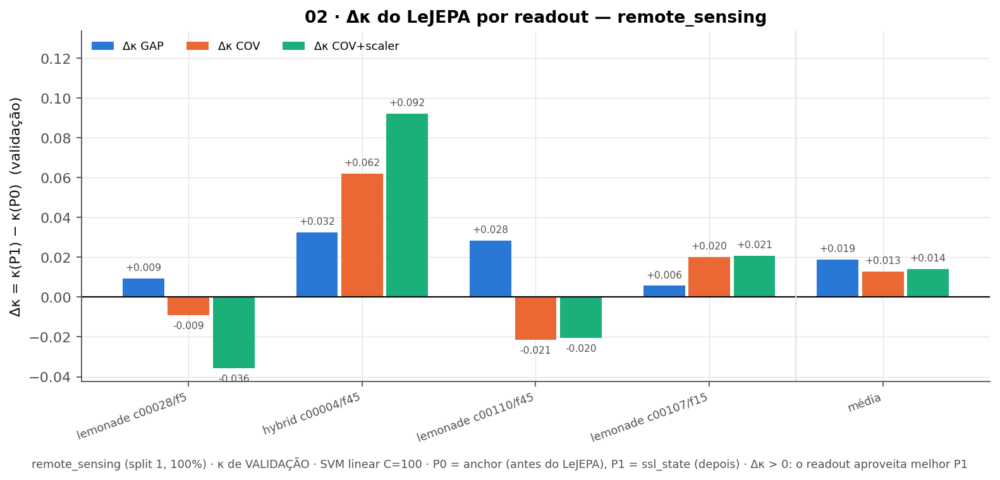
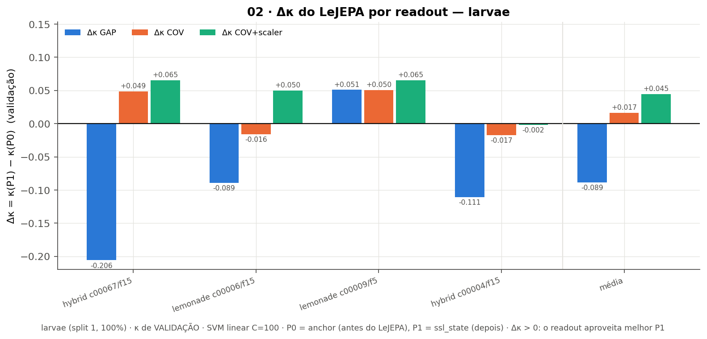
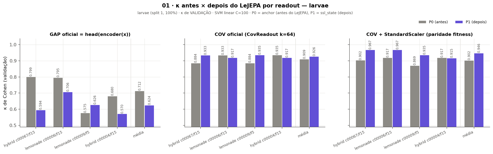
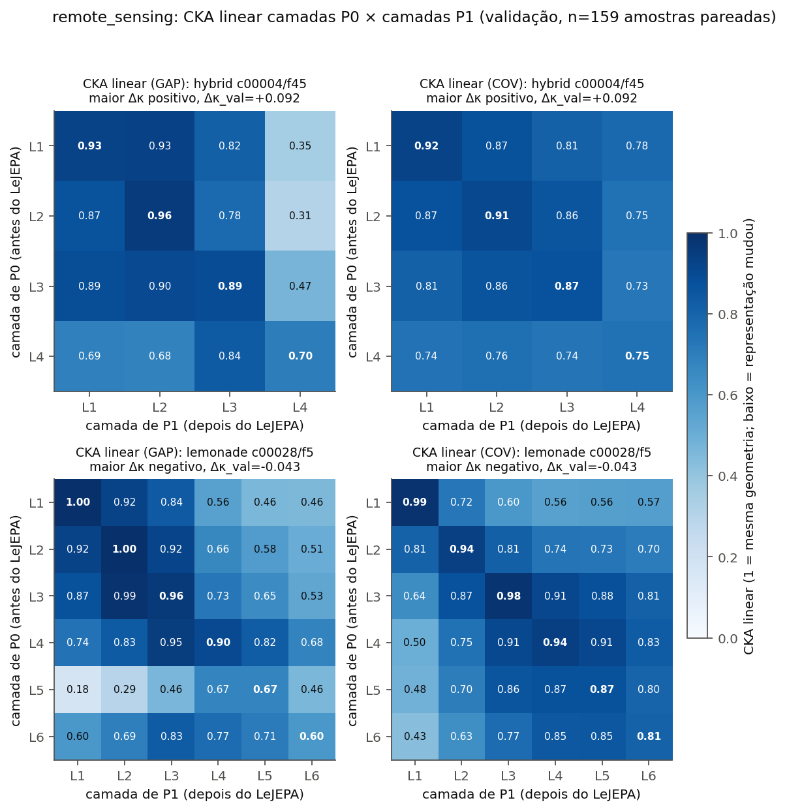
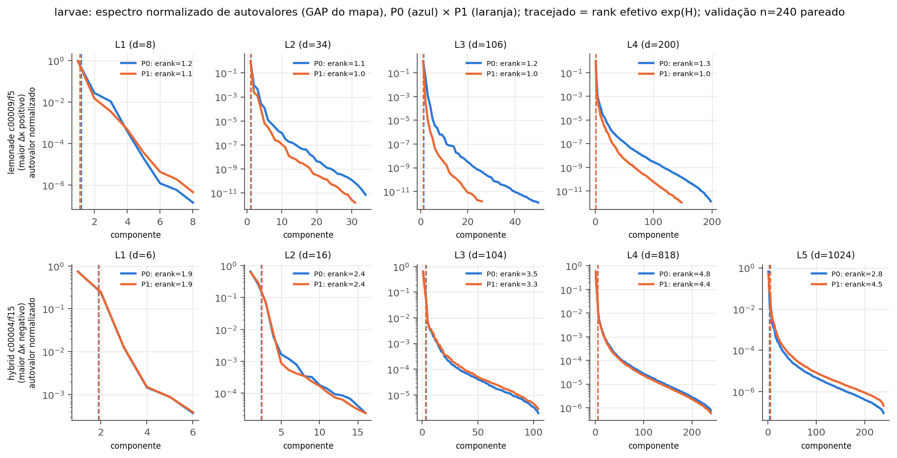
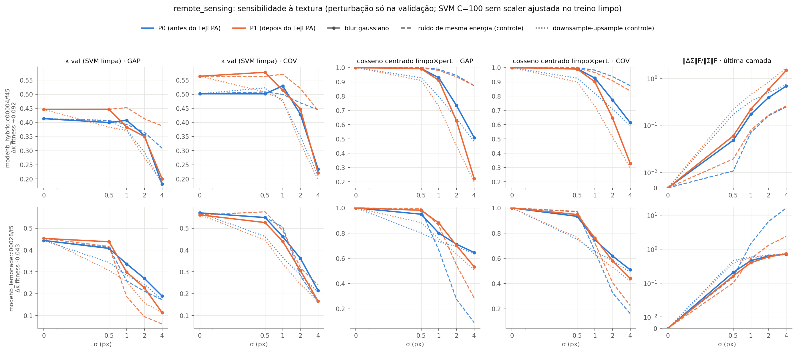

# Conclusões: o LeJEPA prejudica as representações SPiFiL?

Base de evidência:
- 8 pares P0/P1 com a mesma arquitetura, tirados do mesmo `encoder.pt` (`anchor` = antes do LeJEPA, `ssl_state` = depois): 4 em remote_sensing e 4 em larvae. A lista está em `data/checkpoint_manifest.json`.
- Extração em fp32, sem retreinar os encoders.
- SVM original (`core.svm.fit_svm`, C=100, sem scaler), reajustada para cada leitura.
- Todos os κ são de **validação**; o teste não foi lido.
- larvae substitui protozoan como base de parasitas (é menor; há 2 pares de protozoan no manifest, ainda não medidos).
- Ruído: o erro-padrão de um κ é ≈0,04 em RS (n_val=159) e ≈0,05 em larvae (n_val=240).

Classificação de cada resposta: **CONFIRMADA** pelos experimentos, **EVIDÊNCIA PARCIAL** ou **INCONCLUSIVA**.

## 1. O LeJEPA piorou só o GAP ou também a covariância?

**Só o GAP, e só em larvae. CONFIRMADA.**

 

| Base | Δκ GAP (média, 4 pares) | Δκ COV (média, 4 pares) |
|---|---|---|
| remote_sensing | **+0,019** (sobe nos 4 pares) | +0,013 (2 pares sobem, 2 caem; todos dentro do ruído) |
| larvae | **−0,089** (cai em 3 de 4; até −0,206) | +0,017 (de −0,017 a +0,050) |

A covariância não piora de forma relevante em nenhuma das duas bases.

## 2. A informação discriminativa continua acessível depois do LeJEPA?

**Sim. CONFIRMADA.**

- Com o mesmo P1, a covariância chega a 0,917–0,935 em larvae e 0,56–0,57 em RS.
- A covariância fica acima do GAP antes e depois do LeJEPA: cerca de 0,10 em RS e de 0,13 a 0,34 em larvae.
- A queda do GAP em larvae não é destruição de informação: a mesma informação continua legível por estatística de 2ª ordem.

## 3. Em qual camada aparecem as maiores mudanças?

**Nas últimas camadas em RS; varia em larvae. EVIDÊNCIA PARCIAL** (2 pares por base, e o efeito por camada fica perto do ruído).

- **RS:** a maior mudança é em L4–L6 (CKA 0,60–0,75).
  - No par que mais ganha, todo o ganho está no COV de L4 (+0,106).
  - No par que perde, a informação útil se desloca para L4/L5 (+0,07/+0,08) e cai nas pontas.
- **larvae:** a maior mudança é em L2 num par e em L5 no outro.

CKA baixo indicou mudança, não perda: no L6 do RS o CKA é 0,60 e o κ fica igual.

## 4. O rank efetivo aumentou, diminuiu ou ficou estável?

**O rank do GAP DIMINUI (colapso); o das camadas varia. CONFIRMADA para o GAP.**

- O GAP já tem rank efetivo muito baixo antes do LeJEPA (1–10), e o LeJEPA concentra ainda mais:
  - RS L4: o 1º autovalor vai de 37% para 78% da variância;
  - larvae: de 96% para 99,96%;
  - larvae hybrid c00067: o rank efetivo vai de 4,4 para 1,2.
- Nas camadas, o espectro às vezes se espalha (larvae L5: 2,8 → 4,5), e isso não se associa a ganho de κ.

## 5. Há evidência de redução da sensibilidade à textura?

**Não. O LeJEPA AUMENTA o uso de detalhe fino e a seletividade a textura. EVIDÊNCIA PARCIAL.**

- **Em todos os 4 pares testados:** a razão blur/ruído da covariância da última camada sobe de P0 para P1 (por exemplo, larvae 0,07 → 1,72; RS 2,4 → 3,5). P1 trata alta frequência como sinal e ruído i.i.d. como perturbação.
- **No par de RS que mais ganha:** a vantagem do P1 some já com blur σ=1. O ganho está no detalhe fino, e o controle de ruído de mesma energia mostra que a queda é perda de textura, não degradação geral.
- **O GAP de larvae parece "insensível ao blur":** é só porque ele quase não tem informação a perder; ele cai para κ≈0 com o ruído mais fraco.

Ressalva: o blur remove só 0,01–0,7% da energia, então o controle de ruído é fraco em termos absolutos.

## 6. O problema está no encoder, no readout ou nos dois?

**No readout, principalmente. CONFIRMADA para larvae, EVIDÊNCIA PARCIAL para RS.**

- O encoder pós-LeJEPA continua com a informação: a covariância não cai, e o uso de textura e de detalhe aumenta.
- O que falha é a cabeça GAP de 1280, um resumo de 1ª ordem que também é treinado pelo LeJEPA. Ela colapsa para poucas direções.
- **Por que a busca nunca viu o problema:** ela seleciona por cov_head + StandardScaler, que vê o LeJEPA como ganho em larvae (+0,045). Um pipeline que lê o GAP perde −0,089 com o mesmo checkpoint.

## 7. Abandonar, modificar ou manter o LeJEPA na cadeia B0–B4?

**MODIFICAR, não abandonar. EVIDÊNCIA PARCIAL.**

- **Não abandonar:** o LeJEPA não destrói a informação discriminativa e chega a aumentar o uso de textura, que é o que os mapas de calor mostravam faltar ao nosso modelo.
- **Modificar:**
  - trocar a cabeça oficial por uma leitura de 2ª ordem de dimensão fixa (≥1280; a `readout_x` mostrou +0,07 de κ teste no RS com μ+σ+Cov);
  - fazer a seleção (fitness e α do WiSE) pela MESMA leitura que vai ser reportada;
  - não treinar a cabeça GAP com o LeJEPA (ou evitar que ela colapse), por exemplo congelando a projeção da cabeça durante o SSL ou aplicando o SIGReg também na saída de 2ª ordem.
- **O que fica em aberto:** se, com a cabeça de 2ª ordem, o crescimento B1/B2 passa a mostrar ganho. Para isso falta a tabela backbone × cabeça (`readout_x`, rodando no athena).

## Limitações

- 4 pares por base, só 2 bases. A validação é pequena (159 e 240 imagens), e diferenças menores que ~0,05 não se distinguem do ruído.
- Os pares vêm das buscas antigas (até 45 épocas de SSL). Em LEMONADE, o P0 já traz blocos herdados treinados.
- O κ por camada (um bloco, k=32, sem scaler) não é o κ da fitness.
- A seed da PCA do COV sozinha muda o κ em ~0,02.
- A COV+scaler reproduz o κ da busca com diferença de até 0,017 (eigh na CPU contra GPU/AMP).
- protozoan não foi medido.

## Figuras e dados

- remote_sensing: `figures/remote_sensing/01…08`
- larvae: `figures/larvae/01…08`
- CSVs: `data/metrics.csv`, `data/delta_kappa.csv`, `data/layer_metrics.csv`, `data/texture_metrics.csv`
- Manifest: `data/checkpoint_manifest.json`
- Detalhes por base: [results_remote_sensing.md](results_remote_sensing.md), [results_larvae.md](results_larvae.md)
- Método: [methodology.md](methodology.md)
