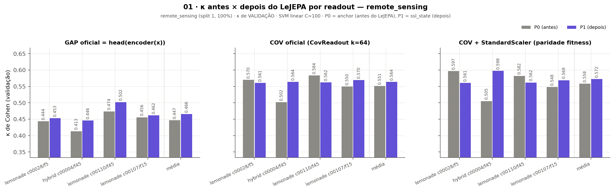
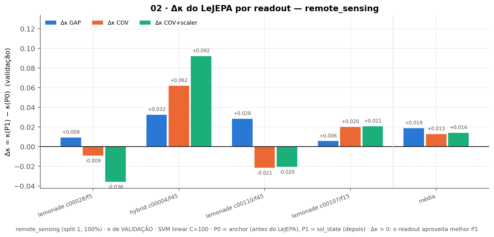
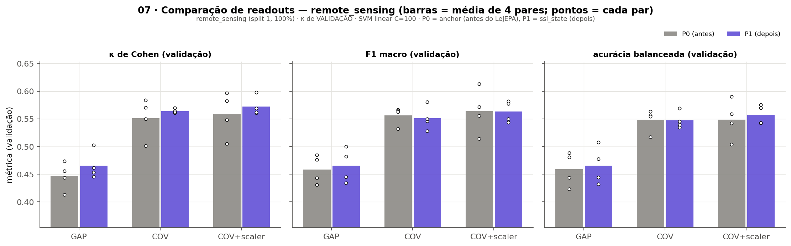
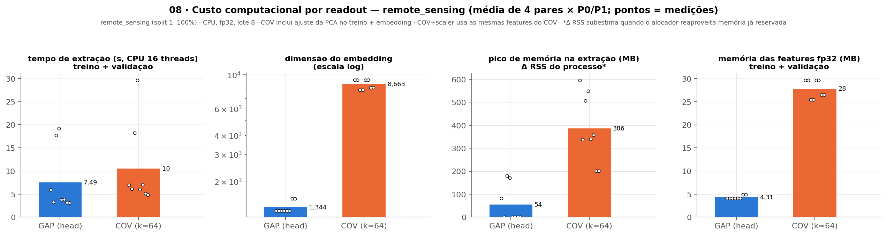
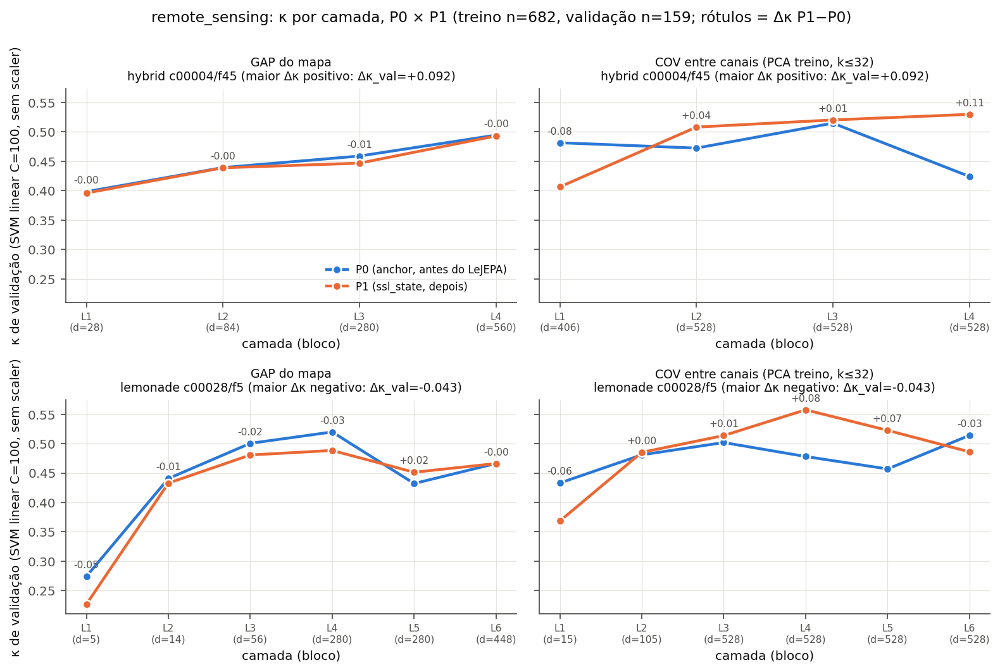
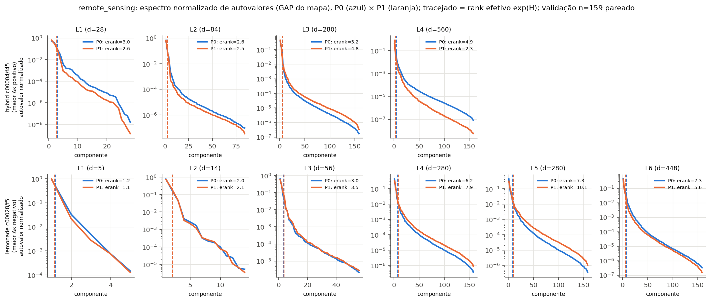
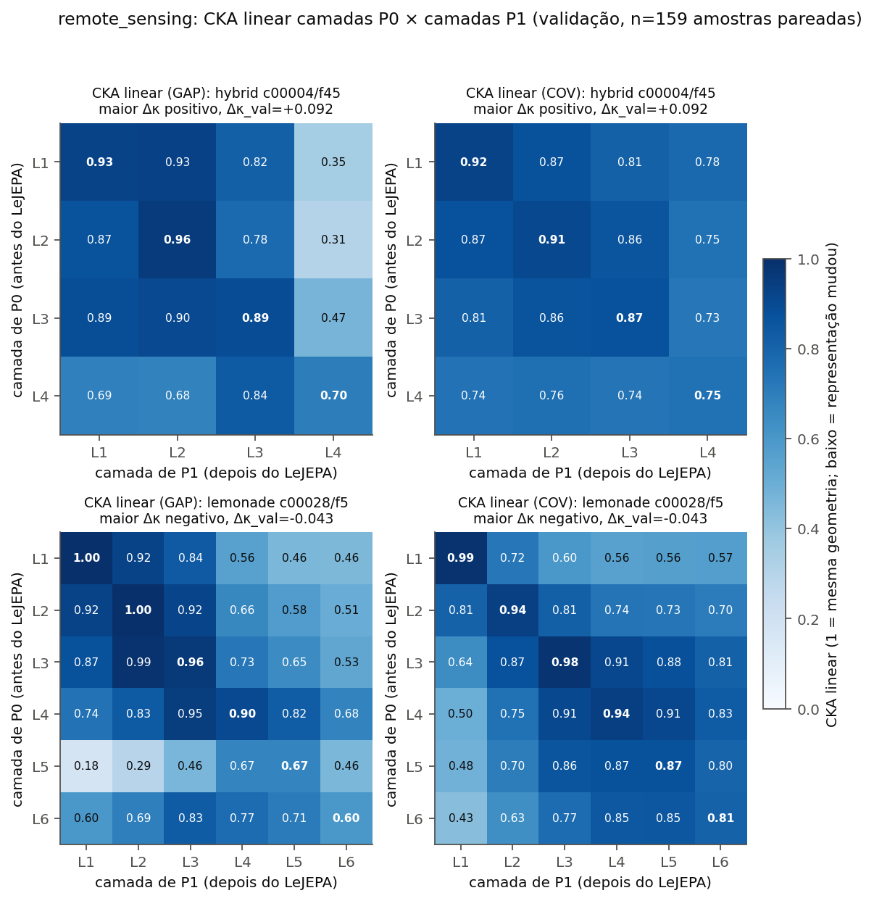

## Matriz 2×2 (etapa 2)

**O que é.** São os mesmos 4 pares do `data/checkpoint_manifest.json`. P0 = `ck['anchor']` (antes do LeJEPA) e P1 = `ck['ssl_state']` (depois do LeJEPA), ambos do mesmo `encoder.pt`. Cruzamos dois readouts oficiais com os dois checkpoints:
- **GAP** é o embedding oficial `head(encoder(x))` do checkpoint (`EmbeddingHead`). O pooling do genoma é `gap`, exceto no hybrid c00004, que usa `moments`.
- **COV** é o `pooling_head.CovReadout` oficial: k=64, PCA ajustada **só nos pixels do treino**, seed 42 da busca, concatenado ao head (`cov_head`).

A SVM é a do repo (`core.svm.fit_svm`, linear, C=100, **sem scaler**), reajustada para cada representação no treino completo (n=682) e avaliada **só na validação** (n=159). O teste não é lido. A coluna **COV+scaler** (StandardScaler) aparece à parte e serve só para paridade com o fitness histórico. Rodamos na CPU da Jaci (16 threads, `nice`), com `eval()`, `no_grad()` e fp32 estrito (sem autocast nem TF32). Usamos os splits do `config_resolved.yaml` de cada busca (hash dos dados `e24bdbb666a9`, igual ao do `result.json`). O driver é `research/lejepa_diag/matrix_2x2.py`, sobre a biblioteca `extract`/`readouts`/`svm_eval`. Os dados estão em `data/metrics.csv` (uma linha por par × checkpoint × readout) e em `data/delta_kappa.csv`.

**Paridade com a busca.** A coluna COV+scaler reproduz o κ de fitness do `result.json` (`wise_kappas` α=0 e α=1) **exatamente em 6 de 8 pontos**. Nos outros 2 (P0 de lemonade c00028 e de c00110) a diferença é ≤ 0.007, porque o eigh roda na CPU e não na GPU, sem AMP. Logo, os números abaixo medem os mesmos modelos que a busca avaliou.

| par | κ GAP P0→P1 | Δκ_GAP | κ COV P0→P1 | Δκ_COV | Δκ_COV − Δκ_GAP | κ COV+scaler P0→P1 (Δ) |
|---|---|---|---|---|---|---|
| lemonade c00028/f5 | 0.444→0.453 | +0.009 | 0.570→0.561 | −0.009 | −0.018 | 0.597→0.561 (−0.036) |
| hybrid c00004/f45 | 0.413→0.446 | +0.032 | 0.502→0.564 | +0.062 | +0.030 | 0.505→0.598 (+0.092) |
| lemonade c00110/f45 | 0.474→0.502 | +0.028 | 0.584→0.562 | −0.021 | −0.050 | 0.582→0.562 (−0.020) |
| lemonade c00107/f15 | 0.456→0.462 | +0.006 | 0.550→0.570 | +0.020 | +0.014 | 0.548→0.569 (+0.021) |
| **média** | **0.447→0.466** | **+0.019** | **0.551→0.564** | **+0.013** | **−0.006** | 0.558→0.572 (+0.014) |

O F1 macro e a acurácia balanceada acompanham o κ (figura 07). Médias P0→P1: GAP F1 0.459→0.465 e bacc 0.459→0.465; COV F1 0.557→0.551 e bacc 0.548→0.547.

(Todas as figuras também existem em SVG, e os dados de cada gráfico estão no `.csv` com o mesmo nome em `figures/remote_sensing/`.)

**Como ler.**
- **01** mostra, para cada readout, as barras de P0 (cinza, antes) e P1 (violeta, depois) por par, mais a média. Compare as alturas dentro de um painel. Entre painéis, compare o nível absoluto de cada readout.
- **02** mostra Δκ = κ(P1) − κ(P0) por readout, com uma linha no zero. Barra acima de zero significa que o readout separa melhor as classes com P1. Δκ negativo **não** significa que o LeJEPA destruiu informação: significa que *esse* readout linear separa menos a validação com P1. A informação pode continuar no encoder e ser lida por outro readout, ou ter migrado de camada (ver "Por camada").
- **07** mostra κ, F1 e bacc médios dos 4 pares; os pontos são os pares.
- **08** mostra o custo de cada readout: tempo de extração (treino + validação; no COV inclui o ajuste da PCA), dimensão, pico de memória (Δ RSS do processo) e memória das features em fp32.

**Interpretação.**
- **O readout pesa mais que o LeJEPA.** O COV fica cerca de **+0.10 de κ** acima do GAP, tanto em P0 quanto em P1 (0.551 contra 0.447 antes, 0.564 contra 0.466 depois). O efeito do LeJEPA, de +0.01 a +0.02 em média, é cinco a dez vezes menor que o efeito da troca de readout.
- **No GAP, o LeJEPA ajuda pouco, mas sempre:** Δκ_GAP > 0 nos 4 pares (+0.006 a +0.032). No COV o sinal é misto: 2 pares sobem (+0.062 e +0.020) e 2 caem (−0.009 e −0.021). Em média, Δκ_COV − Δκ_GAP = −0.006 ± 0.035, ou seja, nenhum readout ganha sistematicamente mais com o LeJEPA.
- **Tamanho do efeito.** Com n_val = 159 e 14 classes, o erro-padrão de um κ é ≈ 0.04. Só o hybrid c00004 tem um Δκ claramente acima do ruído (COV +0.062, ou +0.092 com scaler). As quedas, de −0.009 a −0.036, ficam dentro do ruído e não sustentam a ideia de que o LeJEPA destruiu informação.
- **Rank efetivo na validação** (coluna `erank_val`). No GAP, o rank efetivo é baixo (4–20) e **cai** de P0 para P1 em 3 dos 4 pares, embora o κ GAP suba em todos. A variância se concentra em menos direções, e essas direções são mais discriminativas. No COV, o rank efetivo (40–52) sobe em 3 dos 4 pares. Por isso o colapso dimensional do GAP não deve ser lido como perda de desempenho.
- **O scaler importa nos extremos.** No hybrid c00004, o StandardScaler amplia o ganho (+0.062 → +0.092); no lemonade c00028, amplia a perda (−0.009 → −0.036). Parte do Δκ que a busca registrou vem, portanto, da escala relativa das features do COV, e não só da sua separabilidade. Isso conta a favor de registrar COV e COV+scaler separadamente.
- **Custo.** O COV tem dimensão ~6.4× maior (média 8 663 contra 1 344) e ~6.4× mais memória de features (28 MB contra 4.3 MB para 841 imagens). O tempo de extração aumenta ~1.4× (10.5 s contra 7.5 s na CPU, incluindo o ajuste da PCA). O pico de memória por Δ RSS foi de ~386 MB contra ~54 MB. Essa medida subestima o GAP, porque o alocador reaproveita memória já reservada (vários pontos ficam perto de 0). Os tempos do hybrid c00004 (17–30 s) são maiores porque o head `moments` é mais pesado.

## Por camada (etapa 3)

**Pares** (escolhidos no `data/checkpoint_manifest.json` pelo Δκ_val = κ(α=1) − κ(α=0) da fitness): `modehb_hybrid:c00004/f45` (maior Δκ positivo, **+0.092**; 4 blocos) e `modehb_lemonade:c00028/f5` (maior Δκ negativo, **−0.043**; 6 blocos). P0 = `ck['anchor']` e P1 = `ck['ssl_state']`, ambos do mesmo `encoder.pt`.

**Protocolo.** Rodamos na CPU da Jaci (fp32, `eval()`, `no_grad()`, TF32 desligado), com hooks nos blocos L1..Ln. Usamos a biblioteca `research/lejepa_diag` (`readouts.layer_features`, `svm_eval`, `analysis`); o driver é `research/lejepa_diag/layer_diag.py` e as figuras saem de `layer_plots.py`. Por camada, há duas features:
- **GAP** é a média espacial do mapa, com d = C_l.
- **COV** é o grupo do bloco no `CovReadout` oficial: PCA da covariância entre canais ajustada **só nos pixels do treino** (160 imagens × 256 px), com **k = 32** fixo (k_eff = min(32, C_l), idêntico em P0 e P1), seguida de sqrtm, triângulo superior, signed-sqrt e L2.

O κ vem do SVM original (`core.svm.fit_svm`, linear, C=100, **sem scaler**), treinado no treino completo (n=682) e medido na **validação** completa (n=159). O teste não é usado. Rank efetivo (exp da entropia do espectro), espectro, variância acumulada e CKA linear usam o **mesmo subconjunto pareado da validação**: n = 159, porque a validação de remote_sensing não chega a 500. Como controle, repetimos o rank e o CKA diagonal em 500 imagens do treino (colunas `erank_train_n` e `cka_diag_train_n`); os resultados concordam com a validação. A dimensão de cada camada é igual em P0 e P1. Como d > n−1 em várias camadas, normalizamos o rank por min(n−1, d) (`erank_norm`). Os números estão em `data/layer_metrics.csv`. A matriz CKA completa fica nas colunas `cka_P0Li_vs_P1Lj` (e na versão debiased `ckadeb_*`), e o espectro em `eig_norm_json`.

**Ruído.** Com 159 amostras de validação e 14 classes, o erro-padrão de um κ por camada é ≈ 0.04. Por isso, |Δκ| < ~0.06 numa camada isolada não se distingue de ruído. Este κ por camada (um bloco, k=32, sem scaler) não é o κ da fitness do manifest, que usa `cov_head`: todos os blocos, k=64, head e StandardScaler.

(Espectro do COV: `figures/remote_sensing/04_eigenvalue_spectrum_cov.png`. Todas as figuras também existem em SVG.)

| par | camada | CKA diag GAP / COV | κ GAP P0→P1 | κ COV P0→P1 | erank GAP P0→P1 | erank COV P0→P1 |
|---|---|---|---|---|---|---|
| hybrid c00004 (+0.092) | L1 | 0.93 / 0.92 | 0.398→0.396 | 0.482→0.406 | 3.0→2.6 | 18.3→17.0 |
| | L2 | 0.96 / 0.91 | 0.439→0.439 | 0.472→0.508 | 2.6→2.5 | 27.8→29.4 |
| | L3 | 0.89 / 0.87 | 0.459→0.447 | 0.515→0.520 | 5.2→4.8 | 36.7→41.2 |
| | **L4** | **0.70 / 0.75** | 0.495→0.493 | **0.424→0.530** | **4.9→2.3** | 32.4→26.8 |
| lemonade c00028 (−0.043) | L1 | 1.00 / 0.99 | 0.274→0.227 | 0.433→0.368 | 1.2→1.1 | 5.1→5.3 |
| | L2 | 1.00 / 0.94 | 0.441→0.433 | 0.481→0.485 | 2.0→2.1 | 14.0→15.0 |
| | L3 | 0.96 / 0.98 | 0.500→0.481 | 0.502→0.514 | 3.0→3.5 | 36.3→36.2 |
| | L4 | 0.90 / 0.94 | 0.520→0.488 | 0.478→0.557 | 6.2→7.9 | 46.6→49.3 |
| | L5 | 0.67 / 0.87 | 0.432→0.451 | 0.457→0.523 | 7.3→10.1 | 41.2→49.0 |
| | **L6** | **0.60 / 0.81** | 0.466→0.466 | 0.514→0.486 | 7.3→5.6 | 32.8→43.7 |

**Interpretação.**
- **A mudança se concentra no fim da rede.** Nos dois pares, o CKA P0×P1 da mesma camada fica perto de 1 nas primeiras camadas (0.93–1.00 em L1 e L2) e cai nas últimas. No par positivo, o menor valor está em L4, a última camada (GAP 0.70, COV 0.75). No par negativo, está em L6 (GAP 0.60), com L5 logo atrás (0.67). **A camada que mais muda é a última:** L4 no par hybrid e L6 (com L5) no par lemonade. CKA baixo significa que a geometria da representação mudou, não que a informação se perdeu. Em L6 do par negativo, por exemplo, o κ GAP fica idêntico (0.466) com CKA 0.60.
- **O ganho do par positivo está na estatística de 2ª ordem do último bloco, não no GAP.** O κ GAP não se move em nenhuma camada (|Δκ| ≤ 0.012). Já o κ COV de L4 sobe +0.106 (0.424→0.530), o único Δκ claramente acima do ruído nesse par, e é coerente com o +0.092 da fitness, que usa o `cov_head`. Ao mesmo tempo, o GAP de L4 sofre **colapso dimensional parcial**: o rank efetivo cai de 4.9 para 2.3 e o 1º autovalor passa de 37% para 78% da variância. O LeJEPA concentrou a média espacial numa direção, mas reorganizou a covariância entre canais de forma mais separável.
- **O par negativo é misto.** O κ COV sobe nas camadas intermediárias e finais (L4 +0.079, L5 +0.066), com aumento do rank efetivo (L5 GAP 7.3→10.1, COV 41→49). Ele cai nas pontas: L1 COV −0.065, L1 GAP −0.047 e L6 COV −0.028, onde o rank efetivo do GAP também cai (7.3→5.6). A perda da fitness (−0.043) é compatível com essas pontas, que entram concatenadas no `cov_head`, mas cada queda isolada está perto do ruído. Ou seja, o SSL não estragou o encoder inteiro. Ele **deslocou** a informação útil para L4/L5 e enfraqueceu L1 e L6.
- **Fora da diagonal.** No par negativo, P1·L5 se parece mais com P0·L4 (CKA 0.82) do que com P0·L5 (0.67). P1·L2 e P1·L3 também se alinham com P0·L3 e P0·L4 (0.99 e 0.95, acima da própria diagonal). Depois do SSL, os blocos intermediários passam a reproduzir a geometria de um bloco mais profundo de P0, e o bloco L5 de P1 transforma menos a sua entrada do que o de P0. No par positivo, P1·L4 tem CKA baixo com todas as camadas de P0 (0.31–0.70): é uma representação nova, que não existia em P0.
- **Escala do rank efetivo.** O GAP tem rank efetivo muito baixo em P0 e P1 (2–10 de até 560 dimensões). A variância do GAP é dominada por poucas direções, enquanto o COV ocupa muito mais dimensões (15–49). Por isso o COV é o readout mais sensível ao que o LeJEPA mexe.

## Textura (etapa 4)

**O que é.** São dois pares do manifest: o de maior Δκ de fitness positivo (**hybrid c00004/f45**, +0.092, pooling `moments`) e o de maior Δκ negativo (**lemonade c00028/f5**, −0.043, pooling `gap`). P0 = `ck['anchor']` e P1 = `ck['ssl_state']`. As perturbações atingem **só a validação** (n=159), aplicadas à imagem já normalizada do pipeline: blur gaussiano σ ∈ {0, 0,5, 1, 2, 4} px. Há dois controles:
- **ruído gaussiano** com a mesma energia (MSE) por imagem que o blur de mesmo σ remove;
- **down-up**: downsample por área com fator 1+2σ e upsample bilinear de volta.

A SVM é a original (`core.svm.fit_svm`, C=100, **sem scaler**), ajustada uma vez no treino **limpo** (n=682) e aplicada à validação perturbada. Usamos dois readouts: **GAP** é o embedding oficial `head(encoder(x))`; **COV** é o `CovReadout` oficial (k=64, PCA só no treino, seed 42). Com isso, o κ limpo reproduz a etapa 2 (COV 0.570/0.561 e 0.502/0.564). Também medimos:
- o cosseno embedding limpo × perturbado. A coluna `cos_mean` é o cosseno cru; o painel mostra o cosseno **centrado na média da validação limpa**, porque o cru fica perto de 1 quando o embedding tem um offset comum grande;
- a distância de Frobenius normalizada ‖Σ_pert − Σ_limpa‖_F / ‖Σ_limpa‖_F da covariância de canais da **última camada**, por imagem (`lastcov_fro_rel_mean`, cheia; `lastcovk_*`, no PCA-k);
- a mudança relativa da média espacial (1ª ordem).

Rodamos na CPU da Jaci (16 threads, nice), em fp32. O driver é `research/lejepa_diag/texture_min.py`, sobre `textura.py`/`readouts.py`/`svm_eval.py`. Os dados estão em `data/texture_metrics.csv` e a figura em `figures/remote_sensing/06_texture_sensitivity.{png,svg}`. **Incerteza:** o desvio bootstrap do κ, reamostrando as 159 imagens, é ≈ 0.04 (`kappa_boot_std`). Diferenças P0×P1 menores que ~0.08 num ponto isolado não são conclusivas. O blur remove só 0.01–0.36% da energia total da imagem (σ=0,5→4), porque o DC domina, então o controle de ruído é fraco em termos absolutos.

| par | readout | κ limpo P0→P1 | κ blur σ=1 P0/P1 | κ blur σ=4 P0/P1 | κ ruído σ=4 P0/P1 | cos centr. blur σ=4 P0/P1 | cos centr. ruído σ=4 P0/P1 |
|---|---|---|---|---|---|---|---|
| hybrid c00004 (Δκ+) | GAP | 0.413→0.446 | 0.407/0.383 | 0.182/0.200 | 0.309/0.388 | 0.51/0.22 | 0.87/0.87 |
| hybrid c00004 (Δκ+) | COV | 0.502→0.564 | 0.529/0.515 | 0.234/0.222 | 0.445/0.442 | 0.61/0.33 | 0.87/0.84 |
| lemonade c00028 (Δκ−) | GAP | 0.444→0.453 | 0.336/0.299 | 0.189/0.113 | 0.172/0.061 | 0.65/0.53 | 0.09/0.29 |
| lemonade c00028 (Δκ−) | COV | 0.570→0.561 | 0.461/0.440 | 0.214/0.165 | 0.161/0.239 | 0.51/0.44 | 0.16/0.23 |

Frobenius normalizado da covariância da última camada, P0/P1:

| par | blur σ=2 | blur σ=4 | down-up σ=2 | ruído σ=2 | ruído σ=4 | seletividade blur/ruído (σ=2) P0→P1 |
|---|---|---|---|---|---|---|
| hybrid c00004 | 0.39/0.58 | 0.69/1.48 | 0.49/0.83 | 0.16/0.17 | 0.25/0.26 | 2.4→3.5 |
| lemonade c00028 | 0.62/0.59 | 0.71/0.73 | 0.66/0.65 | 6.49/1.30 | 16.1/2.36 | 0.10→0.45 |

**Interpretação.**
- **Par Δκ+ (hybrid c00004): o ganho do LeJEPA está na escala fina.** Limpo, P1 ganha +0.06 no COV e +0.03 no GAP. Com blur σ=1, essa vantagem **desaparece**: COV fica em 0.529/0.515 e GAP em 0.407/0.383. A partir daí, P0 e P1 caem juntos até ≈0.2 em σ=4. O ruído de mesma energia quase não afeta nenhum dos dois: P1 mantém COV 0.52–0.57 até σ=2, e com σ=4 ainda está em GAP 0.388 contra 0.309 de P0. A degradação de P1 é, portanto, **específica da perda de altas frequências** e não uma fragilidade geral. O down-up, que preserva a estrutura global, produz o mesmo efeito que o blur (com fator 2, ≈ blur σ=1), o que reforça a leitura: o que P1 acrescentou depende de textura/detalhe fino e não de forma global. A geometria confirma. Sob blur σ=4, o cosseno centrado de P1 cai a 0.22 (GAP) e 0.33 (COV), contra 0.51/0.61 de P0, e a covariância da última camada muda 2× mais (1.48 contra 0.69). Já sob ruído, a mudança é igual nos dois (≈0.25). O LeJEPA tornou a 2ª ordem da última camada **mais responsiva ao conteúdo de alta frequência**, mas não ao ruído.
- **Par Δκ− (lemonade c00028): não há perda limpa a explicar.** Sem scaler, o κ limpo é praticamente igual (COV 0.570/0.561, GAP 0.444/0.453), e o −0.043 da fitness vinha do protocolo com StandardScaler (ver etapa 2). Sob blur, P1 perde um pouco mais (σ=4: GAP 0.189→0.113 e COV 0.214→0.165), mas a diferença fica no limite do ruído estatístico (±0.04 por ponto). A mudança grande está no **ruído**: em P0, a covariância da última camada explode (16× a norma limpa em σ=4) e o cosseno centrado do GAP vai a 0.09. P1 é muito mais estável (2.4×; 0.29). Mesmo assim, o κ GAP de P1 sob ruído é **pior** (0.061 contra 0.172): uma representação mais estável no cosseno não implica que a fronteira da SVM limpa sobreviva. No COV, P1 é melhor sob ruído (0.239 contra 0.161).
- **Padrão comum (2/2 pares):** a razão "mudança sob blur / mudança sob ruído" na covariância da última camada **sobe de P0 para P1** (2.4→3.5 e 0.10→0.45). O LeJEPA desloca a sensibilidade de 2ª ordem do ruído i.i.d. para o conteúdo espacial de alta frequência. O que muda é a seletividade, não a robustez em geral.
- **GAP × COV.** Sob blur, as quedas relativas de κ são parecidas nos dois readouts. O COV parte de um κ mais alto e termina num patamar semelhante (≈0.2 em σ=4), logo perde mais em termos absolutos. Sob ruído, o COV é mais estável que o GAP nos dois pares. O ganho do LeJEPA no par Δκ+ aparece mais no COV (+0.06) e se desfaz sob blur no COV tanto quanto no GAP.
- **Cuidado de leitura.** Menos sensibilidade ao blur não significa, sozinha, menos informação. No par Δκ+, P0 é *menos* sensível ao blur (cosseno mais alto, Σ muda menos) justamente porque usa menos o detalhe fino que dá a P1 os +0.06 de κ. "Insensível ao blur" pode significar "não lia textura", e não "robusto". A pergunta certa é se o κ limpo se mantém, e no RS ele não se mantém em nenhum dos dois checkpoints.
