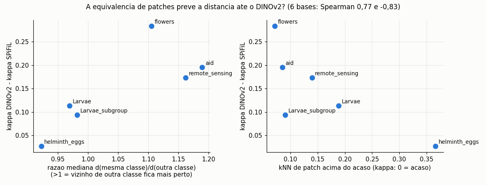

# Os patches de uma classe se repetem nas outras imagens da mesma classe?

Diagnóstico de dados, 08/11/2026, athena, só CPU. Split 1, 50%, só treino (e validação para o 1-NN). Teste não foi tocado. O rótulo foi usado só aqui, para medir; nada volta para o encoder.

## A resposta em uma frase

**A hipótese "o patch só parece consigo mesmo" é falsa em todas as bases; a verdadeira é "o patch parece com muita coisa, mas com coisas de OUTRAS classes".** Em remote_sensing, aid e flowers, o vizinho mais parecido de um patch está, na maioria das vezes, numa imagem de outra classe. Nas larvas e nos ovos isso não acontece. E essa diferença acompanha bem a distância entre o SPiFiL e o DINOv2.

## Os números, lado a lado

| base | classes | vizinho na mesma classe | acaso | acima do acaso (κ) | razão d(mesma)/d(outra) | só-de-si | 1-NN val | 1-NN κ | κ SPiFiL / DINOv2 | buraco |
|---|---|---|---|---|---|---|---|---|---|---|
| helminth_eggs | 9 | 44,7% | 12,7% | **0,37** | **0,92** | 0,1% | 65,7% | 0,40 | 0,960 / 0,987 | 0,027 |
| Larvae (impura) | 2 | 59,4% | 50,0% | 0,19 | 0,97 | 0,9% | 82,9% | 0,34 | 0,855 / 0,968 | 0,113 |
| Larvae_subgroup (pura) | 2 | 54,5% | 50,0% | 0,09 | 0,98 | 0,7% | 75,7% | 0,28 | 0,887 / 0,981 | 0,094 |
| remote_sensing | 14 | 20,8% | 8,0% | 0,14 | **1,16** | 1,0% | 31,4% | 0,24 | 0,535 / 0,708 | 0,173 |
| aid | 30 | 11,5% | 3,3% | 0,09 | **1,19** | 0,2% | 33,1% | 0,31 | 0,775 / 0,970 | 0,195 |
| flowers | 5 | 25,7% | 20,0% | 0,07 | **1,11** | 1,3% | 41,7% | 0,27 | 0,690 / 0,973 | 0,283 |

Como ler cada coluna, em palavras simples:

- **Vizinho na mesma classe**: pego um pedacinho 5×5 de uma imagem e procuro o pedacinho mais parecido em todas as *outras* imagens. Em quantas vezes ele é da mesma classe?
- **Acaso**: quanto daria se o vizinho fosse sorteado (a fatia de patches daquela classe).
- **Acima do acaso (κ)**: quanto do caminho entre "sorteio" (0) e "sempre acerta" (1) o vizinho anda. É a coluna que dá para comparar entre bases com número de classes diferente.
- **Razão**: distância até o patch parecido *da mesma classe* dividida pela distância até o parecido *de outra classe*. Abaixo de 1, a própria classe está mais perto. Acima de 1, outra classe está mais perto.
- **Só-de-si**: patch cujo vizinho na própria imagem fica a menos da metade da distância de qualquer patch de outra imagem. É o "só combina consigo mesmo" da hipótese.
- **Buraco**: κ do DINOv2 menos κ do SPiFiL.

## A hipótese, base por base

**"Só combina consigo mesmo": não.** O só-de-si fica entre 0,1% e 1,3% em todas as seis bases, inclusive nos controles. Pior: em quase toda base, o patch mais parecido de *outra imagem* fica mais perto (mediana 0,25–0,28) do que o patch mais parecido da *mesma imagem* (mediana 0,34–0,41). Com 50 sementes por imagem, cada sementinha cai numa região diferente da foto, então os vizinhos da mesma foto são diferentes entre si. O patch sempre acha um "gêmeo" em outro lugar.

**"Mas o gêmeo é de outra classe": sim, em remote_sensing e aid.**

- **remote_sensing**: o gêmeo é da mesma classe em 20,8% das vezes, contra 8% de acaso. Ganha do sorteio, mas pouco (κ 0,14). A razão é 1,16: o gêmeo de outra classe está 16% mais perto que o da própria classe.
- **aid**: 11,5% contra 3,3% de acaso (κ 0,09). Razão 1,19, a pior das seis.
- **helminth_eggs (controle)**: 44,7% contra 12,7% (κ 0,37). Razão 0,92: aqui a própria classe está mais perto. Esse é o desenho de uma base onde patch de treino ajuda.
- **Larvae e Larvae_subgroup**: razão 0,97 e 0,98, abaixo de 1, como os ovos. O κ de patch é baixo (0,19 e 0,09) porque há só duas classes e "Impurities" é metade dos patches. Mesmo assim o gêmeo pende para a própria classe, e isso as larvas fazem e rs/aid não.
- **flowers**: razão 1,11, igual a rs/aid. Flores do mesmo tipo têm pétalas parecidas, mas um pedacinho 5×5 de folha verde ou de pétala amarela não diz se é girassol ou dente-de-leão.

Imagine 500 crianças, cada uma com uma figurinha. Nas larvas, quem tem figurinha de larva acha outra figurinha de larva no pátio. Em aid, a figurinha de "grama" de um campo de futebol acha a melhor parceira na pilha de "fazenda". A grama existe nas duas classes; o que muda a classe é o desenho grande (pista oval, trevo de viaduto), que um patch de 5×5 em imagem de 200 px não enxerga.

### A equivalência de patches prevê o buraco até o DINOv2?

**Sim, mais ou menos, com só 6 pontos.** Quanto maior a razão, maior o buraco: Spearman **0,77** (Pearson 0,78). O κ de patch prevê o buraco com Spearman **−0,83**. Os ovos têm a menor razão e o menor buraco (0,027). aid e flowers têm as maiores razões e os maiores buracos. As larvas ficam no meio.

Ressalva: com 6 bases, um ponto fora muda tudo. flowers tem o maior buraco (0,283) sem ter a pior razão. Ou seja, a textura explica parte do buraco, não todo.

## As piores classes

**remote_sensing** (vizinho na mesma classe / acaso, nº de imagens de treino, 1-NN val):

1. **River**: 1,6% / 2,9%, 9 imagens, 0% no 1-NN. Abaixo do acaso.
2. **Highway**: 4,6% / 3,2%, 10 imagens, 0%.
3. **Mountain**: 13% / 9%, 28 imagens, 9%.
4. Railway (12 imagens) e Port (20) vêm logo depois.

As duas piores são exatamente as que têm menos imagens (9 e 10) e são definidas por uma *linha* (o rio, a estrada) que ocupa pouco da foto. A melhor é **Desert**: 61% contra 10%. Deserto é textura pura.

**aid**: **Playground, Viaduct, Square, School, Stadium**, todas entre 3,2% e 5,3% contra 3,3% de acaso, ou seja, no nível do sorteio. Não é falta de imagem: são 100 a 147 de treino por classe. São classes de *forma* (pista oval, trevo, praça redonda, prédio), não de textura.

**Controles**: nos ovos, a pior é Enterobius (31% contra 7,5%, 4× o acaso). Nas larvas, Impurities fica perto do acaso e Larva fica bem acima (61–63% contra 50%).

## O que isso quer dizer para o SPiFiL

1. **Mais imagens de treino por classe ajuda só em remote_sensing, e só nas classes pequenas.** River e Highway têm 9–10 imagens e caem abaixo do acaso. Em aid já são 100+ imagens por classe e o problema continua: lá não é falta de exemplo.
2. **Sortear mais filtros por amostra sem rótulo não resolve sozinho.** O patch já tem gêmeo; o gêmeo é que é de outra classe. Mais filtros 5×5 de "grama" e "concreto" só repetem cores e bordas comuns a todas as classes.
3. **Mais resolução e mais contexto, sim.** As imagens de aid e rs são encolhidas para 200 px. Na figura dos vizinhos dá para ver: o patch 5×5 é um borrão de 2–3 cores. O que separa Playground de Farmland é a pista oval inteira. Isso pede campo receptivo grande (camadas de cima, pooling espacial) ou imagem maior, não mais filtros de camada 1.
4. **Ruído de rótulo pesa em remote_sensing.** O rótulo de rs vem da classe de caixa de detecção mais frequente, não da cena. E 89 dos 453 pares de imagem que rs divide com aid têm nomes conflitantes. Parte dos "gêmeos de outra classe" pode ser a mesma cena com outro nome. Isso também ajuda a explicar por que até o DINOv2 fica em 0,708 em rs.

## Nível de imagem (complemento)

Cada imagem virou um "saco de patches": 128 palavras (k-means sem rótulo nos patches de treino), contando quantos patches caem em cada palavra. É um parente pobre do SPiFiL; a receita completa com banco de filtros não foi rodada em CPU.

| base | cos intra (média por classe) | cos inter | silhueta | 1-NN val | 1-NN com média dos patches | maior classe |
|---|---|---|---|---|---|---|
| helminth_eggs | 0,146 | −0,006 | −0,07 | 65,7% | 61,5% | 65,3% |
| Larvae | 0,040 | −0,014 | 0,02 | 82,9% | 77,9% | 84,5% |
| Larvae_subgroup | 0,025 | −0,016 | 0,02 | 75,7% | 71,0% | 81,3% |
| remote_sensing | 0,111 | −0,014 | −0,04 | 31,4% | 26,4% | 16,0% |
| aid | 0,132 | −0,005 | −0,08 | 33,1% | 19,5% | 4,2% |
| flowers | 0,051 | −0,013 | 0,00 | 41,7% | 30,8% | 23,5% |

Esse descritor simples é fraco em todo lugar: a silhueta fica perto de 0 em todas as bases. Nos ovos e nas larvas o 1-NN fica no nível (ou abaixo) de chutar sempre a classe majoritária, porque o fundo e as impurezas dominam o saco de patches. Por isso **a conclusão vem do nível de patch**, não desta tabela. Ela só confirma que, mesmo juntando patches, as imagens de aid e rs da mesma classe são pouco mais parecidas entre si do que com as de outras classes.

## Figuras

Grades (8 imagens de treino por classe, semente fixa):
[remote_sensing](grade_rs.png) ·
[aid 1/3](grade_aid_1.png) · [aid 2/3](grade_aid_2.png) · [aid 3/3](grade_aid_3.png) ·
[flowers](grade_flowers.png) · [Larvae](grade_larvae.png) · [Larvae_subgroup](grade_larvae_sub.png) ·
[helminth_eggs](grade_eggs.png)

Histogramas (distância ao vizinho da mesma classe vs de outra classe, razão, cosseno intra vs inter):
[rs](hist_rs.png) · [aid](hist_aid.png) · [flowers](hist_flowers.png) · [Larvae](hist_larvae.png) ·
[Larvae_subgroup](hist_larvae_sub.png) · [eggs](hist_eggs.png)

Barras por classe (vizinho na mesma classe vs acaso, só-de-si, 1-NN):
[rs](barras_rs.png) · [aid](barras_aid.png) · [flowers](barras_flowers.png) · [Larvae](barras_larvae.png) ·
[Larvae_subgroup](barras_larvae_sub.png) · [eggs](barras_eggs.png)

Patch de consulta e seus vizinhos, nas 3 piores classes:
[remote_sensing](vizinhos_rs.png) · [aid](vizinhos_aid.png)

Previsão do buraco até o DINOv2: [previsao_gap_dinov2.png](previsao_gap_dinov2.png)

Números completos, por classe: [estatisticas_todas.json](estatisticas_todas.json)

## Como foi medido

- **Patches**: a receita da camada 1 do SPiFiL. Imagem em 200 px sem recorte (`Cropped(..., no_crop=True)`), cor `LabNorm`, superpixels `DISF` com 50 regiões, semente no medoide (`Medoids`), patch 5×5×3 = 75 números (`extract_patches`, `LayerSpec(kernel_size=5)`).
- **Normalização (N0)**: z-score por dimensão com média e desvio do treino (+0,01), depois norma 1, como `normalized` em `eval/l1_sem_rotulo.py`. Distância euclidiana entre vetores unitários.
- **Janela chapada**: patch sem variação dentro de nenhum dos 3 canais foi tirado. Isso pegou 50% dos patches de helminth_eggs (fundo preto). Atenção: o teste `rows.std(1) < 1e-3` do `normalized` **não** pega essa janela, porque os canais a/b do preto valem ~0,5 e o L vale 0, então o desvio ao longo das 75 posições não é zero.
- **Amostra de patch**: até 30 imagens de treino por classe, semente 0, 50 patches por imagem. Empate de distância conta meio acerto.
- **Scripts** (fora do repositório, nada no repositório foi editado):
  `/tmp/claude-1033/-dados-home-moliveira-Scalable-Hybrid-FLIM/990a33ea-4327-4228-ac99-2136fb213621/scratchpad/extract.py` e `.../scratchpad/analyze.py`.

Kernels L1 por classe de origem (fiel / trocado / genérico, viés do FPS, utilidade): [kernels_classe/kernels_classe.md](kernels_classe/kernels_classe.md)
