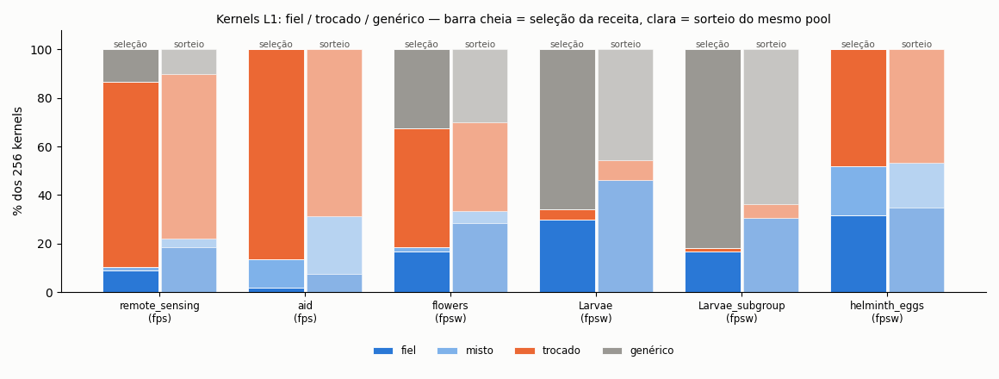
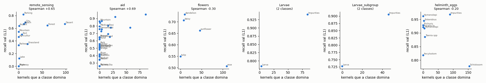

# O kernel "vem" de uma classe, mas acende para outra?

Diagnóstico pós-treino, 09/11/2026, athena, só CPU. Split 1, 50%. O rótulo entra só aqui, para medir; nada volta para o encoder. A validação só entra no recall e no κ da utilidade. O teste não foi tocado.

## A resposta em uma frase

**Sim: na maioria das bases, o kernel cortado de uma imagem da classe A acende mais nas imagens de outra classe B. E a seleção da receita (FPS) piora isso: ela escolhe MENOS kernels fiéis do que um sorteio no mesmo pool, em todas as seis bases.** Mas um kernel "trocado" não é lixo: tirar os trocados custa tanto quanto tirar o mesmo número de kernels sorteados (em rs e aid). Só em flowers eles atrapalham.

## Os números, lado a lado

256 kernels da camada 1 da receita, k5, por base. "Seleção" = o banco real da receita; "sorteio" = 256 patches sorteados do MESMO pool de candidatos (média de 5 sorteios, ± desvio).

| base | braço | fiel | trocado | genérico | misto | fiel no sorteio | κ L1 |
|---|---|---|---|---|---|---|---|
| remote_sensing | fps | **9,0%** | **76,6%** | 13,3% | 1,2% | 18,6% ± 1,5 | 0,47 |
| aid | fps | **2,0%** | **86,3%** | 0,0% | 11,7% | 7,5% ± 1,1 | 0,60 |
| flowers | fpsw | 16,8% | 49,2% | 32,4% | 1,6% | 28,6% ± 2,4 | 0,54 |
| Larvae | fpsw | 29,7% | 4,3% | 66,0% | 0 | 46,2% ± 2,1 | 0,69 |
| Larvae_subgroup | fpsw | 16,8% | 1,2% | 82,0% | 0 | 30,5% ± 3,5 | 0,61 |
| helminth_eggs | fpsw | 31,6% | 48,0% | 0,0% | 20,3% | 34,8% ± 1,6 | 0,90 |

O que cada palavra quer dizer:

- **Fonte**: a classe da imagem de onde o pedacinho 5×5 foi recortado.
- **Dominante**: passo o kernel em todas as imagens de treino e pego os 10% que mais acendem (no mínimo 50). A classe que aparece ali muito acima do normal é a dominante. "Acima do normal" = **lift**: a fatia da classe no topo dividida pela fatia dela no treino.
- **Fiel**: a dominante é a própria classe-fonte.
- **Trocado**: a dominante é outra classe, e a classe-fonte nem chega a se destacar.
- **Misto**: a dominante é outra, mas a fonte também se destaca.
- **Genérico**: nenhuma classe se destaca (lift abaixo de 1,5×, ou não passa no teste binomial com p < 0,01/nº de classes).

## A hipótese, base por base

**remote_sensing e aid: a hipótese vale com força.** Três de cada quatro kernels (rs) e quase nove de cada dez (aid) são trocados. Fiel é raro: 23 de 256 em rs, 5 de 256 em aid.

Para onde eles vão? Quase tudo para as classes de **textura lisa e uniforme**:

- rs: **Desert domina 98 kernels, mas só 7 vêm de imagens de Desert.** Forest domina 61. City é fonte de 61 kernels e dona de só 14.
- aid: **Desert domina 86 kernels e não é fonte de nenhum.** Desert está no banco (19 imagens, 198 patches candidatos), mas o FPS não escolheu nenhum patch dele. Church domina 57 vindo de 5.

Imagine figurinhas recortadas de fotos de cidade, porto e estacionamento. Um pedacinho 5×5 de telhado bege ou de asfalto claro é só "bege liso". Quem tem mais "bege liso" no álbum inteiro? O deserto, de ponta a ponta. Por isso o kernel acende mais no deserto do que na cidade de onde saiu. Ver [trocados_rs.png](trocados_rs.png) e [trocados_aid.png](trocados_aid.png): seis kernels tirados de Port, Parking e City, e as seis imagens que mais os acendem são todas Desert.

**flowers: meio a meio.** 49% trocados, 32% genéricos. Rose domina 109 kernels e tulip não domina nenhum.

**Controles (larvas e ovos): quase não há trocados nas larvas.** Ali o kernel ou é fiel (quase sempre à classe Impurities) ou é genérico. Nos ovos, metade é trocada, e o "ladrão" é Schistosoma mansoni: domina 154 kernels, vindo de só 15.

## A seleção (FPS) é enviesada?

**Sim, e sempre para o mesmo lado: ela pega menos kernels fiéis que o sorteio.**

| base | fiel na seleção | fiel no sorteio | diferença |
|---|---|---|---|
| remote_sensing | 9,0% | 18,6% | −9,6 pontos (6 desvios) |
| aid | 2,0% | 7,5% | −5,5 (5 desvios) |
| flowers | 16,8% | 28,6% | −11,8 (5 desvios) |
| Larvae | 29,7% | 46,2% | −16,5 (8 desvios) |
| Larvae_subgroup | 16,8% | 30,5% | −13,7 (4 desvios) |
| helminth_eggs | 31,6% | 34,8% | −3,2 (2 desvios) |

Por quê: o FPS escolhe sempre o patch **mais longe** de tudo que já escolheu. O mais longe é o esquisito: uma cor rara, uma borda forte. Um patch esquisito de uma foto de cidade não representa a cidade; ele pega um pedaço de cor que acaba sendo mais comum em outra classe. O sorteio pega patches "do meio da multidão", que são mais típicos da própria classe.

A seleção também puxa a fonte para as classes de imagem com muito contraste. Em rs, City dá 61 kernels e Parking 47, contra ~43 e ~16 se a escolha seguisse o tamanho do pool.

## Isso machuca as classes envolvidas?

**Em rs e aid, as classes que não dominam nenhum kernel são as que vão pior.**

- rs: 5 classes não dominam nenhum kernel (Agriculture, Highway, Mountain, Railway, River). Recall médio delas: **0,27**. As outras 9: **0,57**.
- aid: 19 classes não dominam nenhum kernel (Airport, Bridge, Center, DenseResidential, Farmland, Industrial, MediumResidential, Mountain, Park, Playground, Pond, RailwayStation, Resort, River, School, Square, Stadium, StorageTanks, Viaduct). Recall médio: **0,52**. As outras 11: **0,79**.

Correlação de Spearman entre "nº de kernels que a classe domina" e o recall de validação da camada 1:

| base | Spearman | com o recall dos runs da receita (`_erros.csv`) |
|---|---|---|
| remote_sensing | **+0,65** | +0,58 |
| aid | **+0,69** | +0,66 |
| flowers | −0,30 (5 classes) | −0,40 |
| helminth_eggs | −0,20 | — |
| Larvae, Larvae_subgroup | 2 classes, não dá | — |

Cuidado: isso é correlação, não prova de causa. Desert, Forest e Beach são fáceis por natureza (textura pura) **e** atraem os kernels. A ordem pode ser "classe de textura → muitos kernels e recall alto", e não "poucos kernels → recall baixo". Em flowers e nos ovos a relação até se inverte: rose e Schistosoma dominam mais kernels e têm recall dos mais baixos.

Classes sem nenhum kernel fiel: rs 8 de 14, aid 27 de 30, flowers 1 de 5 (tulip), Larvae e Larvae_subgroup a classe Larva, helminth_eggs 7 de 9 (só Impurities e Schistosoma têm). Classes sem nenhum kernel dominante: rs Agriculture, Highway, Mountain, Railway, River; aid as 19 acima; flowers tulip; Larvae_subgroup Larva; ovos Ancylostoma, Ascaris, Hymenolepis nana, Trichuris.

Matrizes fonte → dominante: [rs](confusao_rs.png) · [aid](confusao_aid.png) · [flowers](confusao_flowers.png) · [Larvae](confusao_larvae.png) · [Larvae_subgroup](confusao_larvae_sub.png) · [eggs](confusao_eggs.png)

## Mas o kernel trocado é inútil?

**Não. Em rs e aid, o trocado ajuda o SVM tanto quanto um kernel qualquer.** Um filtro não precisa ser de uma classe só para separar as classes. "Muito bege liso" ajuda a dizer "é deserto"; "pouco bege liso" ajuda a dizer "não é deserto".

Teste de grupo: tiro todos os kernels de um grupo, retreino o mesmo SVM (GeM + PCA-whitening + SVM linear) e comparo com tirar o mesmo número de kernels sorteados (5 sorteios).

| base | grupo tirado | nº | Δκ | Δκ sorteio | ΔF1 | leitura |
|---|---|---|---|---|---|---|
| remote_sensing | trocados | 196 | −0,094 | −0,082 ± 0,009 | −0,101 | úteis, um pouco mais que a média |
| remote_sensing | genéricos | 34 | −0,007 | −0,010 ± 0,007 | −0,010 | iguais ao sorteio |
| remote_sensing | fiéis | 23 | −0,019 | −0,013 ± 0,011 | −0,007 | iguais ao sorteio |
| aid | trocados | 221 | −0,116 | −0,102 ± 0,011 | −0,113 | úteis, um pouco mais que a média |
| aid | fiéis | 5 | −0,003 | −0,003 ± 0,003 | −0,004 | iguais |
| flowers | trocados | 126 | **+0,032** | +0,005 ± 0,008 | +0,024 | **atrapalham**: tirar melhora |
| flowers | genéricos | 83 | +0,028 | +0,009 ± 0,020 | +0,022 | tirar melhora, no ruído |
| Larvae | fiéis | 76 | **−0,115** | −0,023 ± 0,017 | −0,058 | **os fiéis carregam a base** |
| Larvae | genéricos | 169 | −0,083 | −0,061 ± 0,043 | −0,042 | iguais ao sorteio |
| Larvae | trocados | 11 | −0,019 | −0,019 ± 0,012 | −0,009 | iguais |
| Larvae_subgroup | genéricos | 210 | +0,067 | −0,016 ± 0,099 | +0,034 | ruído (val pequena) |
| helminth_eggs | trocados / fiéis / mistos | 123 / 81 / 52 | −0,005 / +0,002 / −0,012 | ~0 | | nenhum grupo importa sozinho |

Em rs e aid, tirar os trocados piora um pouco mais que o sorteio (1,3 desvio). É fraco, porque os trocados são quase o banco inteiro: tirar 221 de 256 sorteados é quase a mesma coisa. Mas a direção é clara: **eles não são lixo**.

Utilidade por kernel (tiro um só e retreino): a mediana é **zero** em todas as bases. Um kernel sozinho não faz falta, porque outros 255 cobrem o que ele via. E a pureza não prevê a utilidade: Spearman entre lift e utilidade fica entre −0,08 e +0,07. Ver o gráfico de pureza × utilidade: [rs](pureza_utilidade_rs.png) · [aid](pureza_utilidade_aid.png) · [flowers](pureza_utilidade_flowers.png) · [Larvae](pureza_utilidade_larvae.png) · [Larvae_subgroup](pureza_utilidade_larvae_sub.png) · [eggs](pureza_utilidade_eggs.png). Em rs a validação é pequena: um acerto a mais vale ~0,007 de κ, por isso os pontos formam degraus.

Painéis com 3 trocados úteis (em cima) e 3 inúteis (embaixo): [rs](trocados_uteis_rs.png) · [aid](trocados_uteis_aid.png) · [flowers](trocados_uteis_flowers.png) · [Larvae](trocados_uteis_larvae.png) · [eggs](trocados_uteis_eggs.png). As 6 imagens ao lado são só as 6 primeiras; a classe dominante vem dos 10% do topo inteiro.

## O que isso quer dizer para o SPiFiL

1. **A hipótese vale em rs e aid, e o FPS piora.** O FPS pega o patch esquisito, e o esquisito de uma classe acaba descrevendo outra. Em todas as seis bases ele tem menos fiéis que o sorteio.
2. **Mas trocar o FPS por "kernel fiel" não é o conserto.** Os trocados são úteis para o SVM. O problema não é o kernel trocado, é a **falta de kernels para as classes de forma** (Highway, River, Viaduct, Square, Stadium). Nenhum kernel 5×5 domina essas classes, e elas são as de pior recall.
3. **Equilibrar o banco sem rótulo** (o encoder não pode ver a classe):
   - cota por imagem: no máximo k kernels por imagem de origem, para que imagem de muito contraste (City, Parking) não encha o banco;
   - cota por grupo: agrupar as imagens do banco sem rótulo (k-means no GeM da L1, ou no histograma de cor) e dar a mesma cota a cada grupo;
   - FPS menos extremo: medoide de grupos (k-medoids) em vez do mais distante, para pegar patches típicos.
4. **Mais imagens no banco** ajuda pouco: em aid, Desert já tem 19 imagens no banco e nenhum kernel escolhido, e domina 86 assim mesmo. Em rs o banco já é o treino inteiro (344 imagens).
5. **Patch maior ou camada mais funda, sim.** O que separa Highway de Desert é a linha comprida, não a cor do pedacinho. Isso pede campo receptivo maior, como a análise de textura já indicava.

## Como foi medido

- **Banco**: o banco L1 real da receita, refeito com as funções do repositório (`eval/spf_grade.py`: `bank_pool`, `Ctx`, `METHODS`, `soft`; `eval/l1_sem_rotulo.py`: `patch_pool`, `fps`), a partir dos arquivos de fontes já salvos (`/exps/moliveira/fontes_filtros/`: `encdeep_off` para rs e aid, `encdeep_on` para flowers, `gelu` para Larvae, `sol` para Larvae_subgroup e helminth_eggs). 500 imagens, sorteio 42, 200 px sem recorte, DISF 50, sementes medoide, k5, 256 filtros. Conferido: os vetores escolhidos são idênticos aos de `METHODS[...]`, e a LAB do banco é idêntica (diferença 0,0) à do conjunto de treino.
- **Braço**: `fps` em aid e rs; `fpsw@mapa_w0.5_1` nas outras. Em Larvae_subgroup e helminth_eggs o arquivo só tinha `mapa_peso`; `mapa_w0.5_1` foi refeito com `soft(peso, 0.5, 1)`, como em `add_weights`. Em flowers, onde existem os dois, isso dá exatamente o mesmo peso e as mesmas linhas.
- **Resposta**: ReLU(conv k5) com a dobra da receita (K = u / desvio, b = −K·média), padding 2, na imagem LAB normalizada de todo o treino. Classe dominante pela **média** do mapa. Com o **máximo**, os números mudam (em rs, 44% trocados e 43% genéricos; a média e o máximo concordam em 41–82% dos kernels), mas a ordem das bases fica a mesma.
- **Sorteio**: 256 patches sorteados de modo uniforme entre os mesmos candidatos da seleção (as linhas com peso > 0 no `fpsw`), 5 vezes.
- **Recall e κ**: GeM (p = 3) do mapa ReLU da L1, `pw_whiten` e `fit_svm`, como em `score_full`. O recall bate com o da camada 1 nos `_erros.csv` dos runs encdeep (Spearman 0,89 em rs, 0,95 em aid, 0,90 em flowers). Diferença: aqui o GeM é tirado antes do pool 2×2 da L1.
- **Utilidade por kernel**: tirar o canal e retreinar o SVM (o PCA-whitening mistura os canais, então o peso do SVM não diz nada sobre um canal só).
- **Scripts** (fora do repositório; nenhum `.py` do repositório foi editado):
  `/tmp/claude-1033/-dados-home-moliveira-Scalable-Hybrid-FLIM/990a33ea-4327-4228-ac99-2136fb213621/scratchpad/kclass.py` (banco e respostas),
  `/tmp/claude-1033/-dados-home-moliveira-Scalable-Hybrid-FLIM/990a33ea-4327-4228-ac99-2136fb213621/scratchpad/kclass_an.py` (rótulos, utilidade, figuras),
  `/tmp/claude-1033/-dados-home-moliveira-Scalable-Hybrid-FLIM/990a33ea-4327-4228-ac99-2136fb213621/scratchpad/kclass_fig.py` (barras e dispersão).
- **Números completos**: [estatisticas_kernels.json](estatisticas_kernels.json)
