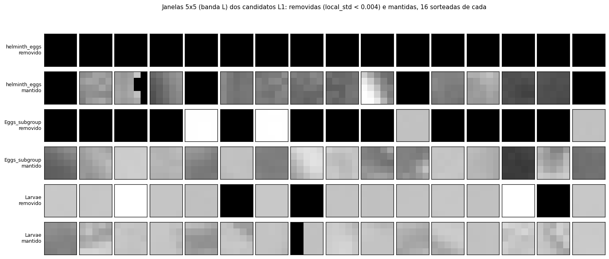

# Janelas chapadas nos candidatos do SPiFiL

08/11/2026, athena, só CPU para o diagnóstico. Sem rótulo e sem máscara. O experimento está pronto e **não** foi lançado.

## A resposta em uma frase

O teste antigo não marca **nenhuma** janela preta (0%). A regra nova marca 51% dos candidatos de helminth_eggs. Mas o SPiFiL já jogava fora as cópias repetidas, então das janelas pretas sobrava **uma só** por camada 1. O ganho esperado na L1 é pequeno; nas camadas de cima ainda escapam algumas.

## Por que o teste antigo falha

O teste antigo é `rows.std(1) < 1e-3`. Ele olha o desvio de **todos os 75 números juntos** da janela 5×5×3. Num preto puro, o L vale 0 e o a/b vale ~0,47/0,53. As três bandas são diferentes entre si, então o desvio fica ~0,24, longe de zero. O teste só pegaria uma janela em que as três bandas tivessem o mesmo valor, coisa que não acontece.

## A regra nova (`plano_tol`)

Uma janela é "chapada" quando **não muda dentro dela**: mede-se o desvio das 25 posições em cada banda LAB e somam-se as três (`local_std`, que já existia). Se o resultado é menor que `tol`, a janela sai.

- **Valor escolhido: 0,004 ≈ 1/255.** Isso é menos que um degrau de cinza de uma imagem de 8 bits. A janela varia menos do que o próprio arquivo consegue registrar.
- **Por que não "uma fração da mediana"?** Em helminth_eggs, mais da metade dos candidatos vale exatamente 0, então a mediana é 0 e a regra não cortaria nada.
- **Só olha a imagem.** A regra roda uma vez, na janela LAB crua da L1. A mesma semente sai de **todas** as camadas: o candidato é um ponto da imagem, e um ponto preto continua preto lá em cima.
- O teste antigo continua valendo. A regra nova só **acrescenta** um corte.

Como ligar: `amostra.plano_tol: [0, 0.004]`. Cada braço ganha um gêmeo com o sufixo `~pl0.004`; o `0` é o braço de hoje, sem sufixo. A coluna `flat_patches` conta quantos candidatos o corte tirou, e `live_rows` conta quantos sobraram. O schema recusa valor negativo, valor que não é lista, e o uso junto com `agrupamento`.

## A verificação de identidade

Usei uma célula pequena em helminth_eggs: split 1, 20 imagens, semente 42, largura 16, 2 camadas, `fps`, `fpsw@mapa_w0.5_1` e `orth`.

- **Sem a chave:** as 18 linhas do CSV saíram **idênticas** antes e depois da mudança, ignorando só as colunas de tempo e de memória.
- **Com `plano_tol: [0, 0.004]`:** as 18 linhas sem sufixo continuaram idênticas. As 18 linhas com `~pl` são novas.
- O controle `orth~pl0.004` dá o mesmo resultado que `orth`, como deveria: um controle aleatório não olha os candidatos.
- O import `eval.spf_grade, eval.alt_encoders` funcionou antes e depois.

## Quanto cada teste marca

Os números são dos candidatos `medoid` da L1 (o ponto do braço `fps`): split 1, sorteio 42, 500 imagens e 25.000 candidatos por base.

| base | teste antigo | regra nova | candidatos únicos (depois do dedupe) | únicos que a regra nova tira |
|---|---|---|---|---|
| helminth_eggs | 0% | **51,4%** | 8.539 | 1 |
| Eggs_subgroup | 0% | 0,2% | 24.473 | 11 |
| Larvae (contraste) | 0% | 2,8% | 24.057 | 585 |

Como ler a tabela:

- **O dedupe já fazia quase todo o trabalho.** As 12.846 janelas pretas de helminth_eggs são cópias exatas umas das outras. A deduplicação, que já existia, guardava uma só. A regra nova tira essa última.
- **Larvae tem fundo claro e liso.** Os 585 tirados são, quase todos, janelas brancas ou cinza uniformes, não pretas (veja a figura).
- **Eggs_subgroup quase não tem preto chapado.** Só 0,2% é marcado. Não é um bom segundo controle de fundo preto.
- **No mini-teste, a L2 perdeu 28 candidatos pretos** (de 406 para 378 vivos no braço `fps`). Na L2 as janelas pretas deixam de ser cópias exatas e passam pelo dedupe; é ali que a regra pode mudar o resultado.

## O que a regra NÃO pega

Em 14,5% dos candidatos de helminth_eggs, e em 1,9% dos de Eggs_subgroup, a janela tem o L todo em 0, mas o a/b salta entre **0** e ~0,5. Ou seja: uma parte da janela é preto de verdade e a outra é "tudo zero" nas três bandas, que na LABNorm2 não é preto. Parece ser a borda da imagem, onde entra o preenchimento com zero.

Essas janelas variam muito por dentro, então nenhuma regra de "janela chapada" as tira. Elas aparecem como quadrados pretos na linha "helminth_eggs mantido" da figura. Se valer a pena, é outro conserto: preencher a borda com o preto LAB (`LAB_BLACK`) em vez de zero.



A figura mostra a banda L de 16 janelas sorteadas de cada grupo, nas três bases.

## O experimento

O YAML é `experiments/autoencoder/disc_md_plano_helminth.yaml`, copiado da receita `disc_md_sol_wsal.yaml` (athena).

- **Bases e sorteios:** helminth_eggs e Eggs_subgroup, splits 1, 2 e 3, 50%, sorteios 42 e 43.
- **Rede:** largura 256 em 6 camadas, kernel 5, com whitening entre camadas.
- **Braços:** `fps` e `fpsw@mapa_w0.5_1`, mais os controles `random_z` e `orth`. Cada um sai com e sem `~pl0.004`, e as duas versões usam a mesma semente e o mesmo K.
- **Quando faltam candidatos:** se a regra nova deixar menos de K únicos, a linha sai com `short=1` e o motivo em `short_why`. Nada é completado. Os controles gêmeos (`orth`, `random_z`) rodam na largura que de fato saiu.
- **Leituras:** `L` e `cat`, e também `L_b` e `cat_b`, que vêm do whitening.
- **Caminhos:** fontes em `/exps/moliveira/fontes_filtros/plano_helminth`, saídas em `/exps/moliveira/...`, gpu_ids [0,1,2,3] e max_per_gpu 1.
- **Dry-run:** passou com **12 jobs** (2 bases × 3 splits × 2 shards). São 96 redes no total: 16 por base e split, fora os gêmeos de largura curta.

Para lançar:

```
LD_LIBRARY_PATH=/dados/home/moliveira/miniforge3/envs/scalable_FLIM/lib /dados/home/moliveira/miniforge3/envs/scalable_FLIM/bin/python -m experiments.ray.launch experiments/autoencoder/disc_md_plano_helminth.yaml
```
