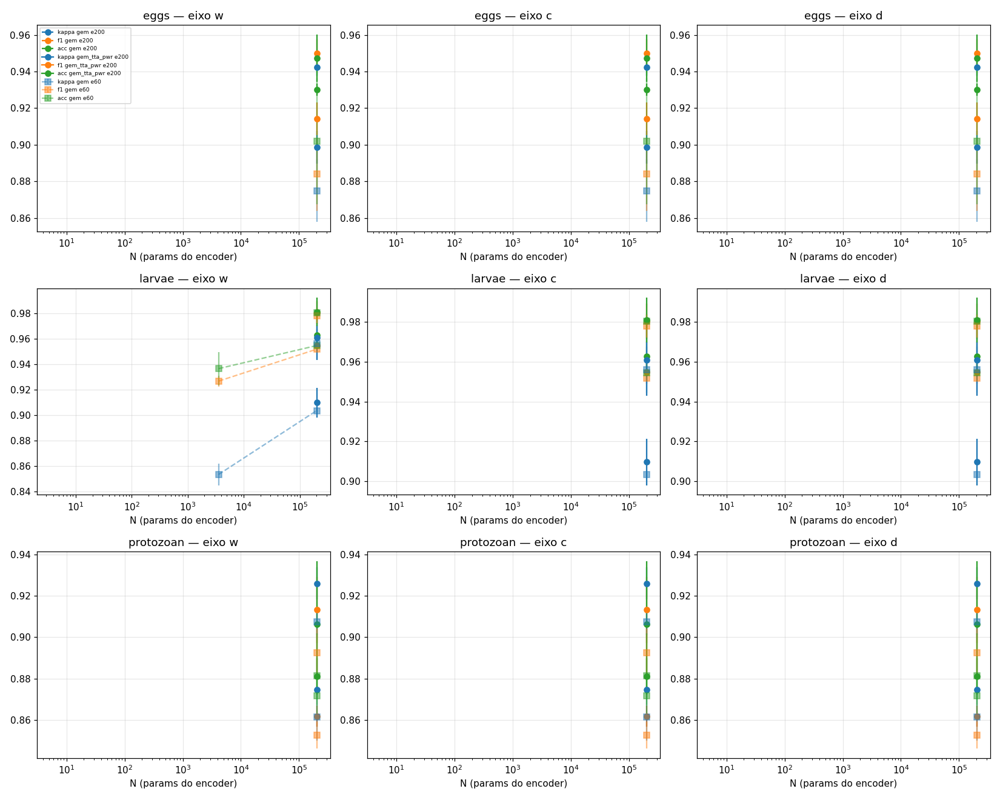

# Lei de escala do encoder (disc_sl_*) — κ, F1, acc × N

_Gerado por scratchpad/a4/scaling_law.py em 2026-11-02 22:56; lei com **val**, teste em coluna separada._

N = parâmetros do encoder (tabela do A15; conferir com L4_grow/architecture.json). Fração SPiFiL da 1x1 = min(1, sementes / canais), com sementes eggs 400, larvae 100, protozoan 300.

## eixo w (largura total), 200 épocas

| ponto | N | dataset | SPiFiL na 1x1 | κ gem | κ gem_tta_pwr | F1 tta_pwr | acc tta_pwr | κ teste tta_pwr |
|---|---|---|---|---|---|---|---|---|
| w0125 | 3,558 | eggs | 100% | pendente | pendente | pendente | pendente | pendente |
| w025 | 13,276 | eggs | 100% | pendente | pendente | pendente | pendente | pendente |
| w050 | 51,192 | eggs | 62% | pendente | pendente | pendente | pendente | pendente |
| m1 | 200,944 | eggs | 31% | 0.899 ± 0.009 (n3) | 0.942 ± 0.004 (n3) | 0.950 ± 0.007 (n3) | 0.947 ± 0.013 (n3) | 0.933 ± 0.016 (n3) |
| w200 | 713,568 | eggs | 16% | pendente | pendente | pendente | pendente | pendente |
| w0125 | 3,558 | larvae | 62% | pendente | pendente | pendente | pendente | pendente |
| w025 | 13,276 | larvae | 31% | pendente | pendente | pendente | pendente | pendente |
| w050 | 51,192 | larvae | 16% | pendente | pendente | pendente | pendente | pendente |
| m1 | 200,944 | larvae | 8% | 0.910 ± 0.012 (n3) | 0.961 ± 0.018 (n3) | 0.980 ± 0.009 (n3) | 0.981 ± 0.011 (n3) | 0.968 ± 0.008 (n3) |
| w200 | 713,568 | larvae | 4% | pendente | pendente | pendente | pendente | pendente |
| w0125 | 3,558 | protozoan | 100% | pendente | pendente | pendente | pendente | pendente |
| w025 | 13,276 | protozoan | 94% | pendente | pendente | pendente | pendente | pendente |
| w050 | 51,192 | protozoan | 47% | pendente | pendente | pendente | pendente | pendente |
| m1 | 200,944 | protozoan | 23% | 0.875 ± 0.002 (n3) | 0.926 ± 0.008 (n3) | 0.913 ± 0.016 (n3) | 0.906 ± 0.031 (n3) | 0.928 ± 0.006 (n3) |
| w200 | 713,568 | protozoan | 12% | pendente | pendente | pendente | pendente | pendente |

_Ajuste e(N)=E+A·N^(−α) só com ≥3 pontos; IC por bootstrap sobre splits._

## eixo c (largura da 1x1), 200 épocas

| ponto | N | dataset | SPiFiL na 1x1 | κ gem | κ gem_tta_pwr | F1 tta_pwr | acc tta_pwr | κ teste tta_pwr |
|---|---|---|---|---|---|---|---|---|
| c160 | 128,144 | eggs | 100% | pendente | pendente | pendente | pendente | pendente |
| c320 | 138,544 | eggs | 100% | pendente | pendente | pendente | pendente | pendente |
| c640 | 159,344 | eggs | 62% | pendente | pendente | pendente | pendente | pendente |
| m1 | 200,944 | eggs | 31% | 0.899 ± 0.009 (n3) | 0.942 ± 0.004 (n3) | 0.950 ± 0.007 (n3) | 0.947 ± 0.013 (n3) | 0.933 ± 0.016 (n3) |
| c1920 | 242,544 | eggs | 21% | pendente | pendente | pendente | pendente | pendente |
| c160 | 128,144 | larvae | 62% | pendente | pendente | pendente | pendente | pendente |
| c320 | 138,544 | larvae | 31% | pendente | pendente | pendente | pendente | pendente |
| c640 | 159,344 | larvae | 16% | pendente | pendente | pendente | pendente | pendente |
| m1 | 200,944 | larvae | 8% | 0.910 ± 0.012 (n3) | 0.961 ± 0.018 (n3) | 0.980 ± 0.009 (n3) | 0.981 ± 0.011 (n3) | 0.968 ± 0.008 (n3) |
| c1920 | 242,544 | larvae | 5% | pendente | pendente | pendente | pendente | pendente |
| c160 | 128,144 | protozoan | 100% | pendente | pendente | pendente | pendente | pendente |
| c320 | 138,544 | protozoan | 94% | pendente | pendente | pendente | pendente | pendente |
| c640 | 159,344 | protozoan | 47% | pendente | pendente | pendente | pendente | pendente |
| m1 | 200,944 | protozoan | 23% | 0.875 ± 0.002 (n3) | 0.926 ± 0.008 (n3) | 0.913 ± 0.016 (n3) | 0.906 ± 0.031 (n3) | 0.928 ± 0.006 (n3) |
| c1920 | 242,544 | protozoan | 16% | pendente | pendente | pendente | pendente | pendente |

_Ajuste e(N)=E+A·N^(−α) só com ≥3 pontos; IC por bootstrap sobre splits._

## eixo d (profundidade), 200 épocas

| ponto | N | dataset | SPiFiL na 1x1 | κ gem | κ gem_tta_pwr | F1 tta_pwr | acc tta_pwr | κ teste tta_pwr |
|---|---|---|---|---|---|---|---|---|
| d3 | 103,600 | eggs | 31% | pendente | pendente | pendente | pendente | pendente |
| m1 | 200,944 | eggs | 31% | 0.899 ± 0.009 (n3) | 0.942 ± 0.004 (n3) | 0.950 ± 0.007 (n3) | 0.947 ± 0.013 (n3) | 0.933 ± 0.016 (n3) |
| d5 | 395,600 | eggs | 31% | pendente | pendente | pendente | pendente | pendente |
| d3 | 103,600 | larvae | 8% | pendente | pendente | pendente | pendente | pendente |
| m1 | 200,944 | larvae | 8% | 0.910 ± 0.012 (n3) | 0.961 ± 0.018 (n3) | 0.980 ± 0.009 (n3) | 0.981 ± 0.011 (n3) | 0.968 ± 0.008 (n3) |
| d5 | 395,600 | larvae | 8% | pendente | pendente | pendente | pendente | pendente |
| d3 | 103,600 | protozoan | 23% | pendente | pendente | pendente | pendente | pendente |
| m1 | 200,944 | protozoan | 23% | 0.875 ± 0.002 (n3) | 0.926 ± 0.008 (n3) | 0.913 ± 0.016 (n3) | 0.906 ± 0.031 (n3) | 0.928 ± 0.006 (n3) |
| d5 | 395,600 | protozoan | 23% | pendente | pendente | pendente | pendente | pendente |

_Ajuste e(N)=E+A·N^(−α) só com ≥3 pontos; IC por bootstrap sobre splits._

## eixo w (largura total), 60 épocas

| ponto | N | dataset | SPiFiL na 1x1 | κ gem | κ gem_tta_pwr | F1 tta_pwr | acc tta_pwr | κ teste tta_pwr |
|---|---|---|---|---|---|---|---|---|
| w0125 | 3,558 | eggs | 100% | pendente | pendente | pendente | pendente | pendente |
| w025 | 13,276 | eggs | 100% | pendente | pendente | pendente | pendente | pendente |
| w050 | 51,192 | eggs | 62% | pendente | pendente | pendente | pendente | pendente |
| m1 | 200,944 | eggs | 31% | 0.875 ± 0.017 (n3) | pendente | pendente | pendente | pendente |
| w200 | 713,568 | eggs | 16% | pendente | pendente | pendente | pendente | pendente |
| w0125 | 3,558 | larvae | 62% | 0.853 ± 0.009 (n3) | pendente | pendente | pendente | pendente |
| w025 | 13,276 | larvae | 31% | pendente | pendente | pendente | pendente | pendente |
| w050 | 51,192 | larvae | 16% | pendente | pendente | pendente | pendente | pendente |
| m1 | 200,944 | larvae | 8% | 0.903 ± 0.001 (n3) | 0.956 ± 0.012 (n3) | 0.978 ± 0.006 (n3) | 0.980 ± 0.004 (n3) | 0.948 ± 0.017 (n3) |
| w200 | 713,568 | larvae | 4% | pendente | pendente | pendente | pendente | pendente |
| w0125 | 3,558 | protozoan | 100% | pendente | pendente | pendente | pendente | pendente |
| w025 | 13,276 | protozoan | 94% | pendente | pendente | pendente | pendente | pendente |
| w050 | 51,192 | protozoan | 47% | pendente | pendente | pendente | pendente | pendente |
| m1 | 200,944 | protozoan | 23% | 0.861 ± 0.011 (n3) | 0.907 ± 0.006 (n3) | 0.893 ± 0.012 (n3) | 0.881 ± 0.021 (n3) | 0.908 ± 0.003 (n3) |
| w200 | 713,568 | protozoan | 12% | pendente | pendente | pendente | pendente | pendente |

_Ajuste e(N)=E+A·N^(−α) só com ≥3 pontos; IC por bootstrap sobre splits._

## eixo c (largura da 1x1), 60 épocas

| ponto | N | dataset | SPiFiL na 1x1 | κ gem | κ gem_tta_pwr | F1 tta_pwr | acc tta_pwr | κ teste tta_pwr |
|---|---|---|---|---|---|---|---|---|
| c160 | 128,144 | eggs | 100% | pendente | pendente | pendente | pendente | pendente |
| c320 | 138,544 | eggs | 100% | pendente | pendente | pendente | pendente | pendente |
| c640 | 159,344 | eggs | 62% | pendente | pendente | pendente | pendente | pendente |
| m1 | 200,944 | eggs | 31% | 0.875 ± 0.017 (n3) | pendente | pendente | pendente | pendente |
| c1920 | 242,544 | eggs | 21% | pendente | pendente | pendente | pendente | pendente |
| c160 | 128,144 | larvae | 62% | pendente | pendente | pendente | pendente | pendente |
| c320 | 138,544 | larvae | 31% | pendente | pendente | pendente | pendente | pendente |
| c640 | 159,344 | larvae | 16% | pendente | pendente | pendente | pendente | pendente |
| m1 | 200,944 | larvae | 8% | 0.903 ± 0.001 (n3) | 0.956 ± 0.012 (n3) | 0.978 ± 0.006 (n3) | 0.980 ± 0.004 (n3) | 0.948 ± 0.017 (n3) |
| c1920 | 242,544 | larvae | 5% | pendente | pendente | pendente | pendente | pendente |
| c160 | 128,144 | protozoan | 100% | pendente | pendente | pendente | pendente | pendente |
| c320 | 138,544 | protozoan | 94% | pendente | pendente | pendente | pendente | pendente |
| c640 | 159,344 | protozoan | 47% | pendente | pendente | pendente | pendente | pendente |
| m1 | 200,944 | protozoan | 23% | 0.861 ± 0.011 (n3) | 0.907 ± 0.006 (n3) | 0.893 ± 0.012 (n3) | 0.881 ± 0.021 (n3) | 0.908 ± 0.003 (n3) |
| c1920 | 242,544 | protozoan | 16% | pendente | pendente | pendente | pendente | pendente |

_Ajuste e(N)=E+A·N^(−α) só com ≥3 pontos; IC por bootstrap sobre splits._

## eixo d (profundidade), 60 épocas

| ponto | N | dataset | SPiFiL na 1x1 | κ gem | κ gem_tta_pwr | F1 tta_pwr | acc tta_pwr | κ teste tta_pwr |
|---|---|---|---|---|---|---|---|---|
| d3 | 103,600 | eggs | 31% | pendente | pendente | pendente | pendente | pendente |
| m1 | 200,944 | eggs | 31% | 0.875 ± 0.017 (n3) | pendente | pendente | pendente | pendente |
| d5 | 395,600 | eggs | 31% | pendente | pendente | pendente | pendente | pendente |
| d3 | 103,600 | larvae | 8% | pendente | pendente | pendente | pendente | pendente |
| m1 | 200,944 | larvae | 8% | 0.903 ± 0.001 (n3) | 0.956 ± 0.012 (n3) | 0.978 ± 0.006 (n3) | 0.980 ± 0.004 (n3) | 0.948 ± 0.017 (n3) |
| d5 | 395,600 | larvae | 8% | pendente | pendente | pendente | pendente | pendente |
| d3 | 103,600 | protozoan | 23% | pendente | pendente | pendente | pendente | pendente |
| m1 | 200,944 | protozoan | 23% | 0.861 ± 0.011 (n3) | 0.907 ± 0.006 (n3) | 0.893 ± 0.012 (n3) | 0.881 ± 0.021 (n3) | 0.908 ± 0.003 (n3) |
| d5 | 395,600 | protozoan | 23% | pendente | pendente | pendente | pendente | pendente |

_Ajuste e(N)=E+A·N^(−α) só com ≥3 pontos; IC por bootstrap sobre splits._

