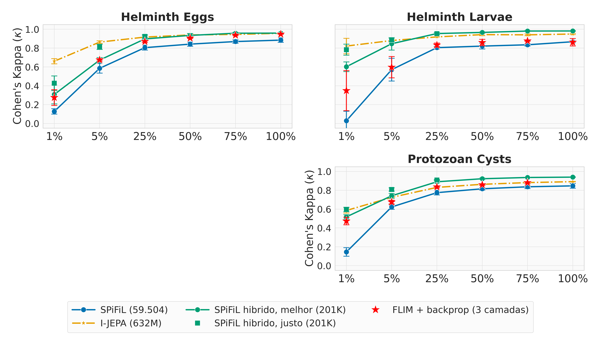

# Hybrid SPiFiL em múltiplos datasets: treinamento e classificação

Este documento reúne a explicação do modelo `disc_bp01w64c1280`, da variante `bg1` e do protocolo `ssl100_svm1`. O foco é o funcionamento do treinamento, da extração de características e do classificador, sem reproduzir as tabelas de resultados.

Os datasets são **helminth-eggs**, **helminth-larvae** e **protozoan-cysts**, com três splits por dataset.

## 1. Visão geral

O sistema combina três partes:

1. **SPiFiL:** inicializa os filtros convolucionais a partir de regiões representativas de imagens.
2. **Autoencoder:** ajusta o encoder por backprop, aprendendo a reconstruir as imagens com um decoder auxiliar.
3. **SVM linear:** aprende a classificar os vetores extraídos pelo encoder congelado.

Durante o treinamento por reconstrução:

```text
Imagem LAB → encoder → decoder → reconstrução da imagem
                  ↑ backprop pela perda de reconstrução ↑
```

Durante a extração e classificação com `gem_tta_pw`:

```text
Imagem → 8 vistas → encoder congelado → GeM por vista
    → média dos 8 vetores → PCA whitening → normalização L2 → SVM linear
```

O decoder participa do treinamento por reconstrução. A classificação pelo SVM utiliza somente o encoder e o processamento dos vetores.

## 2. Como o encoder é treinado

### Crescimento camada por camada

A rede é construída em quatro estágios, L1 a L4.

Na L1, o SPiFiL inicializa a convolução usando imagens em LAB. Nas etapas seguintes, a camada nova é inicializada usando as características produzidas pelo encoder já treinado. No caminho utilizado por este experimento, os superpixels são calculados sobre a imagem LAB; suas sementes são transportadas para a resolução das características.

Depois de adicionar cada camada, cria-se um **decoder residual novo** e treina-se a reconstrução. Ao passar ao próximo estágio, os pesos treinados do encoder anterior são reaproveitados.

As camadas anteriores continuam treinando: `layerwise_backprop: 0.1` atribui a elas uma taxa de aprendizado dez vezes menor que a da camada nova e do decoder. Esse valor é uma escala da taxa de aprendizado; não significa que apenas 10% dos pesos são atualizados.

Na L4, os filtros produzidos pelo SPiFiL são completados com filtros aleatórios até atingir 1.280 canais.

### Uso de rótulos e máscaras

A inicialização SPiFiL usa uma imagem por classe com máscara no protocolo descrito no relatório. Portanto, o sistema completo inclui informação anotada nessa etapa.

O **backprop por reconstrução não usa os rótulos das classes**: o alvo é a própria imagem de entrada. Posteriormente, o SVM usa os rótulos para aprender as fronteiras de classificação.

### Hiperparâmetros

| Item | Configuração |
|---|---|
| Entrada | LAB em [0, 1], 200 × 200 pixels |
| Batch size | 32 |
| Otimizador | AdamW |
| Taxa base de aprendizado | `5e-4` |
| Escala da taxa das camadas anteriores | `0.1` |
| Weight decay | `0.05` |
| Warmup | 10 épocas |
| Após o warmup | Decaimento cossenoidal |
| Limite por estágio | 200 épocas |
| Early stopping | Paciência de 50 verificações de validação |
| Perda | BCE por pixel sobre a reconstrução LAB |
| Seleção do checkpoint | Menor `probe/val_recon_loss`, com a sonda SVM desligada |

O nome `best_kappa.ckpt` é mantido por convenção do pipeline; nesse protocolo ele não indica seleção pelo maior kappa.

### Modelo base e variante `bg1`

- **`disc_bp01w64c1280`:** o fundo recebe peso `0.1` na perda de reconstrução.
- **`disc_bp01w64c1280_bg1`:** `recon_bg_weight: 1.0`; a BCE não reduz o peso do fundo.

A arquitetura e a leitura dos vetores seguem a mesma proposta, mas são treinamentos diferentes. Resultados do modelo base não devem ser atribuídos automaticamente à variante `bg1`.

## 3. Summary da arquitetura

As dimensões abaixo omitem o batch e usam a ordem **canais × altura × largura**, para eggs e larvae.

| Etapa | Operação | Saída | Parâmetros do encoder |
|---|---|---:|---:|
| Entrada | Imagem LAB | 3 × 200 × 200 | — |
| L1 | Conv 5×5 + ReLU + MaxPool 3×3, stride 2 | 32 × 99 × 99 | 2.432 |
| L2 | Conv 5×5 + ReLU + MaxPool 3×3, stride 2 | 48 × 49 × 49 | 38.448 |
| L3 | Conv 5×5 + ReLU + MaxPool 3×3, stride 2 | 64 × 24 × 24 | 76.864 |
| L4 | Conv 1×1 + ReLU | 1.280 × 24 × 24 | 83.200 |
| **Total** | | | **200.944** |

Não há BatchNorm nesse encoder. L4 não possui pooling espacial adicional.

No protozoan, os canais efetivos documentados são **30 → 48 → 60 → 1.280**, totalizando **188.468 parâmetros**. Os números solicitados na configuração e os efetivamente produzidos pelo SPiFiL podem diferir.

O decoder da L4 possui 952.099 parâmetros para eggs/larvae e 890.121 para protozoan, conforme a contagem do relatório. Esses parâmetros são adicionais aos do encoder e não entram na classificação pelo SVM. O checkpoint pode guardar o decoder mesmo quando a avaliação utiliza apenas o encoder.

## 4. DISF, superpixels e medoids

A configuração solicita **50 superpixels por imagem** ao DISF (`n_superpixels: 50`). O extrator `Medoids()` escolhe **um representante por região válida**. Se forem produzidas 50 regiões válidas, são 50 medoids por imagem.

Nesse código, o representante é o pixel cuja aparência fica mais próxima da média das características da região. Ele pertence à própria região e funciona como semente para a construção dos filtros.

O DISF faz a segmentação; a seleção dos representantes é realizada pelo extrator de medoids. O número de sementes efetivamente utilizado pode depender das regiões válidas e das máscaras.

**50 medoids não significam 50 filtros finais.** As sementes fornecem candidatos; a construção da camada determina os filtros mantidos. Na L4, há ainda o preenchimento com filtros aleatórios até 1.280 canais.

## 5. Há data augmentation durante o treinamento?

No treinamento documentado de **`disc_bp01w64c1280`**, não há augmentation aleatória da entrada: são usados resize e recorte central para 200 × 200.

A verificação dos 216 arquivos `config.yaml` salvos nos estágios desse modelo encontrou:

- `V_train: 1` em todos;
- `geo_aug: false` em todos;
- `strong_aug` ausente, com padrão desligado, ou explicitamente `false`;
- `mask_ratio: 0.0` em todos.

O metadata de execução consultado também registra `train_augmentation: "none"`. A configuração `bg1` examinada na main igualmente não habilita augmentation de treino.

**`V_train: 1`, isoladamente, não prova ausência de augmentation.** A branch discovery permite aplicar transformações geométricas mesmo com uma única vista, por meio de `geo_aug` ou `strong_aug`.

Existem outros experimentos nessa branch que ativam isso, como `growth_layerwise5_aug`, com flips e rotações de 90°, e `disc_ld_saug`, com transformações adicionais de rotação livre, jitter LAB, blur e ruído. Eles são variantes distintas.

As oito vistas de `gem_tta_pw` são usadas posteriormente, na extração de características com o encoder congelado, para as imagens de treino do SVM e de avaliação.

## 6. GeM: como cada mapa vira um número

Na L4, o encoder produz **1.280 mapas de 24 × 24**. O GeM resume cada mapa em um único número, formando um vetor de **1.280 características por vista**.

O GeM é uma média generalizada, que dá maior influência aos valores mais altos quando `p > 1`. Não é exatamente uma média ponderada tradicional, mas tem um efeito semelhante de destacar valores maiores.

A fórmula, para ativações não negativas, é:

$$
\operatorname{GeM}(X)=\left(\frac{1}{N}\sum_{i=1}^{N}x_i^p\right)^{1/p}
$$

Aqui, `N` é o número de posições espaciais de um mapa: na L4, `24 × 24 = 576`. O código limita as ativações inferiormente a `1e-6` antes de calcular as potências.

### Exemplo numérico com quatro valores

Considere:

$$
X=[1,2,3,10], \qquad p=3
$$

1. Expandindo o somatório:

   $$
   \operatorname{GeM}(X)=\left(\frac{1^3+2^3+3^3+10^3}{4}\right)^{1/3}
   $$

2. Calculando as potências:

   $$
   =\left(\frac{1+8+27+1000}{4}\right)^{1/3}
   $$

3. Somando e dividindo:

   $$
   =\left(\frac{1036}{4}\right)^{1/3}
   =\sqrt[3]{259}\approx\boxed{6{,}38}
   $$

Compare:

| Operação | Resultado |
|---|---:|
| Average Pooling | 4 |
| GeM, `p=3` | 6,38 |
| Max Pooling | 10 |

Ao elevar os valores à potência `p`, as ativações maiores passam a dominar o somatório. Depois, a raiz de ordem `p` devolve o resultado à escala original.

Para ativações não negativas, `p=1` corresponde à média aritmética; quanto maior o `p`, mais o GeM se aproxima do máximo.

### O valor de `p` foi aprendido ou testado em uma busca?

Na implementação examinada, **`p=3` é fixo**, expresso por `.pow(3)` e `.pow(1 / 3)`. Ele não é aprendido por backprop nem exposto como hiperparâmetro nesses YAMLs.

Não foi encontrada evidência, nos arquivos e registros consultados, de uma busca por diferentes valores de `p`. Foram testadas diferentes formas de leitura, como média, GeM, GeM com oito vistas e variantes de whitening; isso não demonstra uma busca pelo expoente.

## 7. Oito vistas: rotações e espelhamento

O modo `gem_tta` usa as quatro rotações de 0°, 90°, 180° e 270°, tanto da imagem original quanto da imagem espelhada horizontalmente, totalizando oito vistas.

Cada vista passa pelo encoder e pelo GeM. Depois, calcula-se a média dos oito vetores:

$$
x=\frac{1}{8}\sum_{v=1}^{8}\operatorname{GeM}(E(T_v(I)))
$$

`E` representa o encoder e `T_v` a transformação da vista. Isso reduz a dependência da orientação da imagem, mas não garante invariância a qualquer rotação arbitrária.

Na L4, o vetor continua com **1.280 valores**; as oito vistas não são concatenadas nesse modo. O custo é executar o encoder oito vezes por imagem.

## 8. PCA: o que é a saída PCA(x)ₖ?

A PCA é ajustada usando **somente os vetores do conjunto de treino do SVM, sem usar seus rótulos**. Ela calcula a média desses vetores e encontra direções principais da sua variação.

Para uma imagem com vetor `x`, a coordenada na direção principal `k` é:

$$
\operatorname{PCA}(x)_k=(x-\mu)^\top v_k
$$

- `x`: vetor após GeM e média das vistas;
- `μ`: média dos vetores de treino;
- `vₖ`: k-ésima direção principal encontrada no treino.

**PCA(x)ₖ é um único número**, que pode ser positivo, negativo ou zero. Ele representa uma combinação dos canais originais, não diretamente uma classe ou um único filtro.

**PCA(x), sem o índice `k`, é o vetor completo** dessas coordenadas.

Com `PCA()` sem definição explícita de `n_components`, a dimensão produzida é:

$$
d=\min(n_{\text{treino}},C)
$$

Na L4, `C=1280`. Como os dados são centralizados, há no máximo `n_treino − 1` direções com variância não nula. Portanto, o número de coordenadas retornadas e o número de direções informativas não são necessariamente iguais.

## 9. Whitening com regularização e normalização L2

Depois da projeção PCA, cada componente é dividido por uma medida de sua dispersão:

$$
z_k=\frac{\operatorname{PCA}(x)_k}
{\sqrt{\lambda_k+0{,}1\,\overline{\lambda}}}
$$

`λₖ` é a variância da componente `k`, e `λ̄` é a média das variâncias das componentes retornadas pela PCA.

A divisão reescala as componentes, reduzindo diferenças de escala. A parcela `0,1 λ̄` regulariza o denominador para evitar que variâncias muito pequenas amplifiquem excessivamente ruído numérico. Por haver regularização, as variâncias resultantes não ficam necessariamente iguais a 1.

Depois, a normalização L2 coloca cada vetor não nulo com comprimento 1:

$$
\hat z=\frac{z}{\lVert z\rVert_2}
$$

A média, as direções e as variâncias da PCA são calculadas no treino. As mesmas transformações são aplicadas na validação ou no teste, sem reajustar a PCA nesses conjuntos.

### Em qual camada isso é aplicado?

O whitening é aplicado **ao vetor final extraído do estágio escolhido**, depois do GeM e da média das vistas, antes do SVM. Ele não é inserido entre as convoluções nem aplicado diretamente aos mapas espaciais nesse experimento.

O YAML pede `stages: [L1, L2, L3, L4]`. Isso gera avaliações separadas:

| Estágio avaliado | Saída usada | Dimensão antes da PCA, eggs/larvae |
|---|---|---:|
| L1 | Encoder do estágio L1 → GeM e média das vistas | 32 |
| L2 | Encoder do estágio L2 → GeM e média das vistas | 48 |
| L3 | Encoder do estágio L3 → GeM e média das vistas | 64 |
| L4 | Encoder do estágio L4 → GeM e média das vistas | 1.280 |

Cada estágio usa seu checkpoint e ajusta sua própria PCA e seu próprio SVM. Não há concatenação das quatro camadas. Como as camadas antigas continuam treinando durante o crescimento, avaliar o checkpoint L1 também não equivale necessariamente a extrair a primeira camada do checkpoint L4.

## 10. SVM linear e ausência de backprop na leitura

O SVM recebe os vetores transformados e os rótulos das imagens de treino. Suas funções de decisão são lineares nesse espaço:

$$
f(\hat z)=w^\top\hat z+b
$$

O solver do SVM otimiza seus próprios coeficientes. Ele não propaga gradientes para o encoder.

| Etapa | O que é ajustado | Usa backprop no encoder? |
|---|---|---|
| Inicialização SPiFiL | Filtros a partir de sementes e características | Não |
| Treino por reconstrução | Encoder e decoder | Sim |
| GeM e média das oito vistas | Operações fixas, com `p=3` | Não |
| Ajuste da PCA whitening | Transformação estatística dos vetores | Não |
| Normalização L2 | Operação fixa por vetor | Não |
| Treino do SVM | Coeficientes de classificação | Não |

GeM pode ser usado em redes diferenciáveis e participar de outros treinamentos por backprop. Nesta avaliação, porém, a extração usa o encoder congelado, sem cálculo de gradientes.

## 11. O significado de ssl100_svm1

No arquivo `eval_svm_disc_bp01w64c1280_bg1_ssl100_svm1_test_gemttapwr.yaml`:

- `family: disc_bp01w64c1280_bg1` seleciona a variante com peso de fundo 1,0;
- `percentages: [100]` seleciona encoders treinados com 100% das imagens de treino;
- `svm_train_pct: 1` restringe o treino do SVM ao subconjunto de 1%;
- a PCA também é ajustada somente com os vetores desse subconjunto de 1%;
- `eval_set: test` seleciona o conjunto de teste;
- `stages: [L1, L2, L3, L4]` avalia os quatro estágios separadamente.

O nome SSL descreve o treino por reconstrução sem rótulos de classe no backprop. A inicialização SPiFiL continua usando a informação anotada descrita anteriormente.

## 12. Diferença entre formas de leitura e comparação com outros modelos

A leitura determina como a saída do encoder vira um vetor para o classificador. É possível manter o mesmo encoder e obter comportamentos diferentes alterando apenas esse processamento.

| Leitura | Operação | Característica |
|---|---|---|
| Flatten | Concatena as posições dos mapas | Preserva posições, mas gera vetores grandes |
| Média global | Média espacial por canal | Resume a presença de cada característica |
| GeM, `p=3` | Média generalizada por canal | Dá mais influência a ativações fortes |
| GeM com oito vistas | Média dos vetores de rotações e espelhamento | Reduz dependência da orientação |
| PCA whitening + L2 | Projeta, reescala e normaliza o vetor | Reduz correlações e controla escalas |

Na L4, flatten produz **737.280 valores** (`1280 × 24 × 24`). Média global e GeM produzem **1.280 valores**. A média de oito vistas mantém os 1.280 valores; a PCA pode reduzir a dimensão conforme o número de amostras de treino.

Essas operações podem ser utilizadas com outros encoders que produzam mapas de características. A combinação específica deste sistema reúne **inicialização SPiFiL, treino por reconstrução, GeM com oito vistas, whitening e SVM**.

Comparar esse pipeline com outro que usa flatten ou média mede o efeito do **encoder e da leitura juntos**. Para isolar o efeito do encoder, é necessário controlar o procedimento de extração, o processamento dos vetores, os dados disponíveis e o protocolo de classificação.

## Referências locais

- [Relatório de arquitetura e resultados](../../october/report_results_only_spifil.md).
- [Treinamento da variante bg1](../../../experiments/autoencoder/growth_disc_bp01w64c1280_bg1_pcts.yaml).
- [Avaliação bg1, SSL 100% e SVM 1%](../../../experiments/autoencoder/eval_svm_disc_bp01w64c1280_bg1_ssl100_svm1_test_gemttapwr.yaml).
- [Extração, GeM e PCA whitening](../../../eval/svm.py).
- [Módulo de treinamento do autoencoder](../../../methods/autoencoder/autoencoder_flim_module.py).
- [Construção das camadas e sementes SPiFiL](../../../flim/spifil.py).

A conferência da branch discovery foi feita no worktree `/dados/home/moliveira/Scalable_Hybrid_FLIM_discovery`, revisão `0de1838`. As configurações reais de treinamento consultadas estão em `/dados/home/moliveira/artifacts/spifil_growth/disc_bp01w64c1280`.

## 13. Curvas de resultados alcançados

A figura abaixo apresenta as curvas de kappa de Cohen em função da porcentagem de dados, para eggs, larvae e protozoan, da variante **`disc_bp01w64c1280_bg1`**, comparada às referências indicadas na legenda.



Na curva **“SPiFiL híbrido, melhor”**, o encoder é treinado com a porcentagem de imagens indicada no eixo horizontal, e o SVM usa os rótulos dessa porcentagem. Os pontos **“SPiFiL híbrido, justo”** usam o encoder treinado com 100% das imagens de treino, enquanto a porcentagem indica os rótulos disponíveis para o SVM. São resultados por disponibilidade de dados, não curvas de perda ao longo das épocas.
