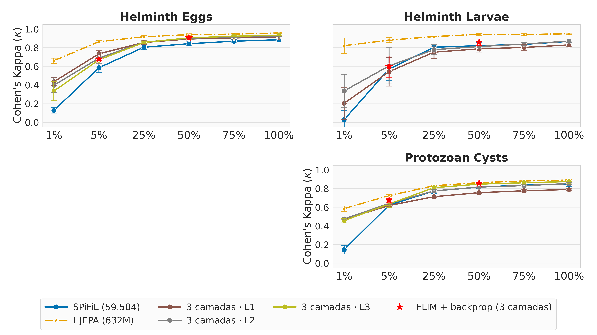
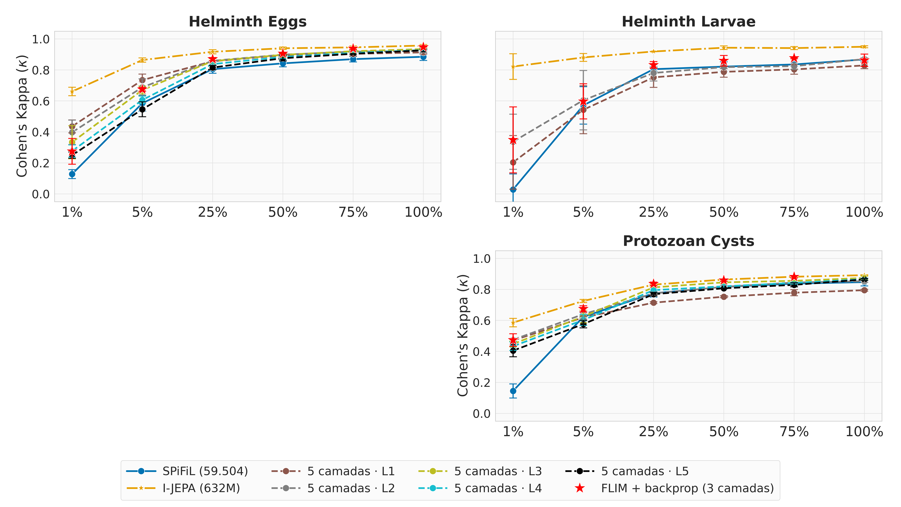
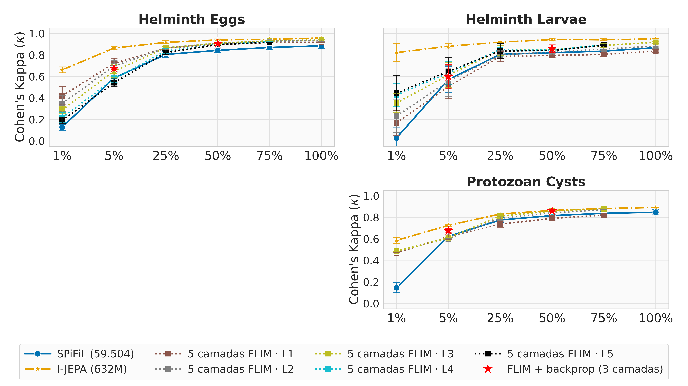

# Outubro 2026

## Crescer o encoder SPiFiL camada por camada (layerwise)

O encoder nasce do zero e cresce uma camada por vez. O SPiFiL corta cada camada nova, as camadas
antigas ficam congeladas e só a nova aprende por backprop, contra um decoder descartável
(reconstrução, sem rótulo). No fim de cada camada, o SVM oficial avalia o encoder congelado.

- **layerwise3** (L1 → L3): 54 células treinadas e avaliadas.
- **layerwise5** (L1 → L5): avaliação em andamento; faltam 2 células para treinar
  (`eggs s2 75%`, `eggs s3 5%`).
- Configurado por YAML: `experiments/autoencoder/growth_layerwise{3,5}.yaml` e
  `eval_svm_layerwise{3,5}.yaml`.
- Na tabela geral entra como `spifil_bckprop_L1/L2/L3`, em
  [`table_result_methods.md`](../2026/august/details_report/table_result_methods.md).

### Resultado do layerwise3

- **Ganha do SPiFiL quase sempre.** Com pouco dado o ganho é grande: em 1%, κ 0,44 contra 0,13
  em eggs e 0,47 contra 0,15 em protozoan.
- **A melhor camada depende da quantidade de dados.** Com pouco dado vence a L1; com muitos, a
  L3 (eggs 100%: 0,934).
- **Ganha dos Distill 3 e 4** em eggs e protozoan; perde em larvae, que para na L2.
- **O I-JEPA continua na frente**, mas por pouco com muitos dados (0,02 em eggs 100%).

Detalhes: [`details/layerwise3_parcial_2026-10-05.md`](details/layerwise3_parcial_2026-10-05.md)
(como foi treinado, tabela completa, ressalvas).

### Atenção: não é uma cópia fiel do SPiFiL original

O layerwise usou **uma foto a mais** para montar os filtros: a da **impureza**. Com isso o eggs
sai com 9/27/45 filtros em vez de 16/32/48, e o protozoan com 14/28/42 em vez de 12/30/48. Parte
dos filtros vem de sujeira, não de parasita. O superpixel também difere: SLIC/100 em vez de
DISF/50.

A divisão dos filtros é o padrão do SPiFiL; a foto a mais vem do nosso `train_samples`. Para
ficar fiel, basta tirar a classe de impureza da escolha de fotos e treinar de novo.

Detalhes: [`details/layerwise_vs_spifil_original.md`](details/layerwise_vs_spifil_original.md).

## SPiFiL + I-JEPA: resultados por porcentagem

Teste, SVM oficial sobre o encoder congelado, média ± desvio dos 3 splits. Negrito = maior κ do
dataset naquela porcentagem.

| nome | o que é |
|---|---|
| SPiFiL | o encoder SPiFiL/FLIM de 3 camadas, sem treino (`SVM_FLIM`) |
| SPiFiL + backprop (3 camadas) | o mesmo encoder: decoder adaptado com o encoder congelado, depois backprop no encoder inteiro (`grid4`, `stage2`; só 5% e 50%) |
| spifil_bckprop_L1…L3 | layerwise3: cresce do zero até a L3 |
| spifil_bckprop5_L1…L5 | layerwise5: cresce do zero até a L5 |
| spifil_flim_L1…L5 | layerwise5_flim: até a L5 como o FLIM de `data/` (classes sem impureza no eggs e protozoan, 24/32/48/64/96 filtros, kernel 5×5, DISF 50, sem a trava N ≤ D). **Parcial**: o treino ainda roda; `(n=…)` marca célula com menos de 3 splits |
| I-JEPA | referência, 632M parâmetros |

O `layerwise5_flim` entra **parcial**: 193 camadas avaliadas (eggs e larvae quase completos,
protozoan pela metade). Sem a trava, o larvae chega até a L5.

**Leitura rápida**

- **L4 e L5 não ajudam.** Em 100% a L5 fica um pouco abaixo da L3 (eggs 0,927 contra 0,935;
  protozoan 0,864 contra 0,874). Com pouco dado piora: eggs 5% cai de 0,734 (L1) para 0,546 (L5).
- **A L1–L3 do layerwise5 repete o layerwise3** (mesmo processo, mesma semente): os números batem
  na terceira casa.
- **SPiFiL + backprop (estrela vermelha)** fica perto da melhor camada: em eggs 5%, 0,675 contra
  0,734 da L1; em protozoan 5% é o melhor dos SPiFiL (0,675).
- **flim (parcial): no larvae, empilhar ajuda.** Sem a trava, ele chega à L5, e o κ sobe a cada
  camada (5%: 0,51 na L1 e 0,65 na L5). No eggs acontece o contrário (0,72 na L1, 0,54 na L5).
- **I-JEPA continua na frente** em todas as células.

### Gráficos (κ)

3 camadas:

5 camadas:

5 camadas, como o FLIM (parcial):

### 1% dos dados

| Método | eggs κ | eggs F1 | eggs Acc | larvae κ | larvae F1 | larvae Acc | protozoan κ | protozoan F1 | protozoan Acc |
|---|---|---|---|---|---|---|---|---|---|
| SPiFiL | 0.1278 ± 0.0284 | 0.0952 ± 0.0170 | 0.1738 ± 0.0297 | 0.0284 ± 0.1004 | 0.3365 ± 0.4386 | 0.3899 ± 0.4281 | 0.1447 ± 0.0455 | 0.1422 ± 0.0183 | 0.2083 ± 0.0455 |
| spifil_bckprop_L1 | 0.4356 ± 0.0418 | 0.5185 ± 0.0177 | 0.5758 ± 0.0799 | 0.2038 ± 0.1731 | 0.5855 ± 0.1000 | 0.5773 ± 0.0760 | 0.4707 ± 0.0061 | 0.5116 ± 0.0224 | 0.5181 ± 0.0289 |
| spifil_bckprop_L2 | 0.3975 ± 0.0786 | 0.4774 ± 0.0339 | 0.5498 ± 0.0302 | 0.3367 ± 0.1778 | 0.6584 ± 0.0994 | 0.6314 ± 0.0865 | 0.4751 ± 0.0098 | 0.5140 ± 0.0207 | 0.5382 ± 0.0330 |
| spifil_bckprop_L3 | 0.3358 ± 0.1024 | 0.4331 ± 0.0662 | 0.5102 ± 0.0181 | - | - | - | 0.4573 ± 0.0251 | 0.5056 ± 0.0192 | 0.5384 ± 0.0203 |
| spifil_bckprop5_L1 | 0.4356 ± 0.0418 | 0.5185 ± 0.0177 | 0.5758 ± 0.0799 | 0.2038 ± 0.1731 | 0.5855 ± 0.1000 | 0.5773 ± 0.0760 | 0.4705 ± 0.0062 | 0.5116 ± 0.0226 | 0.5180 ± 0.0289 |
| spifil_bckprop5_L2 | 0.3975 ± 0.0786 | 0.4772 ± 0.0337 | 0.5498 ± 0.0302 | 0.3367 ± 0.1778 | 0.6584 ± 0.0994 | 0.6314 ± 0.0865 | 0.4748 ± 0.0103 | 0.5137 ± 0.0205 | 0.5381 ± 0.0329 |
| spifil_bckprop5_L3 | 0.3336 ± 0.1069 | 0.4319 ± 0.0686 | 0.5102 ± 0.0181 | - | - | - | 0.4476 ± 0.0181 | 0.4988 ± 0.0192 | 0.5326 ± 0.0150 |
| spifil_bckprop5_L4 | 0.2767 ± 0.0396 | 0.3930 ± 0.0366 | 0.4875 ± 0.0632 | - | - | - | 0.4331 ± 0.0272 | 0.4822 ± 0.0028 | 0.5157 ± 0.0258 |
| spifil_bckprop5_L5 | 0.2499 ± 0.0207 | 0.3604 ± 0.0204 | 0.4337 ± 0.0681 | - | - | - | 0.4046 ± 0.0395 | 0.4582 ± 0.0176 | 0.5068 ± 0.0217 |
| spifil_flim_L1 | 0.4192 ± 0.0845 | 0.5042 ± 0.0193 | 0.5567 ± 0.0340 | 0.1692 ± 0.1160 | 0.5673 ± 0.0686 | 0.5577 ± 0.0406 | 0.4702 ± 0.0017 | 0.5014 ± 0.0230 | 0.5191 ± 0.0369 |
| spifil_flim_L2 | 0.3478 ± 0.0711 | 0.4449 ± 0.0261 | 0.5022 ± 0.0293 | 0.2314 ± 0.1498 | 0.6026 ± 0.0865 | 0.5846 ± 0.0572 | 0.4828 ± 0.0000 (n=1) | 0.5003 ± 0.0000 | 0.4952 ± 0.0000 |
| spifil_flim_L3 | 0.2878 ± 0.0337 | 0.4074 ± 0.0058 | 0.4582 ± 0.0562 | 0.3536 ± 0.0896 | 0.6690 ± 0.0503 | 0.6308 ± 0.0423 | 0.4849 ± 0.0000 (n=1) | 0.5028 ± 0.0000 | 0.5101 ± 0.0000 |
| spifil_flim_L4 | 0.2154 ± 0.0462 | 0.3427 ± 0.0278 | 0.3815 ± 0.0663 | 0.4278 ± 0.1063 | 0.7084 ± 0.0580 | 0.6828 ± 0.0918 | - | - | - |
| spifil_flim_L5 | 0.1897 ± 0.0255 | 0.3232 ± 0.0398 | 0.3576 ± 0.0792 | 0.4451 ± 0.1660 | 0.7158 ± 0.0881 | 0.7094 ± 0.1519 | - | - | - |
| I-JEPA | **0.6608 ± 0.0273** | 0.6518 ± 0.0198 | 0.6805 ± 0.0449 | **0.8216 ± 0.0825** | 0.9105 ± 0.0416 | 0.9241 ± 0.0413 | **0.5855 ± 0.0273** | 0.5593 ± 0.0151 | 0.5756 ± 0.0245 |

### 5% dos dados

| Método | eggs κ | eggs F1 | eggs Acc | larvae κ | larvae F1 | larvae Acc | protozoan κ | protozoan F1 | protozoan Acc |
|---|---|---|---|---|---|---|---|---|---|
| SPiFiL | 0.5852 ± 0.0513 | 0.7577 ± 0.0355 | 0.7512 ± 0.0374 | 0.5712 ± 0.1208 | 0.9125 ± 0.0232 | 0.9213 ± 0.0189 | 0.6230 ± 0.0254 | 0.7674 ± 0.0164 | 0.7646 ± 0.0184 |
| SPiFiL + backprop (3 camadas) | 0.6749 ± 0.0120 | 0.7152 ± 0.0020 | 0.7603 ± 0.0476 | 0.5971 ± 0.1135 | 0.7973 ± 0.0578 | 0.7562 ± 0.0592 | 0.6746 ± 0.0199 | 0.6780 ± 0.0194 | 0.6990 ± 0.0205 |
| spifil_bckprop_L1 | 0.7344 ± 0.0386 | 0.7703 ± 0.0306 | 0.7699 ± 0.0546 | 0.5428 ± 0.1547 | 0.7689 ± 0.0796 | 0.7242 ± 0.0786 | 0.6184 ± 0.0112 | 0.6384 ± 0.0301 | 0.6417 ± 0.0182 |
| spifil_bckprop_L2 | 0.6879 ± 0.0546 | 0.7234 ± 0.0531 | 0.7371 ± 0.0588 | 0.6049 ± 0.1933 | 0.8007 ± 0.0988 | 0.7685 ± 0.1134 | 0.6402 ± 0.0150 | 0.6520 ± 0.0335 | 0.6642 ± 0.0197 |
| spifil_bckprop_L3 | 0.6699 ± 0.0296 | 0.6994 ± 0.0289 | 0.7239 ± 0.0323 | - | - | - | 0.6343 ± 0.0343 | 0.6501 ± 0.0520 | 0.6667 ± 0.0427 |
| spifil_bckprop5_L1 | 0.7344 ± 0.0386 | 0.7703 ± 0.0306 | 0.7699 ± 0.0546 | 0.5428 ± 0.1547 | 0.7689 ± 0.0796 | 0.7242 ± 0.0786 | 0.6187 ± 0.0107 | 0.6385 ± 0.0299 | 0.6417 ± 0.0182 |
| spifil_bckprop5_L2 | 0.6881 ± 0.0543 | 0.7234 ± 0.0530 | 0.7372 ± 0.0588 | 0.6045 ± 0.1917 | 0.8006 ± 0.0979 | 0.7689 ± 0.1124 | 0.6398 ± 0.0171 | 0.6490 ± 0.0363 | 0.6602 ± 0.0220 |
| spifil_bckprop5_L3 | 0.6704 ± 0.0251 | 0.7039 ± 0.0268 | 0.7328 ± 0.0279 | - | - | - | 0.6251 ± 0.0405 | 0.6467 ± 0.0561 | 0.6687 ± 0.0471 |
| spifil_bckprop5_L4 | 0.6062 ± 0.0243 | 0.6563 ± 0.0290 | 0.6993 ± 0.0341 | - | - | - | 0.6026 ± 0.0350 | 0.6314 ± 0.0506 | 0.6605 ± 0.0452 |
| spifil_bckprop5_L5 | 0.5461 ± 0.0482 | 0.6126 ± 0.0302 | 0.6711 ± 0.0645 | - | - | - | 0.5756 ± 0.0238 | 0.6224 ± 0.0391 | 0.6563 ± 0.0454 |
| spifil_flim_L1 | 0.7222 ± 0.0469 | 0.7584 ± 0.0418 | 0.7670 ± 0.0473 | 0.5069 ± 0.1141 | 0.7509 ± 0.0590 | 0.7070 ± 0.0558 | 0.6206 ± 0.0275 | 0.6250 ± 0.0198 | 0.6353 ± 0.0113 |
| spifil_flim_L2 | 0.6966 ± 0.0492 | 0.7352 ± 0.0349 | 0.7712 ± 0.0427 | 0.5553 ± 0.1437 | 0.7758 ± 0.0738 | 0.7366 ± 0.0747 | 0.6006 ± 0.0000 (n=1) | 0.6100 ± 0.0000 | 0.6507 ± 0.0000 |
| spifil_flim_L3 | 0.6498 ± 0.0593 | 0.6934 ± 0.0518 | 0.7498 ± 0.0490 | 0.6134 ± 0.1152 | 0.8062 ± 0.0577 | 0.7752 ± 0.0523 | 0.6098 ± 0.0000 (n=1) | 0.6209 ± 0.0000 | 0.6605 ± 0.0000 |
| spifil_flim_L4 | 0.5768 ± 0.0353 | 0.6290 ± 0.0323 | 0.7038 ± 0.0506 | 0.6321 ± 0.1081 | 0.8156 ± 0.0546 | 0.7899 ± 0.0637 | - | - | - |
| spifil_flim_L5 | 0.5424 ± 0.0349 | 0.6087 ± 0.0273 | 0.6875 ± 0.0393 | 0.6478 ± 0.1265 | 0.8235 ± 0.0638 | 0.8067 ± 0.0786 | - | - | - |
| I-JEPA | **0.8639 ± 0.0135** | 0.8683 ± 0.0144 | 0.8696 ± 0.0278 | **0.8807 ± 0.0251** | 0.9403 ± 0.0126 | 0.9469 ± 0.0026 | **0.7251 ± 0.0098** | 0.6644 ± 0.0267 | 0.6628 ± 0.0200 |

### 25% dos dados

| Método | eggs κ | eggs F1 | eggs Acc | larvae κ | larvae F1 | larvae Acc | protozoan κ | protozoan F1 | protozoan Acc |
|---|---|---|---|---|---|---|---|---|---|
| SPiFiL | 0.8050 ± 0.0263 | 0.8885 ± 0.0161 | 0.8870 ± 0.0171 | 0.8049 ± 0.0142 | 0.9566 ± 0.0027 | 0.9566 ± 0.0023 | 0.7750 ± 0.0248 | 0.8628 ± 0.0152 | 0.8619 ± 0.0158 |
| spifil_bckprop_L1 | 0.8558 ± 0.0249 | 0.8715 ± 0.0227 | 0.8878 ± 0.0033 | 0.7521 ± 0.0646 | 0.8761 ± 0.0323 | 0.8783 ± 0.0345 | 0.7135 ± 0.0075 | 0.7666 ± 0.0040 | 0.7847 ± 0.0121 |
| spifil_bckprop_L2 | 0.8585 ± 0.0131 | 0.8709 ± 0.0147 | 0.8930 ± 0.0070 | 0.7785 ± 0.0539 | 0.8892 ± 0.0270 | 0.8954 ± 0.0269 | 0.7749 ± 0.0126 | 0.7965 ± 0.0074 | 0.8088 ± 0.0079 |
| spifil_bckprop_L3 | 0.8562 ± 0.0120 | 0.8699 ± 0.0138 | 0.8939 ± 0.0107 | - | - | - | 0.8099 ± 0.0129 | 0.8139 ± 0.0099 | 0.8347 ± 0.0075 |
| spifil_bckprop5_L1 | 0.8558 ± 0.0249 | 0.8715 ± 0.0227 | 0.8878 ± 0.0033 | 0.7521 ± 0.0646 | 0.8761 ± 0.0323 | 0.8783 ± 0.0345 | 0.7143 ± 0.0061 | 0.7653 ± 0.0024 | 0.7846 ± 0.0118 |
| spifil_bckprop5_L2 | 0.8589 ± 0.0126 | 0.8702 ± 0.0128 | 0.8899 ± 0.0042 | 0.7803 ± 0.0516 | 0.8901 ± 0.0258 | 0.8963 ± 0.0245 | 0.7739 ± 0.0119 | 0.7938 ± 0.0056 | 0.8159 ± 0.0095 |
| spifil_bckprop5_L3 | 0.8567 ± 0.0142 | 0.8727 ± 0.0159 | 0.8995 ± 0.0111 | - | - | - | 0.8128 ± 0.0046 | 0.8206 ± 0.0079 | 0.8480 ± 0.0117 |
| spifil_bckprop5_L4 | 0.8375 ± 0.0083 | 0.8576 ± 0.0153 | 0.8880 ± 0.0158 | - | - | - | 0.7951 ± 0.0120 | 0.8120 ± 0.0155 | 0.8392 ± 0.0196 |
| spifil_bckprop5_L5 | 0.8152 ± 0.0138 | 0.8337 ± 0.0207 | 0.8639 ± 0.0252 | - | - | - | 0.7688 ± 0.0116 | 0.7934 ± 0.0067 | 0.8285 ± 0.0131 |
| spifil_flim_L1 | 0.8632 ± 0.0132 | 0.8769 ± 0.0156 | 0.8938 ± 0.0095 | 0.7860 ± 0.0474 | 0.8930 ± 0.0237 | 0.8942 ± 0.0211 | 0.7360 ± 0.0288 (n=2) | 0.7706 ± 0.0080 | 0.7924 ± 0.0096 |
| spifil_flim_L2 | 0.8663 ± 0.0081 | 0.8754 ± 0.0152 | 0.8948 ± 0.0049 | 0.8011 ± 0.0372 | 0.9005 ± 0.0186 | 0.9030 ± 0.0182 | 0.7916 ± 0.0170 (n=2) | 0.8004 ± 0.0009 | 0.8260 ± 0.0087 |
| spifil_flim_L3 | 0.8657 ± 0.0102 | 0.8748 ± 0.0171 | 0.8956 ± 0.0126 | 0.8416 ± 0.0485 | 0.9208 ± 0.0243 | 0.9295 ± 0.0150 | 0.8111 ± 0.0000 (n=1) | 0.8223 ± 0.0000 | 0.8357 ± 0.0000 |
| spifil_flim_L4 | 0.8371 ± 0.0208 | 0.8492 ± 0.0251 | 0.8845 ± 0.0169 | 0.8499 ± 0.0598 | 0.9249 ± 0.0299 | 0.9338 ± 0.0234 | - | - | - |
| spifil_flim_L5 | 0.8213 ± 0.0188 | 0.8371 ± 0.0271 | 0.8745 ± 0.0238 | 0.8373 ± 0.0683 | 0.9187 ± 0.0342 | 0.9271 ± 0.0277 | - | - | - |
| I-JEPA | **0.9171 ± 0.0138** | 0.9278 ± 0.0089 | 0.9362 ± 0.0111 | **0.9190 ± 0.0005** | 0.9595 ± 0.0002 | 0.9659 ± 0.0029 | **0.8307 ± 0.0023** | 0.8189 ± 0.0024 | 0.8266 ± 0.0091 |

### 50% dos dados

| Método | eggs κ | eggs F1 | eggs Acc | larvae κ | larvae F1 | larvae Acc | protozoan κ | protozoan F1 | protozoan Acc |
|---|---|---|---|---|---|---|---|---|---|
| SPiFiL | 0.8423 ± 0.0222 | 0.9109 ± 0.0128 | 0.9097 ± 0.0129 | 0.8213 ± 0.0308 | 0.9606 ± 0.0065 | 0.9607 ± 0.0064 | 0.8158 ± 0.0128 | 0.8880 ± 0.0076 | 0.8875 ± 0.0079 |
| SPiFiL + backprop (3 camadas) | 0.9062 ± 0.0032 | 0.9137 ± 0.0038 | 0.9245 ± 0.0095 | 0.8593 ± 0.0336 | 0.9297 ± 0.0168 | 0.9310 ± 0.0147 | 0.8587 ± 0.0062 | 0.8511 ± 0.0055 | 0.8661 ± 0.0025 |
| spifil_bckprop_L1 | 0.8932 ± 0.0072 | 0.9051 ± 0.0110 | 0.9190 ± 0.0189 | 0.7875 ± 0.0349 | 0.8938 ± 0.0174 | 0.8920 ± 0.0184 | 0.7563 ± 0.0056 | 0.7811 ± 0.0002 | 0.8006 ± 0.0093 |
| spifil_bckprop_L2 | 0.9023 ± 0.0117 | 0.9142 ± 0.0100 | 0.9284 ± 0.0081 | 0.8124 ± 0.0149 | 0.9062 ± 0.0074 | 0.9059 ± 0.0060 | 0.8164 ± 0.0083 | 0.8261 ± 0.0079 | 0.8431 ± 0.0044 |
| spifil_bckprop_L3 | 0.9050 ± 0.0168 | 0.9136 ± 0.0155 | 0.9301 ± 0.0192 | - | - | - | 0.8480 ± 0.0031 | 0.8458 ± 0.0038 | 0.8567 ± 0.0178 |
| spifil_bckprop5_L1 | 0.8942 ± 0.0062 | 0.9058 ± 0.0101 | 0.9200 ± 0.0183 | 0.7875 ± 0.0349 | 0.8938 ± 0.0174 | 0.8920 ± 0.0184 | 0.7526 ± 0.0064 | 0.7792 ± 0.0021 | 0.7987 ± 0.0084 |
| spifil_bckprop5_L2 | 0.8986 ± 0.0066 | 0.9096 ± 0.0046 | 0.9241 ± 0.0065 | 0.8180 ± 0.0096 | 0.9090 ± 0.0048 | 0.9098 ± 0.0061 | 0.8165 ± 0.0099 | 0.8255 ± 0.0060 | 0.8380 ± 0.0082 |
| spifil_bckprop5_L3 | 0.8974 ± 0.0153 | 0.9078 ± 0.0197 | 0.9206 ± 0.0191 | - | - | - | 0.8453 ± 0.0083 | 0.8456 ± 0.0086 | 0.8545 ± 0.0016 |
| spifil_bckprop5_L4 | 0.8838 ± 0.0102 | 0.8950 ± 0.0174 | 0.9159 ± 0.0198 | - | - | - | 0.8199 ± 0.0112 | 0.8193 ± 0.0142 | 0.8369 ± 0.0110 |
| spifil_bckprop5_L5 | 0.8755 ± 0.0183 | 0.8896 ± 0.0201 | 0.9109 ± 0.0311 | - | - | - | 0.8070 ± 0.0022 | 0.8088 ± 0.0046 | 0.8289 ± 0.0129 |
| spifil_flim_L1 | 0.8993 ± 0.0120 | 0.9101 ± 0.0144 | 0.9200 ± 0.0172 | 0.7956 ± 0.0227 | 0.8978 ± 0.0114 | 0.8980 ± 0.0100 | 0.7901 ± 0.0243 (n=2) | 0.8038 ± 0.0180 | 0.8213 ± 0.0092 |
| spifil_flim_L2 | 0.9064 ± 0.0030 | 0.9153 ± 0.0031 | 0.9238 ± 0.0124 | 0.8268 ± 0.0141 | 0.9134 ± 0.0070 | 0.9147 ± 0.0074 | 0.8413 ± 0.0009 (n=2) | 0.8378 ± 0.0152 | 0.8427 ± 0.0083 |
| spifil_flim_L3 | 0.9094 ± 0.0098 | 0.9170 ± 0.0131 | 0.9278 ± 0.0158 | 0.8474 ± 0.0068 | 0.9237 ± 0.0034 | 0.9158 ± 0.0036 | 0.8584 ± 0.0041 (n=2) | 0.8461 ± 0.0144 | 0.8446 ± 0.0151 |
| spifil_flim_L4 | 0.8995 ± 0.0114 | 0.9069 ± 0.0120 | 0.9210 ± 0.0176 | 0.8440 ± 0.0118 | 0.9220 ± 0.0059 | 0.9148 ± 0.0103 | 0.8505 ± 0.0000 (n=1) | 0.8464 ± 0.0000 | 0.8509 ± 0.0000 |
| spifil_flim_L5 | 0.8959 ± 0.0063 | 0.9043 ± 0.0102 | 0.9200 ± 0.0163 | 0.8411 ± 0.0167 | 0.9206 ± 0.0083 | 0.9150 ± 0.0133 | - | - | - |
| I-JEPA | **0.9397 ± 0.0081** | 0.9484 ± 0.0072 | 0.9489 ± 0.0094 | **0.9433 ± 0.0115** | 0.9717 ± 0.0057 | 0.9698 ± 0.0031 | **0.8636 ± 0.0032** | 0.8559 ± 0.0118 | 0.8570 ± 0.0050 |

### 75% dos dados

| Método | eggs κ | eggs F1 | eggs Acc | larvae κ | larvae F1 | larvae Acc | protozoan κ | protozoan F1 | protozoan Acc |
|---|---|---|---|---|---|---|---|---|---|
| SPiFiL | 0.8696 ± 0.0182 | 0.9267 ± 0.0105 | 0.9261 ± 0.0106 | 0.8353 ± 0.0132 | 0.9634 ± 0.0028 | 0.9632 ± 0.0026 | 0.8371 ± 0.0185 | 0.9014 ± 0.0112 | 0.9005 ± 0.0118 |
| spifil_bckprop_L1 | 0.9046 ± 0.0123 | 0.9148 ± 0.0093 | 0.9297 ± 0.0180 | 0.8024 ± 0.0306 | 0.9012 ± 0.0153 | 0.9014 ± 0.0150 | 0.7765 ± 0.0118 | 0.8057 ± 0.0170 | 0.8251 ± 0.0265 |
| spifil_bckprop_L2 | 0.9150 ± 0.0070 | 0.9226 ± 0.0063 | 0.9333 ± 0.0102 | 0.8387 ± 0.0134 | 0.9194 ± 0.0067 | 0.9250 ± 0.0046 | 0.8324 ± 0.0138 | 0.8410 ± 0.0225 | 0.8579 ± 0.0263 |
| spifil_bckprop_L3 | 0.9223 ± 0.0059 | 0.9315 ± 0.0061 | 0.9383 ± 0.0089 | - | - | - | 0.8627 ± 0.0147 | 0.8635 ± 0.0203 | 0.8809 ± 0.0245 |
| spifil_bckprop5_L1 | 0.9040 ± 0.0135 | 0.9136 ± 0.0118 | 0.9272 ± 0.0212 | 0.8034 ± 0.0307 | 0.9017 ± 0.0154 | 0.9022 ± 0.0153 | 0.7786 ± 0.0200 | 0.8077 ± 0.0185 | 0.8263 ± 0.0277 |
| spifil_bckprop5_L2 | 0.9178 ± 0.0070 | 0.9225 ± 0.0058 | 0.9345 ± 0.0092 | 0.8244 ± 0.0216 | 0.9122 ± 0.0108 | 0.9156 ± 0.0080 | 0.8440 ± 0.0049 | 0.8554 ± 0.0083 | 0.8716 ± 0.0129 |
| spifil_bckprop5_L3 | 0.9207 ± 0.0102 | 0.9281 ± 0.0094 | 0.9381 ± 0.0135 | - | - | - | 0.8552 ± 0.0032 | 0.8604 ± 0.0077 | 0.8794 ± 0.0208 |
| spifil_bckprop5_L4 | 0.9097 ± 0.0073 | 0.9210 ± 0.0072 | 0.9333 ± 0.0114 | - | - | - | 0.8416 ± 0.0072 | 0.8439 ± 0.0168 | 0.8633 ± 0.0289 |
| spifil_bckprop5_L5 | 0.9041 ± 0.0020 | 0.9183 ± 0.0039 | 0.9345 ± 0.0032 | - | - | - | 0.8292 ± 0.0132 | 0.8352 ± 0.0179 | 0.8528 ± 0.0250 |
| spifil_flim_L1 | 0.9154 ± 0.0031 | 0.9246 ± 0.0058 | 0.9364 ± 0.0107 | 0.8046 ± 0.0169 | 0.9023 ± 0.0084 | 0.9072 ± 0.0112 | 0.8198 ± 0.0069 (n=2) | 0.8316 ± 0.0182 | 0.8408 ± 0.0230 |
| spifil_flim_L2 | 0.9288 ± 0.0036 | 0.9332 ± 0.0028 | 0.9422 ± 0.0083 | 0.8549 ± 0.0102 | 0.9275 ± 0.0051 | 0.9285 ± 0.0004 | 0.8719 ± 0.0000 (n=1) | 0.8604 ± 0.0000 | 0.8642 ± 0.0000 |
| spifil_flim_L3 | 0.9304 ± 0.0051 | 0.9355 ± 0.0056 | 0.9448 ± 0.0072 | 0.8890 ± 0.0180 | 0.9445 ± 0.0090 | 0.9456 ± 0.0091 | 0.8788 ± 0.0000 (n=1) | 0.8619 ± 0.0000 | 0.8688 ± 0.0000 |
| spifil_flim_L4 | 0.9212 ± 0.0024 | 0.9317 ± 0.0026 | 0.9414 ± 0.0024 | 0.8946 ± 0.0077 | 0.9473 ± 0.0038 | 0.9464 ± 0.0041 | - | - | - |
| spifil_flim_L5 | 0.9170 ± 0.0013 | 0.9278 ± 0.0017 | 0.9388 ± 0.0020 | 0.8898 ± 0.0054 | 0.9449 ± 0.0027 | 0.9457 ± 0.0051 | - | - | - |
| I-JEPA | **0.9455 ± 0.0087** | 0.9527 ± 0.0073 | 0.9528 ± 0.0128 | **0.9410 ± 0.0094** | 0.9705 ± 0.0047 | 0.9708 ± 0.0059 | **0.8817 ± 0.0049** | 0.8692 ± 0.0143 | 0.8730 ± 0.0029 |

### 100% dos dados

| Método | eggs κ | eggs F1 | eggs Acc | larvae κ | larvae F1 | larvae Acc | protozoan κ | protozoan F1 | protozoan Acc |
|---|---|---|---|---|---|---|---|---|---|
| SPiFiL | 0.8848 ± 0.0236 | 0.9355 ± 0.0134 | 0.9348 ± 0.0138 | 0.8677 ± 0.0106 | 0.9706 ± 0.0023 | 0.9706 ± 0.0023 | 0.8470 ± 0.0250 | 0.9075 ± 0.0151 | 0.9069 ± 0.0156 |
| spifil_bckprop_L1 | 0.9130 ± 0.0097 | 0.9221 ± 0.0118 | 0.9314 ± 0.0146 | 0.8297 ± 0.0206 | 0.9148 ± 0.0103 | 0.9163 ± 0.0085 | 0.7905 ± 0.0116 | 0.8199 ± 0.0026 | 0.8384 ± 0.0088 |
| spifil_bckprop_L2 | 0.9236 ± 0.0004 | 0.9313 ± 0.0026 | 0.9401 ± 0.0008 | 0.8701 ± 0.0121 | 0.9351 ± 0.0060 | 0.9418 ± 0.0099 | 0.8534 ± 0.0100 | 0.8585 ± 0.0065 | 0.8727 ± 0.0070 |
| spifil_bckprop_L3 | 0.9338 ± 0.0033 | 0.9406 ± 0.0056 | 0.9479 ± 0.0016 | - | - | - | 0.8754 ± 0.0040 | 0.8789 ± 0.0034 | 0.8985 ± 0.0033 |
| spifil_bckprop5_L1 | 0.9131 ± 0.0105 | 0.9217 ± 0.0136 | 0.9315 ± 0.0160 | 0.8289 ± 0.0205 | 0.9144 ± 0.0103 | 0.9162 ± 0.0087 | 0.7948 ± 0.0059 | 0.8195 ± 0.0116 | 0.8390 ± 0.0179 |
| spifil_bckprop5_L2 | 0.9227 ± 0.0101 | 0.9316 ± 0.0085 | 0.9341 ± 0.0076 | 0.8700 ± 0.0076 | 0.9350 ± 0.0038 | 0.9411 ± 0.0109 | 0.8530 ± 0.0078 | 0.8583 ± 0.0049 | 0.8734 ± 0.0126 |
| spifil_bckprop5_L3 | 0.9346 ± 0.0034 | 0.9409 ± 0.0012 | 0.9466 ± 0.0019 | - | - | - | 0.8736 ± 0.0123 | 0.8724 ± 0.0063 | 0.8860 ± 0.0098 |
| spifil_bckprop5_L4 | 0.9284 ± 0.0046 | 0.9380 ± 0.0009 | 0.9442 ± 0.0021 | - | - | - | 0.8659 ± 0.0063 | 0.8647 ± 0.0121 | 0.8854 ± 0.0144 |
| spifil_bckprop5_L5 | 0.9266 ± 0.0079 | 0.9365 ± 0.0052 | 0.9450 ± 0.0028 | - | - | - | 0.8644 ± 0.0059 | 0.8662 ± 0.0070 | 0.8870 ± 0.0124 |
| spifil_flim_L1 | 0.9181 ± 0.0056 | 0.9234 ± 0.0093 | 0.9339 ± 0.0115 | 0.8364 ± 0.0136 | 0.9182 ± 0.0068 | 0.9155 ± 0.0045 | - | - | - |
| spifil_flim_L2 | 0.9340 ± 0.0076 | 0.9392 ± 0.0077 | 0.9463 ± 0.0048 | 0.8827 ± 0.0233 | 0.9413 ± 0.0117 | 0.9448 ± 0.0146 | - | - | - |
| spifil_flim_L3 | 0.9410 ± 0.0024 | 0.9471 ± 0.0016 | 0.9493 ± 0.0040 | 0.9172 ± 0.0098 (n=2) | 0.9586 ± 0.0049 | 0.9626 ± 0.0093 | - | - | - |
| I-JEPA | **0.9574 ± 0.0067** | 0.9626 ± 0.0063 | 0.9626 ± 0.0114 | **0.9495 ± 0.0065** | 0.9748 ± 0.0033 | 0.9751 ± 0.0054 | **0.8917 ± 0.0024** | 0.8841 ± 0.0046 | 0.8902 ± 0.0071 |

## Mudanças no repositório

- **`evaluate: {SVM: false}` no YAML** desliga a sonda SVM durante o treino; ela é que travava a
  grade. Sem ela, o melhor checkpoint e a parada passam a olhar a perda de reconstrução.
- **Runner `growth` pelo launcher Ray** consertado: GPU visível com
  `RAY_ACCEL_ENV_VAR_OVERRIDE_ON_ZERO=0`, caminho de saída do `grow` e atalhos para os
  checkpoints.
- **Plots** com uma curva por camada (`configs/eval/plots.yaml`). Gráficos só do layerwise3 em
  `artifacts/plots/layerwise3/`.
