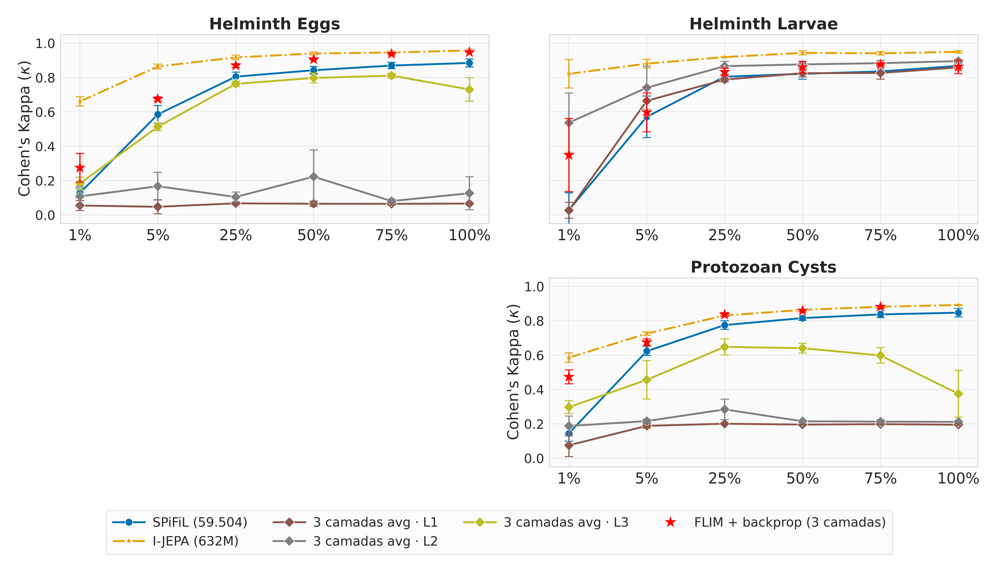
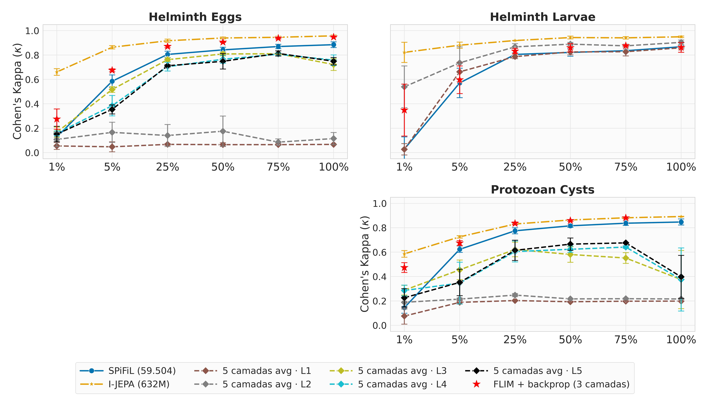
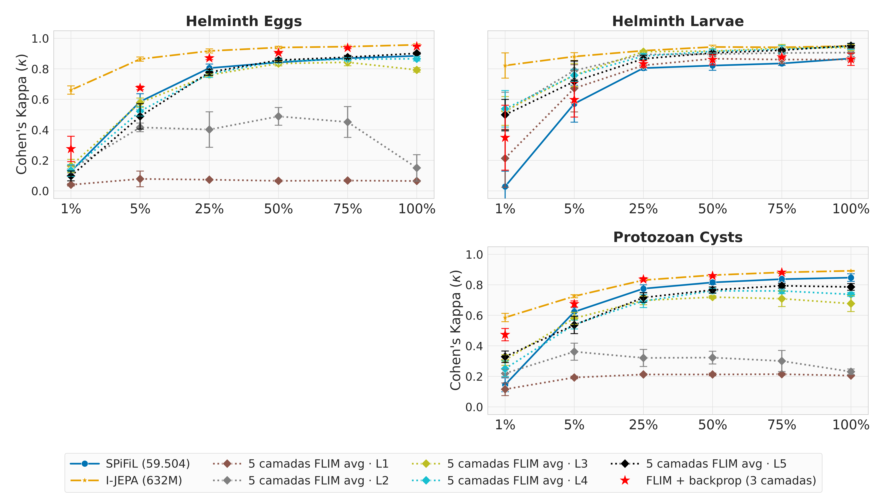

# Outubro 2026

## SPiFiL + I-JEPA: resultados por porcentagem

Teste, SVM oficial sobre o encoder congelado, média ± desvio dos 3 splits. Negrito = maior κ do
dataset naquela porcentagem.

| nome | o que é |
|---|---|
| SPiFiL | o encoder SPiFiL/FLIM de 3 camadas, sem treino (`SVM_FLIM`) |
| SPiFiL + backprop (3 camadas) | o mesmo encoder: decoder adaptado com o encoder congelado, depois backprop no encoder inteiro (`grid4` em 5% e 50%, `grid4_backprop` em 1/25/75/100%; `stage2`. Em 100% faltam eggs s1 e os 3 splits do protozoan: o treino morreu por falta de memória) |
| spifil_bckprop_L1…L3 | layerwise3: cresce do zero até a L3 |
| spifil_bckprop5_L1…L5 | layerwise5: cresce do zero até a L5 |
| spifil_flim_L1…L5 | layerwise5_flim: até a L5 como o FLIM de `data/` (classes sem impureza no eggs e protozoan, 24/32/48/64/96 filtros, kernel 5×5, DISF 50, sem a trava N ≤ D). `(n=…)` marca célula com menos de 3 splits |
| I-JEPA | referência, 632M parâmetros |

### Arquitetura de cada método

Todos recebem a imagem em LAB (cada canal entre 0 e 1), 200×200. Cada camada é uma convolução seguida de ReLU, sem
BatchNorm. A L1, a L2 e a L3 terminam num max-pool 3×3 com passo 2, que corta a imagem pela
metade; a L4 e a L5 não têm pooling. Números lidos dos `best_kappa.ckpt`, contando o encoder
uma vez só (o checkpoint guarda uma cópia duplicada).

| método | camadas | kernel | superpixel |
|---|---|---|---|
| SPiFiL | 3 | 5×5 | DISF (50) |
| SPiFiL + backprop (3 camadas) | 3 | 5×5 | DISF (50), herdado do SPiFiL |
| spifil_bckprop_L1…L3 | 3 (larvae para na L2) | 3×3 | SLIC (100) |
| spifil_bckprop5_L1…L5 | 5 (larvae para na L2) | 3×3 | SLIC (100) |
| spifil_flim_L1…L5 | 5 | 5×5 | DISF (50) |
| I-JEPA | ViT | — | — |

**O que muda entre eles**

- **SPiFiL + backprop tem a mesma forma do SPiFiL.** São os mesmos 59.504 parâmetros e o mesmo
  vetor de 27.648 números. Só os pesos mudam, pelo backprop.
- **flim × bckprop5:** o flim usa kernel 5×5 em vez de 3×3 e tem mais filtros. Na L5 ele tem
  290 mil parâmetros, contra 50 mil do bckprop5: quase 6 vezes mais.
- **Na L4 e na L5 não há pooling.** No bckprop5 o nº de filtros também não muda (45), então o
  vetor do SVM fica igual ao da L3. No flim os filtros sobem (64, 96), e o vetor cresce junto.
- **No larvae o bckprop para na L2.** A trava N ≤ D barra a L3; o flim não tem essa trava.

#### Bloco a bloco

Formas do eggs. No protozoan muda só o nº de filtros (SPiFiL 24-30-48; bckprop5 14-28-42-42-42;
flim 24-30-48-60-96). No larvae o bckprop5 para no bloco 2. `N_CLASSES`: eggs 9, larvae 2,
protozoan 7.

**SPiFiL**: pesos do FLIM, sem treino.

| Stage | Operation | Output Shape |
|---|---|---|
| Input | LAB image ([0, 1]) | 200 × 200 × 3 |
| Block 1 | FLIM convolution 5×5 + ReLU + max-pool 3×3/2 | 99 × 99 × 24 |
| Block 2 | FLIM convolution 5×5 + ReLU + max-pool 3×3/2 | 49 × 49 × 32 |
| Block 3 | FLIM convolution 5×5 + ReLU + max-pool 3×3/2 | 24 × 24 × 48 |
| Pooling | Flatten | 27.648 |
| Classifier | Linear SVM | N_CLASSES |

**SPiFiL + backprop (3 camadas)**: o mesmo encoder do SPiFiL, ajustado por backprop.

| Stage | Operation | Output Shape |
|---|---|---|
| Input | LAB image ([0, 1]) | 200 × 200 × 3 |
| Block 1 | FLIM convolution 5×5 + ReLU + max-pool 3×3/2 (backprop) | 99 × 99 × 24 |
| Block 2 | FLIM convolution 5×5 + ReLU + max-pool 3×3/2 (backprop) | 49 × 49 × 32 |
| Block 3 | FLIM convolution 5×5 + ReLU + max-pool 3×3/2 (backprop) | 24 × 24 × 48 |
| Pooling | Flatten | 27.648 |
| Classifier | Linear SVM | N_CLASSES |

**SPiFiL + backprop (5 camadas)** (`spifil_bckprop5_L5`): cresce do zero, uma camada por vez.

| Stage | Operation | Output Shape |
|---|---|---|
| Input | LAB image ([0, 1]) | 200 × 200 × 3 |
| Block 1 | SPiFiL convolution 3×3 + ReLU + max-pool 3×3/2 | 99 × 99 × 9 |
| Block 2 | SPiFiL convolution 3×3 + ReLU + max-pool 3×3/2 | 49 × 49 × 27 |
| Block 3 | SPiFiL convolution 3×3 + ReLU + max-pool 3×3/2 | 24 × 24 × 45 |
| Block 4 | SPiFiL convolution 3×3 + ReLU | 24 × 24 × 45 |
| Block 5 | SPiFiL convolution 3×3 + ReLU | 24 × 24 × 45 |
| Pooling | Flatten | 25.920 |
| Classifier | Linear SVM | N_CLASSES |

**spifil_flim_avg_L5**: cresce até a L5 como o FLIM; o SVM vê a média de cada canal.

| Stage | Operation | Output Shape |
|---|---|---|
| Input | LAB image ([0, 1]) | 200 × 200 × 3 |
| Block 1 | FLIM convolution 5×5 + ReLU + max-pool 3×3/2 | 99 × 99 × 24 |
| Block 2 | FLIM convolution 5×5 + ReLU + max-pool 3×3/2 | 49 × 49 × 32 |
| Block 3 | FLIM convolution 5×5 + ReLU + max-pool 3×3/2 | 24 × 24 × 48 |
| Block 4 | FLIM convolution 5×5 + ReLU | 24 × 24 × 64 |
| Block 5 | FLIM convolution 5×5 + ReLU | 24 × 24 × 96 |
| Pooling | Global average pooling | 96 |
| Classifier | Linear SVM | N_CLASSES |

O `layerwise5_flim` está completo no eval flatten (269 camadas). Sem a trava, o larvae chega
até a L5.

**Leitura rápida**

- **L4 e L5 não ajudam.** Em 100% a L5 fica um pouco abaixo da L3 (eggs 0,927 contra 0,935;
  protozoan 0,864 contra 0,874). Com pouco dado piora: eggs 5% cai de 0,734 (L1) para 0,546 (L5).
- **A L1–L3 do layerwise5 repete o layerwise3** (mesmo processo, mesma semente): os números batem
  na terceira casa.
- **SPiFiL + backprop (estrela vermelha)** fica perto da melhor camada: em eggs 5%, 0,675 contra
  0,734 da L1; em protozoan 5% é o melhor dos SPiFiL (0,675).
- **Com 25% ou mais, SPiFiL + backprop é o melhor dos SPiFiL em eggs e protozoan** (eggs 75%:
  0,938 contra 0,930 da flim_L3; protozoan 75%: 0,881 contra 0,877). Em 1% perde feio no eggs
  (0,275 contra 0,436 da L1), e no larvae fica atrás da flim_L3/L4 a partir de 25%.
- **I-JEPA continua na frente** em todas as células.

### Gráficos (κ)

3 camadas:

5 camadas:

5 camadas, como o FLIM:

### 1% dos dados

| Método | eggs κ | eggs F1 | eggs Acc | larvae κ | larvae F1 | larvae Acc | protozoan κ | protozoan F1 | protozoan Acc |
|---|---|---|---|---|---|---|---|---|---|
| SPiFiL | 0.1278 ± 0.0284 | 0.0952 ± 0.0170 | 0.1738 ± 0.0297 | 0.0284 ± 0.1004 | 0.3365 ± 0.4386 | 0.3899 ± 0.4281 | 0.1447 ± 0.0455 | 0.1422 ± 0.0183 | 0.2083 ± 0.0455 |
| SPiFiL + backprop (3 camadas) | 0.2748 ± 0.0832 | 0.3886 ± 0.0409 | 0.4532 ± 0.0139 | 0.3485 ± 0.2129 | 0.6640 ± 0.1183 | 0.6514 ± 0.1239 | 0.4734 ± 0.0404 | 0.5018 ± 0.0031 | 0.5315 ± 0.0220 |
| spifil_bckprop_L1 | 0.4356 ± 0.0418 | 0.5185 ± 0.0177 | 0.5758 ± 0.0799 | 0.2038 ± 0.1731 | 0.5855 ± 0.1000 | 0.5773 ± 0.0760 | 0.4707 ± 0.0061 | 0.5116 ± 0.0224 | 0.5181 ± 0.0289 |
| spifil_bckprop_L2 | 0.3975 ± 0.0786 | 0.4774 ± 0.0339 | 0.5498 ± 0.0302 | 0.3367 ± 0.1778 | 0.6584 ± 0.0994 | 0.6314 ± 0.0865 | 0.4751 ± 0.0098 | 0.5140 ± 0.0207 | 0.5382 ± 0.0330 |
| spifil_bckprop_L3 | 0.3358 ± 0.1024 | 0.4331 ± 0.0662 | 0.5102 ± 0.0181 | - | - | - | 0.4573 ± 0.0251 | 0.5056 ± 0.0192 | 0.5384 ± 0.0203 |
| spifil_bckprop5_L1 | 0.4356 ± 0.0418 | 0.5185 ± 0.0177 | 0.5758 ± 0.0799 | 0.2038 ± 0.1731 | 0.5855 ± 0.1000 | 0.5773 ± 0.0760 | 0.4705 ± 0.0062 | 0.5116 ± 0.0226 | 0.5180 ± 0.0289 |
| spifil_bckprop5_L2 | 0.3975 ± 0.0786 | 0.4772 ± 0.0337 | 0.5498 ± 0.0302 | 0.3367 ± 0.1778 | 0.6584 ± 0.0994 | 0.6314 ± 0.0865 | 0.4748 ± 0.0103 | 0.5137 ± 0.0205 | 0.5381 ± 0.0329 |
| spifil_bckprop5_L3 | 0.3336 ± 0.1069 | 0.4319 ± 0.0686 | 0.5102 ± 0.0181 | - | - | - | 0.4476 ± 0.0181 | 0.4988 ± 0.0192 | 0.5326 ± 0.0150 |
| spifil_bckprop5_L4 | 0.2767 ± 0.0396 | 0.3930 ± 0.0366 | 0.4875 ± 0.0632 | - | - | - | 0.4331 ± 0.0272 | 0.4822 ± 0.0028 | 0.5157 ± 0.0258 |
| spifil_bckprop5_L5 | 0.2499 ± 0.0207 | 0.3604 ± 0.0204 | 0.4337 ± 0.0681 | - | - | - | 0.4046 ± 0.0395 | 0.4582 ± 0.0176 | 0.5068 ± 0.0217 |
| spifil_flim_L1 | 0.4192 ± 0.0845 | 0.5042 ± 0.0193 | 0.5567 ± 0.0340 | 0.1692 ± 0.1160 | 0.5673 ± 0.0686 | 0.5577 ± 0.0406 | 0.4702 ± 0.0017 | 0.5014 ± 0.0230 | 0.5191 ± 0.0369 |
| spifil_flim_L2 | 0.3478 ± 0.0711 | 0.4449 ± 0.0261 | 0.5022 ± 0.0293 | 0.2314 ± 0.1498 | 0.6026 ± 0.0865 | 0.5846 ± 0.0572 | 0.4791 ± 0.0120 | 0.4992 ± 0.0170 | 0.5208 ± 0.0223 |
| spifil_flim_L3 | 0.2878 ± 0.0337 | 0.4074 ± 0.0058 | 0.4582 ± 0.0562 | 0.3536 ± 0.0896 | 0.6690 ± 0.0503 | 0.6308 ± 0.0423 | 0.4808 ± 0.0088 | 0.5030 ± 0.0102 | 0.5377 ± 0.0281 |
| spifil_flim_L4 | 0.2154 ± 0.0462 | 0.3427 ± 0.0278 | 0.3815 ± 0.0663 | 0.4278 ± 0.1063 | 0.7084 ± 0.0580 | 0.6828 ± 0.0918 | 0.4571 ± 0.0100 | 0.4950 ± 0.0041 | 0.5273 ± 0.0444 |
| spifil_flim_L5 | 0.1897 ± 0.0255 | 0.3232 ± 0.0398 | 0.3576 ± 0.0792 | 0.4451 ± 0.1660 | 0.7158 ± 0.0881 | 0.7094 ± 0.1519 | 0.4435 ± 0.0088 | 0.4891 ± 0.0037 | 0.5248 ± 0.0417 |
| I-JEPA | **0.6608 ± 0.0273** | 0.6518 ± 0.0198 | 0.6805 ± 0.0449 | **0.8216 ± 0.0825** | 0.9105 ± 0.0416 | 0.9241 ± 0.0413 | **0.5855 ± 0.0273** | 0.5593 ± 0.0151 | 0.5756 ± 0.0245 |

### 5% dos dados

| Método | eggs κ | eggs F1 | eggs Acc | larvae κ | larvae F1 | larvae Acc | protozoan κ | protozoan F1 | protozoan Acc |
|---|---|---|---|---|---|---|---|---|---|
| SPiFiL | 0.5852 ± 0.0513 | 0.7577 ± 0.0355 | 0.7512 ± 0.0374 | 0.5712 ± 0.1208 | 0.9125 ± 0.0232 | 0.9213 ± 0.0189 | 0.6230 ± 0.0254 | 0.7674 ± 0.0164 | 0.7646 ± 0.0184 |
| SPiFiL + backprop (3 camadas) | 0.6749 ± 0.0120 | 0.7152 ± 0.0020 | 0.7603 ± 0.0476 | 0.5971 ± 0.1135 | 0.7973 ± 0.0578 | 0.7562 ± 0.0592 | 0.6746 ± 0.0199 | 0.6780 ± 0.0194 | 0.6990 ± 0.0205 |
| spifil_bckprop_L1 | 0.7344 ± 0.0386 | 0.7703 ± 0.0306 | 0.7699 ± 0.0546 | 0.5428 ± 0.1547 | 0.7689 ± 0.0796 | 0.7242 ± 0.0786 | 0.6184 ± 0.0112 | 0.6384 ± 0.0301 | 0.6417 ± 0.0182 |
| spifil_bckprop_L2 | 0.6879 ± 0.0546 | 0.7234 ± 0.0531 | 0.7371 ± 0.0588 | 0.6049 ± 0.1933 | 0.8007 ± 0.0988 | 0.7685 ± 0.1134 | 0.6402 ± 0.0150 | 0.6520 ± 0.0335 | 0.6642 ± 0.0197 |
| spifil_bckprop_L3 | 0.6699 ± 0.0296 | 0.6994 ± 0.0289 | 0.7239 ± 0.0323 | - | - | - | 0.6343 ± 0.0343 | 0.6501 ± 0.0520 | 0.6667 ± 0.0427 |
| spifil_bckprop5_L1 | 0.7344 ± 0.0386 | 0.7703 ± 0.0306 | 0.7699 ± 0.0546 | 0.5428 ± 0.1547 | 0.7689 ± 0.0796 | 0.7242 ± 0.0786 | 0.6187 ± 0.0107 | 0.6385 ± 0.0299 | 0.6417 ± 0.0182 |
| spifil_bckprop5_L2 | 0.6881 ± 0.0543 | 0.7234 ± 0.0530 | 0.7372 ± 0.0588 | 0.6045 ± 0.1917 | 0.8006 ± 0.0979 | 0.7689 ± 0.1124 | 0.6398 ± 0.0171 | 0.6490 ± 0.0363 | 0.6602 ± 0.0220 |
| spifil_bckprop5_L3 | 0.6704 ± 0.0251 | 0.7039 ± 0.0268 | 0.7328 ± 0.0279 | - | - | - | 0.6251 ± 0.0405 | 0.6467 ± 0.0561 | 0.6687 ± 0.0471 |
| spifil_bckprop5_L4 | 0.6062 ± 0.0243 | 0.6563 ± 0.0290 | 0.6993 ± 0.0341 | - | - | - | 0.6026 ± 0.0350 | 0.6314 ± 0.0506 | 0.6605 ± 0.0452 |
| spifil_bckprop5_L5 | 0.5461 ± 0.0482 | 0.6126 ± 0.0302 | 0.6711 ± 0.0645 | - | - | - | 0.5756 ± 0.0238 | 0.6224 ± 0.0391 | 0.6563 ± 0.0454 |
| spifil_flim_L1 | 0.7222 ± 0.0469 | 0.7584 ± 0.0418 | 0.7670 ± 0.0473 | 0.5069 ± 0.1141 | 0.7509 ± 0.0590 | 0.7070 ± 0.0558 | 0.6206 ± 0.0275 | 0.6250 ± 0.0198 | 0.6353 ± 0.0113 |
| spifil_flim_L2 | 0.6966 ± 0.0492 | 0.7352 ± 0.0349 | 0.7712 ± 0.0427 | 0.5553 ± 0.1437 | 0.7758 ± 0.0738 | 0.7366 ± 0.0747 | 0.6336 ± 0.0324 | 0.6351 ± 0.0300 | 0.6565 ± 0.0178 |
| spifil_flim_L3 | 0.6498 ± 0.0593 | 0.6934 ± 0.0518 | 0.7498 ± 0.0490 | 0.6134 ± 0.1152 | 0.8062 ± 0.0577 | 0.7752 ± 0.0523 | 0.6485 ± 0.0361 | 0.6471 ± 0.0239 | 0.6718 ± 0.0133 |
| spifil_flim_L4 | 0.5768 ± 0.0353 | 0.6290 ± 0.0323 | 0.7038 ± 0.0506 | 0.6321 ± 0.1081 | 0.8156 ± 0.0546 | 0.7899 ± 0.0637 | 0.6270 ± 0.0384 | 0.6235 ± 0.0220 | 0.6533 ± 0.0140 |
| spifil_flim_L5 | 0.5424 ± 0.0349 | 0.6087 ± 0.0273 | 0.6875 ± 0.0393 | 0.6478 ± 0.1265 | 0.8235 ± 0.0638 | 0.8067 ± 0.0786 | 0.6215 ± 0.0457 | 0.6202 ± 0.0395 | 0.6525 ± 0.0359 |
| I-JEPA | **0.8639 ± 0.0135** | 0.8683 ± 0.0144 | 0.8696 ± 0.0278 | **0.8807 ± 0.0251** | 0.9403 ± 0.0126 | 0.9469 ± 0.0026 | **0.7251 ± 0.0098** | 0.6644 ± 0.0267 | 0.6628 ± 0.0200 |

### 25% dos dados

| Método | eggs κ | eggs F1 | eggs Acc | larvae κ | larvae F1 | larvae Acc | protozoan κ | protozoan F1 | protozoan Acc |
|---|---|---|---|---|---|---|---|---|---|
| SPiFiL | 0.8050 ± 0.0263 | 0.8885 ± 0.0161 | 0.8870 ± 0.0171 | 0.8049 ± 0.0142 | 0.9566 ± 0.0027 | 0.9566 ± 0.0023 | 0.7750 ± 0.0248 | 0.8628 ± 0.0152 | 0.8619 ± 0.0158 |
| SPiFiL + backprop (3 camadas) | 0.8698 ± 0.0102 | 0.8791 ± 0.0059 | 0.9030 ± 0.0126 | 0.8318 ± 0.0216 | 0.9159 ± 0.0108 | 0.9209 ± 0.0099 | 0.8360 ± 0.0109 | 0.8341 ± 0.0141 | 0.8510 ± 0.0095 |
| spifil_bckprop_L1 | 0.8558 ± 0.0249 | 0.8715 ± 0.0227 | 0.8878 ± 0.0033 | 0.7521 ± 0.0646 | 0.8761 ± 0.0323 | 0.8783 ± 0.0345 | 0.7135 ± 0.0075 | 0.7666 ± 0.0040 | 0.7847 ± 0.0121 |
| spifil_bckprop_L2 | 0.8585 ± 0.0131 | 0.8709 ± 0.0147 | 0.8930 ± 0.0070 | 0.7785 ± 0.0539 | 0.8892 ± 0.0270 | 0.8954 ± 0.0269 | 0.7749 ± 0.0126 | 0.7965 ± 0.0074 | 0.8088 ± 0.0079 |
| spifil_bckprop_L3 | 0.8562 ± 0.0120 | 0.8699 ± 0.0138 | 0.8939 ± 0.0107 | - | - | - | 0.8099 ± 0.0129 | 0.8139 ± 0.0099 | 0.8347 ± 0.0075 |
| spifil_bckprop5_L1 | 0.8558 ± 0.0249 | 0.8715 ± 0.0227 | 0.8878 ± 0.0033 | 0.7521 ± 0.0646 | 0.8761 ± 0.0323 | 0.8783 ± 0.0345 | 0.7143 ± 0.0061 | 0.7653 ± 0.0024 | 0.7846 ± 0.0118 |
| spifil_bckprop5_L2 | 0.8589 ± 0.0126 | 0.8702 ± 0.0128 | 0.8899 ± 0.0042 | 0.7803 ± 0.0516 | 0.8901 ± 0.0258 | 0.8963 ± 0.0245 | 0.7739 ± 0.0119 | 0.7938 ± 0.0056 | 0.8159 ± 0.0095 |
| spifil_bckprop5_L3 | 0.8567 ± 0.0142 | 0.8727 ± 0.0159 | 0.8995 ± 0.0111 | - | - | - | 0.8128 ± 0.0046 | 0.8206 ± 0.0079 | 0.8480 ± 0.0117 |
| spifil_bckprop5_L4 | 0.8375 ± 0.0083 | 0.8576 ± 0.0153 | 0.8880 ± 0.0158 | - | - | - | 0.7951 ± 0.0120 | 0.8120 ± 0.0155 | 0.8392 ± 0.0196 |
| spifil_bckprop5_L5 | 0.8152 ± 0.0138 | 0.8337 ± 0.0207 | 0.8639 ± 0.0252 | - | - | - | 0.7688 ± 0.0116 | 0.7934 ± 0.0067 | 0.8285 ± 0.0131 |
| spifil_flim_L1 | 0.8632 ± 0.0132 | 0.8769 ± 0.0156 | 0.8938 ± 0.0095 | 0.7860 ± 0.0474 | 0.8930 ± 0.0237 | 0.8942 ± 0.0211 | 0.7310 ± 0.0222 | 0.7722 ± 0.0063 | 0.7873 ± 0.0110 |
| spifil_flim_L2 | 0.8663 ± 0.0081 | 0.8754 ± 0.0152 | 0.8948 ± 0.0049 | 0.8011 ± 0.0372 | 0.9005 ± 0.0186 | 0.9030 ± 0.0182 | 0.7855 ± 0.0160 | 0.7966 ± 0.0065 | 0.8208 ± 0.0109 |
| spifil_flim_L3 | 0.8657 ± 0.0102 | 0.8748 ± 0.0171 | 0.8956 ± 0.0126 | 0.8416 ± 0.0485 | 0.9208 ± 0.0243 | 0.9295 ± 0.0150 | 0.8066 ± 0.0056 | 0.8091 ± 0.0135 | 0.8334 ± 0.0027 |
| spifil_flim_L4 | 0.8371 ± 0.0208 | 0.8492 ± 0.0251 | 0.8845 ± 0.0169 | 0.8499 ± 0.0598 | 0.9249 ± 0.0299 | 0.9338 ± 0.0234 | 0.7790 ± 0.0158 | 0.7934 ± 0.0035 | 0.8220 ± 0.0044 |
| spifil_flim_L5 | 0.8213 ± 0.0188 | 0.8371 ± 0.0271 | 0.8745 ± 0.0238 | 0.8373 ± 0.0683 | 0.9187 ± 0.0342 | 0.9271 ± 0.0277 | 0.7718 ± 0.0218 | 0.7964 ± 0.0075 | 0.8206 ± 0.0061 |
| I-JEPA | **0.9171 ± 0.0138** | 0.9278 ± 0.0089 | 0.9362 ± 0.0111 | **0.9190 ± 0.0005** | 0.9595 ± 0.0002 | 0.9659 ± 0.0029 | **0.8307 ± 0.0023** | 0.8189 ± 0.0024 | 0.8266 ± 0.0091 |

### 50% dos dados

| Método | eggs κ | eggs F1 | eggs Acc | larvae κ | larvae F1 | larvae Acc | protozoan κ | protozoan F1 | protozoan Acc |
|---|---|---|---|---|---|---|---|---|---|
| SPiFiL | 0.8423 ± 0.0222 | 0.9109 ± 0.0128 | 0.9097 ± 0.0129 | 0.8213 ± 0.0308 | 0.9606 ± 0.0065 | 0.9607 ± 0.0064 | 0.8158 ± 0.0128 | 0.8880 ± 0.0076 | 0.8875 ± 0.0079 |
| SPiFiL + backprop (3 camadas) | 0.9062 ± 0.0032 | 0.9137 ± 0.0038 | 0.9245 ± 0.0095 | 0.8593 ± 0.0336 | 0.9297 ± 0.0168 | 0.9310 ± 0.0147 | 0.8587 ± 0.0062 | 0.8511 ± 0.0055 | 0.8661 ± 0.0025 |
| spifil_bckprop_L1 | 0.8932 ± 0.0072 | 0.9051 ± 0.0110 | 0.9190 ± 0.0189 | 0.7875 ± 0.0349 | 0.8938 ± 0.0174 | 0.8920 ± 0.0184 | 0.7563 ± 0.0056 | 0.7811 ± 0.0002 | 0.8006 ± 0.0093 |
| spifil_bckprop_L2 | 0.9023 ± 0.0117 | 0.9142 ± 0.0100 | 0.9284 ± 0.0081 | 0.8124 ± 0.0149 | 0.9062 ± 0.0074 | 0.9059 ± 0.0060 | 0.8164 ± 0.0083 | 0.8261 ± 0.0079 | 0.8431 ± 0.0044 |
| spifil_bckprop_L3 | 0.9050 ± 0.0168 | 0.9136 ± 0.0155 | 0.9301 ± 0.0192 | - | - | - | 0.8480 ± 0.0031 | 0.8458 ± 0.0038 | 0.8567 ± 0.0178 |
| spifil_bckprop5_L1 | 0.8942 ± 0.0062 | 0.9058 ± 0.0101 | 0.9200 ± 0.0183 | 0.7875 ± 0.0349 | 0.8938 ± 0.0174 | 0.8920 ± 0.0184 | 0.7526 ± 0.0064 | 0.7792 ± 0.0021 | 0.7987 ± 0.0084 |
| spifil_bckprop5_L2 | 0.8986 ± 0.0066 | 0.9096 ± 0.0046 | 0.9241 ± 0.0065 | 0.8180 ± 0.0096 | 0.9090 ± 0.0048 | 0.9098 ± 0.0061 | 0.8165 ± 0.0099 | 0.8255 ± 0.0060 | 0.8380 ± 0.0082 |
| spifil_bckprop5_L3 | 0.8974 ± 0.0153 | 0.9078 ± 0.0197 | 0.9206 ± 0.0191 | - | - | - | 0.8453 ± 0.0083 | 0.8456 ± 0.0086 | 0.8545 ± 0.0016 |
| spifil_bckprop5_L4 | 0.8838 ± 0.0102 | 0.8950 ± 0.0174 | 0.9159 ± 0.0198 | - | - | - | 0.8199 ± 0.0112 | 0.8193 ± 0.0142 | 0.8369 ± 0.0110 |
| spifil_bckprop5_L5 | 0.8755 ± 0.0183 | 0.8896 ± 0.0201 | 0.9109 ± 0.0311 | - | - | - | 0.8070 ± 0.0022 | 0.8088 ± 0.0046 | 0.8289 ± 0.0129 |
| spifil_flim_L1 | 0.8993 ± 0.0120 | 0.9101 ± 0.0144 | 0.9200 ± 0.0172 | 0.7956 ± 0.0227 | 0.8978 ± 0.0114 | 0.8980 ± 0.0100 | 0.7826 ± 0.0216 | 0.7977 ± 0.0167 | 0.8152 ± 0.0125 |
| spifil_flim_L2 | 0.9064 ± 0.0030 | 0.9153 ± 0.0031 | 0.9238 ± 0.0124 | 0.8268 ± 0.0141 | 0.9134 ± 0.0070 | 0.9147 ± 0.0074 | 0.8395 ± 0.0031 | 0.8386 ± 0.0109 | 0.8507 ± 0.0150 |
| spifil_flim_L3 | 0.9094 ± 0.0098 | 0.9170 ± 0.0131 | 0.9278 ± 0.0158 | 0.8474 ± 0.0068 | 0.9237 ± 0.0034 | 0.9158 ± 0.0036 | 0.8544 ± 0.0074 | 0.8451 ± 0.0103 | 0.8516 ± 0.0162 |
| spifil_flim_L4 | 0.8995 ± 0.0114 | 0.9069 ± 0.0120 | 0.9210 ± 0.0176 | 0.8440 ± 0.0118 | 0.9220 ± 0.0059 | 0.9148 ± 0.0103 | 0.8425 ± 0.0069 | 0.8356 ± 0.0096 | 0.8500 ± 0.0153 |
| spifil_flim_L5 | 0.8959 ± 0.0063 | 0.9043 ± 0.0102 | 0.9200 ± 0.0163 | 0.8411 ± 0.0167 | 0.9206 ± 0.0083 | 0.9150 ± 0.0133 | 0.8336 ± 0.0079 | 0.8314 ± 0.0114 | 0.8507 ± 0.0151 |
| I-JEPA | **0.9397 ± 0.0081** | 0.9484 ± 0.0072 | 0.9489 ± 0.0094 | **0.9433 ± 0.0115** | 0.9717 ± 0.0057 | 0.9698 ± 0.0031 | **0.8636 ± 0.0032** | 0.8559 ± 0.0118 | 0.8570 ± 0.0050 |

### 75% dos dados

| Método | eggs κ | eggs F1 | eggs Acc | larvae κ | larvae F1 | larvae Acc | protozoan κ | protozoan F1 | protozoan Acc |
|---|---|---|---|---|---|---|---|---|---|
| SPiFiL | 0.8696 ± 0.0182 | 0.9267 ± 0.0105 | 0.9261 ± 0.0106 | 0.8353 ± 0.0132 | 0.9634 ± 0.0028 | 0.9632 ± 0.0026 | 0.8371 ± 0.0185 | 0.9014 ± 0.0112 | 0.9005 ± 0.0118 |
| SPiFiL + backprop (3 camadas) | 0.9378 ± 0.0056 | 0.9412 ± 0.0066 | 0.9495 ± 0.0078 | 0.8767 ± 0.0045 | 0.9384 ± 0.0022 | 0.9353 ± 0.0044 | 0.8811 ± 0.0076 | 0.8791 ± 0.0017 | 0.8897 ± 0.0086 |
| spifil_bckprop_L1 | 0.9046 ± 0.0123 | 0.9148 ± 0.0093 | 0.9297 ± 0.0180 | 0.8024 ± 0.0306 | 0.9012 ± 0.0153 | 0.9014 ± 0.0150 | 0.7765 ± 0.0118 | 0.8057 ± 0.0170 | 0.8251 ± 0.0265 |
| spifil_bckprop_L2 | 0.9150 ± 0.0070 | 0.9226 ± 0.0063 | 0.9333 ± 0.0102 | 0.8387 ± 0.0134 | 0.9194 ± 0.0067 | 0.9250 ± 0.0046 | 0.8324 ± 0.0138 | 0.8410 ± 0.0225 | 0.8579 ± 0.0263 |
| spifil_bckprop_L3 | 0.9223 ± 0.0059 | 0.9315 ± 0.0061 | 0.9383 ± 0.0089 | - | - | - | 0.8627 ± 0.0147 | 0.8635 ± 0.0203 | 0.8809 ± 0.0245 |
| spifil_bckprop5_L1 | 0.9040 ± 0.0135 | 0.9136 ± 0.0118 | 0.9272 ± 0.0212 | 0.8034 ± 0.0307 | 0.9017 ± 0.0154 | 0.9022 ± 0.0153 | 0.7786 ± 0.0200 | 0.8077 ± 0.0185 | 0.8263 ± 0.0277 |
| spifil_bckprop5_L2 | 0.9178 ± 0.0070 | 0.9225 ± 0.0058 | 0.9345 ± 0.0092 | 0.8244 ± 0.0216 | 0.9122 ± 0.0108 | 0.9156 ± 0.0080 | 0.8440 ± 0.0049 | 0.8554 ± 0.0083 | 0.8716 ± 0.0129 |
| spifil_bckprop5_L3 | 0.9207 ± 0.0102 | 0.9281 ± 0.0094 | 0.9381 ± 0.0135 | - | - | - | 0.8552 ± 0.0032 | 0.8604 ± 0.0077 | 0.8794 ± 0.0208 |
| spifil_bckprop5_L4 | 0.9097 ± 0.0073 | 0.9210 ± 0.0072 | 0.9333 ± 0.0114 | - | - | - | 0.8416 ± 0.0072 | 0.8439 ± 0.0168 | 0.8633 ± 0.0289 |
| spifil_bckprop5_L5 | 0.9041 ± 0.0020 | 0.9183 ± 0.0039 | 0.9345 ± 0.0032 | - | - | - | 0.8292 ± 0.0132 | 0.8352 ± 0.0179 | 0.8528 ± 0.0250 |
| spifil_flim_L1 | 0.9154 ± 0.0031 | 0.9246 ± 0.0058 | 0.9364 ± 0.0107 | 0.8046 ± 0.0169 | 0.9023 ± 0.0084 | 0.9072 ± 0.0112 | 0.8184 ± 0.0054 | 0.8342 ± 0.0137 | 0.8473 ± 0.0198 |
| spifil_flim_L2 | 0.9288 ± 0.0036 | 0.9332 ± 0.0028 | 0.9422 ± 0.0083 | 0.8549 ± 0.0102 | 0.9275 ± 0.0051 | 0.9285 ± 0.0004 | 0.8652 ± 0.0071 | 0.8617 ± 0.0126 | 0.8733 ± 0.0134 |
| spifil_flim_L3 | 0.9304 ± 0.0051 | 0.9355 ± 0.0056 | 0.9448 ± 0.0072 | 0.8890 ± 0.0180 | 0.9445 ± 0.0090 | 0.9456 ± 0.0091 | 0.8768 ± 0.0082 | 0.8701 ± 0.0131 | 0.8864 ± 0.0162 |
| spifil_flim_L4 | 0.9212 ± 0.0024 | 0.9317 ± 0.0026 | 0.9414 ± 0.0024 | 0.8946 ± 0.0077 | 0.9473 ± 0.0038 | 0.9464 ± 0.0041 | 0.8596 ± 0.0055 | 0.8628 ± 0.0106 | 0.8803 ± 0.0189 |
| spifil_flim_L5 | 0.9170 ± 0.0013 | 0.9278 ± 0.0017 | 0.9388 ± 0.0020 | 0.8898 ± 0.0054 | 0.9449 ± 0.0027 | 0.9457 ± 0.0051 | 0.8527 ± 0.0086 | 0.8591 ± 0.0041 | 0.8804 ± 0.0132 |
| I-JEPA | **0.9455 ± 0.0087** | 0.9527 ± 0.0073 | 0.9528 ± 0.0128 | **0.9410 ± 0.0094** | 0.9705 ± 0.0047 | 0.9708 ± 0.0059 | **0.8817 ± 0.0049** | 0.8692 ± 0.0143 | 0.8730 ± 0.0029 |

### 100% dos dados

| Método | eggs κ | eggs F1 | eggs Acc | larvae κ | larvae F1 | larvae Acc | protozoan κ | protozoan F1 | protozoan Acc |
|---|---|---|---|---|---|---|---|---|---|
| SPiFiL | 0.8848 ± 0.0236 | 0.9355 ± 0.0134 | 0.9348 ± 0.0138 | 0.8677 ± 0.0106 | 0.9706 ± 0.0023 | 0.9706 ± 0.0023 | 0.8470 ± 0.0250 | 0.9075 ± 0.0151 | 0.9069 ± 0.0156 |
| SPiFiL + backprop (3 camadas) | 0.9479 ± 0.0003 (n=2) | 0.9545 ± 0.0044 | 0.9563 ± 0.0020 | 0.8625 ± 0.0397 | 0.9312 ± 0.0199 | 0.9320 ± 0.0195 | - | - | - |
| spifil_bckprop_L1 | 0.9130 ± 0.0097 | 0.9221 ± 0.0118 | 0.9314 ± 0.0146 | 0.8297 ± 0.0206 | 0.9148 ± 0.0103 | 0.9163 ± 0.0085 | 0.7905 ± 0.0116 | 0.8199 ± 0.0026 | 0.8384 ± 0.0088 |
| spifil_bckprop_L2 | 0.9236 ± 0.0004 | 0.9313 ± 0.0026 | 0.9401 ± 0.0008 | 0.8701 ± 0.0121 | 0.9351 ± 0.0060 | 0.9418 ± 0.0099 | 0.8534 ± 0.0100 | 0.8585 ± 0.0065 | 0.8727 ± 0.0070 |
| spifil_bckprop_L3 | 0.9338 ± 0.0033 | 0.9406 ± 0.0056 | 0.9479 ± 0.0016 | - | - | - | 0.8754 ± 0.0040 | 0.8789 ± 0.0034 | 0.8985 ± 0.0033 |
| spifil_bckprop5_L1 | 0.9131 ± 0.0105 | 0.9217 ± 0.0136 | 0.9315 ± 0.0160 | 0.8289 ± 0.0205 | 0.9144 ± 0.0103 | 0.9162 ± 0.0087 | 0.7948 ± 0.0059 | 0.8195 ± 0.0116 | 0.8390 ± 0.0179 |
| spifil_bckprop5_L2 | 0.9227 ± 0.0101 | 0.9316 ± 0.0085 | 0.9341 ± 0.0076 | 0.8700 ± 0.0076 | 0.9350 ± 0.0038 | 0.9411 ± 0.0109 | 0.8530 ± 0.0078 | 0.8583 ± 0.0049 | 0.8734 ± 0.0126 |
| spifil_bckprop5_L3 | 0.9346 ± 0.0034 | 0.9409 ± 0.0012 | 0.9466 ± 0.0019 | - | - | - | 0.8736 ± 0.0123 | 0.8724 ± 0.0063 | 0.8860 ± 0.0098 |
| spifil_bckprop5_L4 | 0.9284 ± 0.0046 | 0.9380 ± 0.0009 | 0.9442 ± 0.0021 | - | - | - | 0.8659 ± 0.0063 | 0.8647 ± 0.0121 | 0.8854 ± 0.0144 |
| spifil_bckprop5_L5 | 0.9266 ± 0.0079 | 0.9365 ± 0.0052 | 0.9450 ± 0.0028 | - | - | - | 0.8644 ± 0.0059 | 0.8662 ± 0.0070 | 0.8870 ± 0.0124 |
| spifil_flim_L1 | 0.9181 ± 0.0056 | 0.9234 ± 0.0093 | 0.9339 ± 0.0115 | 0.8364 ± 0.0136 | 0.9182 ± 0.0068 | 0.9155 ± 0.0045 | 0.8159 ± 0.0061 | 0.8331 ± 0.0167 | 0.8567 ± 0.0164 |
| spifil_flim_L2 | 0.9340 ± 0.0076 | 0.9392 ± 0.0077 | 0.9463 ± 0.0048 | 0.8827 ± 0.0233 | 0.9413 ± 0.0117 | 0.9448 ± 0.0146 | 0.8629 ± 0.0046 | 0.8617 ± 0.0074 | 0.8782 ± 0.0114 |
| spifil_flim_L3 | 0.9410 ± 0.0024 | 0.9471 ± 0.0016 | 0.9493 ± 0.0040 | 0.9242 ± 0.0139 | 0.9621 ± 0.0070 | 0.9641 ± 0.0071 | 0.8759 ± 0.0048 | 0.8764 ± 0.0035 | 0.8939 ± 0.0115 |
| spifil_flim_L4 | 0.9373 ± 0.0053 | 0.9440 ± 0.0054 | 0.9476 ± 0.0038 | 0.9278 ± 0.0126 | 0.9639 ± 0.0063 | 0.9671 ± 0.0051 | 0.8664 ± 0.0014 | 0.8653 ± 0.0036 | 0.8896 ± 0.0108 |
| spifil_flim_L5 | 0.9320 ± 0.0048 | 0.9408 ± 0.0002 | 0.9430 ± 0.0035 | 0.9353 ± 0.0204 | 0.9677 ± 0.0102 | 0.9700 ± 0.0087 | 0.8652 ± 0.0005 (n=2) | 0.8662 ± 0.0051 | 0.8854 ± 0.0145 |
| I-JEPA | **0.9574 ± 0.0067** | 0.9626 ± 0.0063 | 0.9626 ± 0.0114 | **0.9495 ± 0.0065** | 0.9748 ± 0.0033 | 0.9751 ± 0.0054 | **0.8917 ± 0.0024** | 0.8841 ± 0.0046 | 0.8902 ± 0.0071 |

## SPiFiL + I-JEPA com avgpool2d

O mesmo SVM e os mesmos checkpoints, mas o SVM vê a **média de cada canal** (`avgpool2d`) em vez
do mapa achatado (`flatten`): de 9 a 96 números por imagem, contra dezenas de milhares.
Nomes com `_avg`. **SPiFiL e I-JEPA não têm versão avg**: são as mesmas linhas das tabelas acima,
repetidas como referência.

### Gráficos (κ, avgpool2d)

### 1% dos dados (avgpool2d)

| Método | eggs κ | eggs F1 | eggs Acc | larvae κ | larvae F1 | larvae Acc | protozoan κ | protozoan F1 | protozoan Acc |
|---|---|---|---|---|---|---|---|---|---|
| SPiFiL | 0.1278 ± 0.0284 | 0.0952 ± 0.0170 | 0.1738 ± 0.0297 | 0.0284 ± 0.1004 | 0.3365 ± 0.4386 | 0.3899 ± 0.4281 | 0.1447 ± 0.0455 | 0.1422 ± 0.0183 | 0.2083 ± 0.0455 |
| SPiFiL + backprop (3 camadas) | 0.2748 ± 0.0832 | 0.3886 ± 0.0409 | 0.4532 ± 0.0139 | 0.3485 ± 0.2129 | 0.6640 ± 0.1183 | 0.6514 ± 0.1239 | 0.4734 ± 0.0404 | 0.5018 ± 0.0031 | 0.5315 ± 0.0220 |
| spifil_bckprop_avg_L1 | 0.0547 ± 0.0290 | 0.1719 ± 0.0053 | 0.2042 ± 0.0136 | 0.0270 ± 0.0467 | 0.4828 ± 0.0290 | 0.5082 ± 0.0142 | 0.0753 ± 0.0657 | 0.1723 ± 0.0424 | 0.1953 ± 0.0459 |
| spifil_bckprop_avg_L2 | 0.1079 ± 0.0586 | 0.2215 ± 0.0210 | 0.2516 ± 0.0276 | 0.5368 ± 0.1727 | 0.7677 ± 0.0862 | 0.7682 ± 0.1169 | 0.1876 ± 0.0578 | 0.2911 ± 0.0203 | 0.3057 ± 0.0459 |
| spifil_bckprop_avg_L3 | 0.1830 ± 0.0367 | 0.2892 ± 0.0196 | 0.3487 ± 0.0295 | - | - | - | 0.2970 ± 0.0374 | 0.3812 ± 0.0458 | 0.3997 ± 0.0777 |
| spifil_bckprop5_avg_L1 | 0.0547 ± 0.0290 | 0.1719 ± 0.0053 | 0.2042 ± 0.0136 | 0.0270 ± 0.0467 | 0.4828 ± 0.0290 | 0.5082 ± 0.0142 | 0.0756 ± 0.0659 | 0.1724 ± 0.0425 | 0.1954 ± 0.0461 |
| spifil_bckprop5_avg_L2 | 0.1079 ± 0.0587 | 0.2216 ± 0.0209 | 0.2516 ± 0.0276 | 0.5391 ± 0.1712 | 0.7689 ± 0.0854 | 0.7691 ± 0.1162 | 0.1885 ± 0.0556 | 0.2921 ± 0.0188 | 0.3065 ± 0.0450 |
| spifil_bckprop5_avg_L3 | 0.1677 ± 0.0412 | 0.2823 ± 0.0290 | 0.3435 ± 0.0228 | - | - | - | 0.2880 ± 0.0401 | 0.3812 ± 0.0473 | 0.4008 ± 0.0815 |
| spifil_bckprop5_avg_L4 | 0.1587 ± 0.0186 | 0.2763 ± 0.0263 | 0.3398 ± 0.0730 | - | - | - | 0.2854 ± 0.0439 | 0.3808 ± 0.0402 | 0.3999 ± 0.0620 |
| spifil_bckprop5_avg_L5 | 0.1520 ± 0.0632 | 0.2691 ± 0.0370 | 0.3272 ± 0.0409 | - | - | - | 0.2259 ± 0.0745 | 0.3439 ± 0.0646 | 0.3705 ± 0.0997 |
| spifil_flim_avg_L1 | 0.0399 ± 0.0077 | 0.1920 ± 0.0140 | 0.2170 ± 0.0276 | 0.2134 ± 0.1899 | 0.5921 ± 0.1118 | 0.5838 ± 0.0769 | 0.1153 ± 0.0414 | 0.2243 ± 0.0303 | 0.2335 ± 0.0361 |
| spifil_flim_avg_L2 | 0.1414 ± 0.0245 | 0.2811 ± 0.0123 | 0.3155 ± 0.0357 | 0.5185 ± 0.1282 | 0.7580 ± 0.0646 | 0.7683 ± 0.1079 | 0.2193 ± 0.0263 | 0.3278 ± 0.0133 | 0.3425 ± 0.0408 |
| spifil_flim_avg_L3 | 0.1634 ± 0.0429 | 0.2995 ± 0.0416 | 0.3350 ± 0.0583 | 0.5235 ± 0.0943 | 0.7609 ± 0.0473 | 0.7540 ± 0.0827 | 0.3068 ± 0.0347 | 0.3886 ± 0.0280 | 0.4102 ± 0.0222 |
| spifil_flim_avg_L4 | 0.1334 ± 0.0390 | 0.2787 ± 0.0597 | 0.2919 ± 0.0511 | 0.5379 ± 0.1198 | 0.7678 ± 0.0590 | 0.7853 ± 0.1281 | 0.2498 ± 0.0511 | 0.3488 ± 0.0545 | 0.3548 ± 0.0708 |
| spifil_flim_avg_L5 | 0.0977 ± 0.0324 | 0.2506 ± 0.0524 | 0.2699 ± 0.0774 | 0.4985 ± 0.1010 | 0.7457 ± 0.0494 | 0.7654 ± 0.1409 | 0.3285 ± 0.0375 | 0.4033 ± 0.0217 | 0.4268 ± 0.0241 |
| I-JEPA | **0.6608 ± 0.0273** | 0.6518 ± 0.0198 | 0.6805 ± 0.0449 | **0.8216 ± 0.0825** | 0.9105 ± 0.0416 | 0.9241 ± 0.0413 | **0.5855 ± 0.0273** | 0.5593 ± 0.0151 | 0.5756 ± 0.0245 |

### 5% dos dados (avgpool2d)

| Método | eggs κ | eggs F1 | eggs Acc | larvae κ | larvae F1 | larvae Acc | protozoan κ | protozoan F1 | protozoan Acc |
|---|---|---|---|---|---|---|---|---|---|
| SPiFiL | 0.5852 ± 0.0513 | 0.7577 ± 0.0355 | 0.7512 ± 0.0374 | 0.5712 ± 0.1208 | 0.9125 ± 0.0232 | 0.9213 ± 0.0189 | 0.6230 ± 0.0254 | 0.7674 ± 0.0164 | 0.7646 ± 0.0184 |
| SPiFiL + backprop (3 camadas) | 0.6749 ± 0.0120 | 0.7152 ± 0.0020 | 0.7603 ± 0.0476 | 0.5971 ± 0.1135 | 0.7973 ± 0.0578 | 0.7562 ± 0.0592 | 0.6746 ± 0.0199 | 0.6780 ± 0.0194 | 0.6990 ± 0.0205 |
| spifil_bckprop_avg_L1 | 0.0475 ± 0.0412 | 0.1436 ± 0.0483 | 0.1636 ± 0.0455 | 0.6644 ± 0.0803 | 0.8313 ± 0.0410 | 0.7885 ± 0.0497 | 0.1884 ± 0.0143 | 0.2356 ± 0.0303 | 0.2665 ± 0.0255 |
| spifil_bckprop_avg_L2 | 0.1671 ± 0.0809 | 0.2623 ± 0.0667 | 0.2726 ± 0.0664 | 0.7406 ± 0.1252 | 0.8702 ± 0.0626 | 0.8584 ± 0.0644 | 0.2161 ± 0.0108 | 0.2592 ± 0.0348 | 0.2835 ± 0.0185 |
| spifil_bckprop_avg_L3 | 0.5136 ± 0.0222 | 0.5226 ± 0.0114 | 0.5354 ± 0.0093 | - | - | - | 0.4562 ± 0.1117 | 0.4899 ± 0.1198 | 0.4538 ± 0.1072 |
| spifil_bckprop5_avg_L1 | 0.0475 ± 0.0412 | 0.1436 ± 0.0483 | 0.1636 ± 0.0455 | 0.6620 ± 0.0786 | 0.8301 ± 0.0401 | 0.7870 ± 0.0491 | 0.1882 ± 0.0140 | 0.2355 ± 0.0302 | 0.2664 ± 0.0253 |
| spifil_bckprop5_avg_L2 | 0.1660 ± 0.0829 | 0.2615 ± 0.0680 | 0.2717 ± 0.0678 | 0.7358 ± 0.1303 | 0.8678 ± 0.0652 | 0.8543 ± 0.0685 | 0.2150 ± 0.0094 | 0.2596 ± 0.0335 | 0.2837 ± 0.0170 |
| spifil_bckprop5_avg_L3 | 0.5175 ± 0.0236 | 0.5300 ± 0.0079 | 0.5332 ± 0.0039 | - | - | - | 0.4547 ± 0.0802 | 0.5012 ± 0.1083 | 0.4624 ± 0.0993 |
| spifil_bckprop5_avg_L4 | 0.3845 ± 0.0835 | 0.4312 ± 0.0468 | 0.4430 ± 0.0644 | - | - | - | 0.3462 ± 0.1712 | 0.3973 ± 0.1623 | 0.3839 ± 0.1352 |
| spifil_bckprop5_avg_L5 | 0.3543 ± 0.0373 | 0.4201 ± 0.0471 | 0.4426 ± 0.0603 | - | - | - | 0.3517 ± 0.1085 | 0.4304 ± 0.1220 | 0.4142 ± 0.1011 |
| spifil_flim_avg_L1 | 0.0782 ± 0.0514 | 0.1967 ± 0.0655 | 0.2158 ± 0.0735 | 0.6721 ± 0.1546 | 0.8352 ± 0.0786 | 0.8100 ± 0.0957 | 0.1924 ± 0.0087 | 0.2518 ± 0.0314 | 0.2768 ± 0.0188 |
| spifil_flim_avg_L2 | 0.4160 ± 0.0280 | 0.4221 ± 0.0485 | 0.4246 ± 0.0315 | 0.7888 ± 0.0585 | 0.8944 ± 0.0293 | 0.9004 ± 0.0216 | 0.3617 ± 0.0559 | 0.3514 ± 0.0471 | 0.3499 ± 0.0341 |
| spifil_flim_avg_L3 | 0.5780 ± 0.0304 | 0.5987 ± 0.0213 | 0.6335 ± 0.0375 | 0.7591 ± 0.0752 | 0.8794 ± 0.0376 | 0.8622 ± 0.0387 | 0.5802 ± 0.0395 | 0.5724 ± 0.0470 | 0.5481 ± 0.0546 |
| spifil_flim_avg_L4 | 0.5216 ± 0.0309 | 0.5640 ± 0.0197 | 0.5922 ± 0.0166 | 0.7573 ± 0.0402 | 0.8786 ± 0.0201 | 0.8596 ± 0.0213 | 0.5396 ± 0.0290 | 0.5476 ± 0.0407 | 0.5334 ± 0.0502 |
| spifil_flim_avg_L5 | 0.4883 ± 0.0834 | 0.5549 ± 0.0650 | 0.6023 ± 0.0941 | 0.7169 ± 0.1362 | 0.8584 ± 0.0682 | 0.8475 ± 0.0757 | 0.5365 ± 0.0567 | 0.5371 ± 0.0762 | 0.5294 ± 0.0688 |
| I-JEPA | **0.8639 ± 0.0135** | 0.8683 ± 0.0144 | 0.8696 ± 0.0278 | **0.8807 ± 0.0251** | 0.9403 ± 0.0126 | 0.9469 ± 0.0026 | **0.7251 ± 0.0098** | 0.6644 ± 0.0267 | 0.6628 ± 0.0200 |

### 25% dos dados (avgpool2d)

| Método | eggs κ | eggs F1 | eggs Acc | larvae κ | larvae F1 | larvae Acc | protozoan κ | protozoan F1 | protozoan Acc |
|---|---|---|---|---|---|---|---|---|---|
| SPiFiL | 0.8050 ± 0.0263 | 0.8885 ± 0.0161 | 0.8870 ± 0.0171 | 0.8049 ± 0.0142 | 0.9566 ± 0.0027 | 0.9566 ± 0.0023 | 0.7750 ± 0.0248 | 0.8628 ± 0.0152 | 0.8619 ± 0.0158 |
| SPiFiL + backprop (3 camadas) | 0.8698 ± 0.0102 | 0.8791 ± 0.0059 | 0.9030 ± 0.0126 | 0.8318 ± 0.0216 | 0.9159 ± 0.0108 | 0.9209 ± 0.0099 | 0.8360 ± 0.0109 | 0.8341 ± 0.0141 | 0.8510 ± 0.0095 |
| spifil_bckprop_avg_L1 | 0.0674 ± 0.0069 | 0.1677 ± 0.0071 | 0.1844 ± 0.0058 | 0.7878 ± 0.0133 | 0.8939 ± 0.0067 | 0.8831 ± 0.0107 | 0.2008 ± 0.0026 | 0.2265 ± 0.0007 | 0.2605 ± 0.0022 |
| spifil_bckprop_avg_L2 | 0.1044 ± 0.0291 | 0.2178 ± 0.0440 | 0.2263 ± 0.0298 | 0.8662 ± 0.0278 | 0.9330 ± 0.0140 | 0.9466 ± 0.0138 | 0.2840 ± 0.0599 | 0.2880 ± 0.0285 | 0.2990 ± 0.0142 |
| spifil_bckprop_avg_L3 | 0.7631 ± 0.0144 | 0.7501 ± 0.0301 | 0.7394 ± 0.0262 | - | - | - | 0.6479 ± 0.0468 | 0.6311 ± 0.0471 | 0.5766 ± 0.0507 |
| spifil_bckprop5_avg_L1 | 0.0674 ± 0.0069 | 0.1677 ± 0.0071 | 0.1844 ± 0.0058 | 0.7870 ± 0.0171 | 0.8935 ± 0.0086 | 0.8830 ± 0.0130 | 0.2030 ± 0.0033 | 0.2271 ± 0.0004 | 0.2619 ± 0.0027 |
| spifil_bckprop5_avg_L2 | 0.1402 ± 0.0902 | 0.2445 ± 0.0879 | 0.2540 ± 0.0746 | 0.8670 ± 0.0266 | 0.9335 ± 0.0133 | 0.9443 ± 0.0110 | 0.2477 ± 0.0132 | 0.2583 ± 0.0040 | 0.2815 ± 0.0037 |
| spifil_bckprop5_avg_L3 | 0.7618 ± 0.0143 | 0.7469 ± 0.0228 | 0.7466 ± 0.0138 | - | - | - | 0.6220 ± 0.0597 | 0.5799 ± 0.0303 | 0.5333 ± 0.0354 |
| spifil_bckprop5_avg_L4 | 0.7045 ± 0.0359 | 0.6944 ± 0.0171 | 0.6820 ± 0.0378 | - | - | - | 0.6048 ± 0.0853 | 0.5891 ± 0.0966 | 0.5424 ± 0.0862 |
| spifil_bckprop5_avg_L5 | 0.7120 ± 0.0090 | 0.6992 ± 0.0121 | 0.6832 ± 0.0128 | - | - | - | 0.6148 ± 0.0832 | 0.6257 ± 0.1042 | 0.5875 ± 0.0982 |
| spifil_flim_avg_L1 | 0.0731 ± 0.0042 | 0.1794 ± 0.0167 | 0.1923 ± 0.0084 | 0.8228 ± 0.0173 | 0.9114 ± 0.0086 | 0.9148 ± 0.0324 | 0.2122 ± 0.0052 | 0.2438 ± 0.0120 | 0.2732 ± 0.0078 |
| spifil_flim_avg_L2 | 0.4018 ± 0.1164 | 0.4207 ± 0.0909 | 0.4041 ± 0.0665 | 0.8943 ± 0.0081 | 0.9472 ± 0.0040 | 0.9600 ± 0.0088 | 0.3208 ± 0.0560 | 0.3521 ± 0.0487 | 0.3428 ± 0.0379 |
| spifil_flim_avg_L3 | 0.7592 ± 0.0070 | 0.7333 ± 0.0174 | 0.7337 ± 0.0046 | 0.9122 ± 0.0085 | 0.9561 ± 0.0042 | 0.9619 ± 0.0057 | 0.6975 ± 0.0280 | 0.7299 ± 0.0112 | 0.6965 ± 0.0284 |
| spifil_flim_avg_L4 | 0.7667 ± 0.0232 | 0.7586 ± 0.0255 | 0.7626 ± 0.0220 | 0.8834 ± 0.0179 | 0.9417 ± 0.0089 | 0.9418 ± 0.0218 | 0.6938 ± 0.0429 | 0.7187 ± 0.0438 | 0.6937 ± 0.0617 |
| spifil_flim_avg_L5 | 0.7775 ± 0.0205 | 0.7917 ± 0.0389 | 0.8098 ± 0.0451 | 0.8659 ± 0.0235 | 0.9330 ± 0.0117 | 0.9331 ± 0.0130 | 0.7166 ± 0.0310 | 0.7627 ± 0.0121 | 0.7444 ± 0.0273 |
| I-JEPA | **0.9171 ± 0.0138** | 0.9278 ± 0.0089 | 0.9362 ± 0.0111 | **0.9190 ± 0.0005** | 0.9595 ± 0.0002 | 0.9659 ± 0.0029 | **0.8307 ± 0.0023** | 0.8189 ± 0.0024 | 0.8266 ± 0.0091 |

### 50% dos dados (avgpool2d)

| Método | eggs κ | eggs F1 | eggs Acc | larvae κ | larvae F1 | larvae Acc | protozoan κ | protozoan F1 | protozoan Acc |
|---|---|---|---|---|---|---|---|---|---|
| SPiFiL | 0.8423 ± 0.0222 | 0.9109 ± 0.0128 | 0.9097 ± 0.0129 | 0.8213 ± 0.0308 | 0.9606 ± 0.0065 | 0.9607 ± 0.0064 | 0.8158 ± 0.0128 | 0.8880 ± 0.0076 | 0.8875 ± 0.0079 |
| SPiFiL + backprop (3 camadas) | 0.9062 ± 0.0032 | 0.9137 ± 0.0038 | 0.9245 ± 0.0095 | 0.8593 ± 0.0336 | 0.9297 ± 0.0168 | 0.9310 ± 0.0147 | 0.8587 ± 0.0062 | 0.8511 ± 0.0055 | 0.8661 ± 0.0025 |
| spifil_bckprop_avg_L1 | 0.0652 ± 0.0152 | 0.1661 ± 0.0125 | 0.1820 ± 0.0150 | 0.8251 ± 0.0215 | 0.9125 ± 0.0108 | 0.9169 ± 0.0246 | 0.1957 ± 0.0027 | 0.2251 ± 0.0028 | 0.2586 ± 0.0009 |
| spifil_bckprop_avg_L2 | 0.2229 ± 0.1558 | 0.2921 ± 0.1303 | 0.2977 ± 0.1205 | 0.8762 ± 0.0176 | 0.9381 ± 0.0088 | 0.9457 ± 0.0127 | 0.2150 ± 0.0049 | 0.2441 ± 0.0092 | 0.2717 ± 0.0013 |
| spifil_bckprop_avg_L3 | 0.7973 ± 0.0290 | 0.7727 ± 0.0269 | 0.7590 ± 0.0341 | - | - | - | 0.6404 ± 0.0286 | 0.5891 ± 0.0276 | 0.5349 ± 0.0318 |
| spifil_bckprop5_avg_L1 | 0.0652 ± 0.0152 | 0.1661 ± 0.0125 | 0.1820 ± 0.0150 | 0.8253 ± 0.0237 | 0.9126 ± 0.0119 | 0.9176 ± 0.0250 | 0.1932 ± 0.0041 | 0.2262 ± 0.0053 | 0.2587 ± 0.0015 |
| spifil_bckprop5_avg_L2 | 0.1755 ± 0.1244 | 0.2661 ± 0.1154 | 0.2677 ± 0.0999 | 0.8893 ± 0.0142 | 0.9446 ± 0.0071 | 0.9476 ± 0.0132 | 0.2166 ± 0.0027 | 0.2428 ± 0.0092 | 0.2713 ± 0.0048 |
| spifil_bckprop5_avg_L3 | 0.8090 ± 0.0154 | 0.8060 ± 0.0109 | 0.7931 ± 0.0278 | - | - | - | 0.5807 ± 0.0637 | 0.5201 ± 0.0744 | 0.4892 ± 0.0650 |
| spifil_bckprop5_avg_L4 | 0.7651 ± 0.0321 | 0.7402 ± 0.0269 | 0.7264 ± 0.0377 | - | - | - | 0.6234 ± 0.0251 | 0.5964 ± 0.0160 | 0.5473 ± 0.0152 |
| spifil_bckprop5_avg_L5 | 0.7484 ± 0.0634 | 0.7412 ± 0.0573 | 0.7189 ± 0.0604 | - | - | - | 0.6655 ± 0.0502 | 0.6526 ± 0.0708 | 0.6123 ± 0.0795 |
| spifil_flim_avg_L1 | 0.0656 ± 0.0061 | 0.1725 ± 0.0117 | 0.1819 ± 0.0062 | 0.8664 ± 0.0149 | 0.9332 ± 0.0074 | 0.9394 ± 0.0160 | 0.2123 ± 0.0089 | 0.2473 ± 0.0081 | 0.2736 ± 0.0078 |
| spifil_flim_avg_L2 | 0.4883 ± 0.0579 | 0.5165 ± 0.0358 | 0.4873 ± 0.0369 | 0.8962 ± 0.0104 | 0.9481 ± 0.0052 | 0.9510 ± 0.0088 | 0.3229 ± 0.0418 | 0.3554 ± 0.0235 | 0.3472 ± 0.0184 |
| spifil_flim_avg_L3 | 0.8343 ± 0.0145 | 0.8356 ± 0.0246 | 0.8232 ± 0.0284 | 0.9164 ± 0.0159 | 0.9582 ± 0.0079 | 0.9612 ± 0.0182 | 0.7193 ± 0.0089 | 0.7250 ± 0.0341 | 0.6862 ± 0.0384 |
| spifil_flim_avg_L4 | 0.8507 ± 0.0127 | 0.8600 ± 0.0160 | 0.8554 ± 0.0139 | 0.9148 ± 0.0142 | 0.9574 ± 0.0071 | 0.9628 ± 0.0030 | 0.7605 ± 0.0164 | 0.7841 ± 0.0174 | 0.7575 ± 0.0177 |
| spifil_flim_avg_L5 | 0.8570 ± 0.0135 | 0.8699 ± 0.0120 | 0.8840 ± 0.0242 | 0.9041 ± 0.0081 | 0.9521 ± 0.0041 | 0.9571 ± 0.0179 | 0.7662 ± 0.0197 | 0.7856 ± 0.0066 | 0.7680 ± 0.0085 |
| I-JEPA | **0.9397 ± 0.0081** | 0.9484 ± 0.0072 | 0.9489 ± 0.0094 | **0.9433 ± 0.0115** | 0.9717 ± 0.0057 | 0.9698 ± 0.0031 | **0.8636 ± 0.0032** | 0.8559 ± 0.0118 | 0.8570 ± 0.0050 |

### 75% dos dados (avgpool2d)

| Método | eggs κ | eggs F1 | eggs Acc | larvae κ | larvae F1 | larvae Acc | protozoan κ | protozoan F1 | protozoan Acc |
|---|---|---|---|---|---|---|---|---|---|
| SPiFiL | 0.8696 ± 0.0182 | 0.9267 ± 0.0105 | 0.9261 ± 0.0106 | 0.8353 ± 0.0132 | 0.9634 ± 0.0028 | 0.9632 ± 0.0026 | 0.8371 ± 0.0185 | 0.9014 ± 0.0112 | 0.9005 ± 0.0118 |
| SPiFiL + backprop (3 camadas) | 0.9378 ± 0.0056 | 0.9412 ± 0.0066 | 0.9495 ± 0.0078 | 0.8767 ± 0.0045 | 0.9384 ± 0.0022 | 0.9353 ± 0.0044 | 0.8811 ± 0.0076 | 0.8791 ± 0.0017 | 0.8897 ± 0.0086 |
| spifil_bckprop_avg_L1 | 0.0648 ± 0.0073 | 0.1664 ± 0.0060 | 0.1803 ± 0.0069 | 0.8265 ± 0.0358 | 0.9132 ± 0.0179 | 0.9106 ± 0.0357 | 0.1982 ± 0.0033 | 0.2250 ± 0.0017 | 0.2595 ± 0.0028 |
| spifil_bckprop_avg_L2 | 0.0807 ± 0.0110 | 0.1834 ± 0.0193 | 0.1970 ± 0.0078 | 0.8835 ± 0.0165 | 0.9417 ± 0.0083 | 0.9473 ± 0.0084 | 0.2129 ± 0.0105 | 0.2377 ± 0.0122 | 0.2676 ± 0.0085 |
| spifil_bckprop_avg_L3 | 0.8111 ± 0.0137 | 0.7770 ± 0.0273 | 0.7635 ± 0.0202 | - | - | - | 0.5981 ± 0.0452 | 0.5611 ± 0.0751 | 0.5179 ± 0.0627 |
| spifil_bckprop5_avg_L1 | 0.0652 ± 0.0066 | 0.1667 ± 0.0056 | 0.1809 ± 0.0059 | 0.8272 ± 0.0345 | 0.9136 ± 0.0173 | 0.9107 ± 0.0355 | 0.1976 ± 0.0041 | 0.2246 ± 0.0021 | 0.2596 ± 0.0031 |
| spifil_bckprop5_avg_L2 | 0.0859 ± 0.0263 | 0.1849 ± 0.0258 | 0.1965 ± 0.0139 | 0.8754 ± 0.0147 | 0.9377 ± 0.0074 | 0.9450 ± 0.0115 | 0.2180 ± 0.0052 | 0.2451 ± 0.0188 | 0.2742 ± 0.0112 |
| spifil_bckprop5_avg_L3 | 0.8105 ± 0.0048 | 0.7992 ± 0.0289 | 0.7870 ± 0.0252 | - | - | - | 0.5517 ± 0.0441 | 0.5369 ± 0.0213 | 0.4879 ± 0.0189 |
| spifil_bckprop5_avg_L4 | 0.8067 ± 0.0101 | 0.7741 ± 0.0084 | 0.7693 ± 0.0110 | - | - | - | 0.6414 ± 0.0106 | 0.6077 ± 0.0291 | 0.5616 ± 0.0208 |
| spifil_bckprop5_avg_L5 | 0.8129 ± 0.0214 | 0.7974 ± 0.0420 | 0.7912 ± 0.0374 | - | - | - | 0.6760 ± 0.0042 | 0.6736 ± 0.0139 | 0.6302 ± 0.0164 |
| spifil_flim_avg_L1 | 0.0674 ± 0.0058 | 0.1692 ± 0.0048 | 0.1834 ± 0.0055 | 0.8607 ± 0.0269 | 0.9304 ± 0.0134 | 0.9325 ± 0.0229 | 0.2142 ± 0.0066 | 0.2440 ± 0.0227 | 0.2740 ± 0.0151 |
| spifil_flim_avg_L2 | 0.4513 ± 0.1009 | 0.4942 ± 0.0692 | 0.4742 ± 0.0525 | 0.9040 ± 0.0103 | 0.9520 ± 0.0051 | 0.9589 ± 0.0080 | 0.3004 ± 0.0692 | 0.3197 ± 0.0353 | 0.3236 ± 0.0234 |
| spifil_flim_avg_L3 | 0.8429 ± 0.0226 | 0.8306 ± 0.0492 | 0.8232 ± 0.0416 | 0.9363 ± 0.0232 | 0.9682 ± 0.0116 | 0.9714 ± 0.0111 | 0.7091 ± 0.0516 | 0.7061 ± 0.0260 | 0.6587 ± 0.0336 |
| spifil_flim_avg_L4 | 0.8629 ± 0.0110 | 0.8738 ± 0.0232 | 0.8746 ± 0.0369 | 0.9280 ± 0.0246 | 0.9640 ± 0.0123 | 0.9684 ± 0.0113 | 0.7599 ± 0.0181 | 0.7817 ± 0.0144 | 0.7543 ± 0.0122 |
| spifil_flim_avg_L5 | 0.8764 ± 0.0108 | 0.8933 ± 0.0080 | 0.9032 ± 0.0215 | 0.9217 ± 0.0090 | 0.9609 ± 0.0045 | 0.9632 ± 0.0040 | 0.7938 ± 0.0145 | 0.8100 ± 0.0083 | 0.7988 ± 0.0062 |
| I-JEPA | **0.9455 ± 0.0087** | 0.9527 ± 0.0073 | 0.9528 ± 0.0128 | **0.9410 ± 0.0094** | 0.9705 ± 0.0047 | 0.9708 ± 0.0059 | **0.8817 ± 0.0049** | 0.8692 ± 0.0143 | 0.8730 ± 0.0029 |

### 100% dos dados (avgpool2d)

| Método | eggs κ | eggs F1 | eggs Acc | larvae κ | larvae F1 | larvae Acc | protozoan κ | protozoan F1 | protozoan Acc |
|---|---|---|---|---|---|---|---|---|---|
| SPiFiL | 0.8848 ± 0.0236 | 0.9355 ± 0.0134 | 0.9348 ± 0.0138 | 0.8677 ± 0.0106 | 0.9706 ± 0.0023 | 0.9706 ± 0.0023 | 0.8470 ± 0.0250 | 0.9075 ± 0.0151 | 0.9069 ± 0.0156 |
| SPiFiL + backprop (3 camadas) | 0.9479 ± 0.0003 (n=2) | 0.9545 ± 0.0044 | 0.9563 ± 0.0020 | 0.8625 ± 0.0397 | 0.9312 ± 0.0199 | 0.9320 ± 0.0195 | - | - | - |
| spifil_bckprop_avg_L1 | 0.0662 ± 0.0012 | 0.1671 ± 0.0020 | 0.1826 ± 0.0009 | 0.8584 ± 0.0133 | 0.9292 ± 0.0067 | 0.9284 ± 0.0114 | 0.1950 ± 0.0051 | 0.2232 ± 0.0023 | 0.2587 ± 0.0029 |
| spifil_bckprop_avg_L2 | 0.1263 ± 0.0958 | 0.2268 ± 0.0963 | 0.2359 ± 0.0833 | 0.8954 ± 0.0074 | 0.9477 ± 0.0037 | 0.9502 ± 0.0039 | 0.2114 ± 0.0023 | 0.2312 ± 0.0012 | 0.2657 ± 0.0008 |
| spifil_bckprop_avg_L3 | 0.7303 ± 0.0680 | 0.6880 ± 0.0632 | 0.6691 ± 0.0618 | - | - | - | 0.3750 ± 0.1364 | 0.3486 ± 0.1069 | 0.3495 ± 0.0800 |
| spifil_bckprop5_avg_L1 | 0.0672 ± 0.0006 | 0.1677 ± 0.0015 | 0.1838 ± 0.0009 | 0.8594 ± 0.0117 | 0.9297 ± 0.0059 | 0.9292 ± 0.0101 | 0.1984 ± 0.0024 | 0.2249 ± 0.0021 | 0.2601 ± 0.0008 |
| spifil_bckprop5_avg_L2 | 0.1152 ± 0.0495 | 0.2068 ± 0.0338 | 0.2139 ± 0.0290 | 0.9037 ± 0.0191 | 0.9518 ± 0.0095 | 0.9545 ± 0.0171 | 0.2160 ± 0.0022 | 0.2329 ± 0.0014 | 0.2683 ± 0.0013 |
| spifil_bckprop5_avg_L3 | 0.7220 ± 0.0485 | 0.6832 ± 0.0470 | 0.6593 ± 0.0497 | - | - | - | 0.3751 ± 0.2388 | 0.3695 ± 0.1721 | 0.3739 ± 0.1409 |
| spifil_bckprop5_avg_L4 | 0.7577 ± 0.0430 | 0.7194 ± 0.0544 | 0.6997 ± 0.0601 | - | - | - | 0.3756 ± 0.2591 | 0.3807 ± 0.2187 | 0.3795 ± 0.1683 |
| spifil_bckprop5_avg_L5 | 0.7494 ± 0.0307 | 0.7261 ± 0.0297 | 0.6995 ± 0.0285 | - | - | - | 0.3974 ± 0.1758 | 0.3655 ± 0.1541 | 0.3631 ± 0.1110 |
| spifil_flim_avg_L1 | 0.0645 ± 0.0042 | 0.1670 ± 0.0041 | 0.1803 ± 0.0039 | 0.8613 ± 0.0136 | 0.9306 ± 0.0068 | 0.9362 ± 0.0181 | 0.2046 ± 0.0027 | 0.2273 ± 0.0012 | 0.2635 ± 0.0015 |
| spifil_flim_avg_L2 | 0.1505 ± 0.0862 | 0.2509 ± 0.0779 | 0.2485 ± 0.0576 | 0.9061 ± 0.0250 | 0.9531 ± 0.0125 | 0.9548 ± 0.0161 | 0.2305 ± 0.0178 | 0.2621 ± 0.0395 | 0.2860 ± 0.0255 |
| spifil_flim_avg_L3 | 0.7928 ± 0.0145 | 0.7593 ± 0.0099 | 0.7395 ± 0.0165 | 0.9389 ± 0.0196 | 0.9694 ± 0.0098 | 0.9680 ± 0.0169 | 0.6766 ± 0.0521 | 0.6435 ± 0.0499 | 0.6000 ± 0.0455 |
| spifil_flim_avg_L4 | 0.8660 ± 0.0146 | 0.8749 ± 0.0205 | 0.8559 ± 0.0210 | 0.9471 ± 0.0200 | 0.9736 ± 0.0100 | 0.9760 ± 0.0124 | 0.7374 ± 0.0124 | 0.7438 ± 0.0290 | 0.7074 ± 0.0316 |
| spifil_flim_avg_L5 | 0.9014 ± 0.0070 | 0.9129 ± 0.0062 | 0.9115 ± 0.0120 | **0.9518 ± 0.0149** | 0.9759 ± 0.0074 | 0.9804 ± 0.0058 | 0.7860 ± 0.0219 (n=2) | 0.8207 ± 0.0141 | 0.8074 ± 0.0260 |
| I-JEPA | **0.9574 ± 0.0067** | 0.9626 ± 0.0063 | 0.9626 ± 0.0114 | 0.9495 ± 0.0065 | 0.9748 ± 0.0033 | 0.9751 ± 0.0054 | **0.8917 ± 0.0024** | 0.8841 ± 0.0046 | 0.8902 ± 0.0071 |
