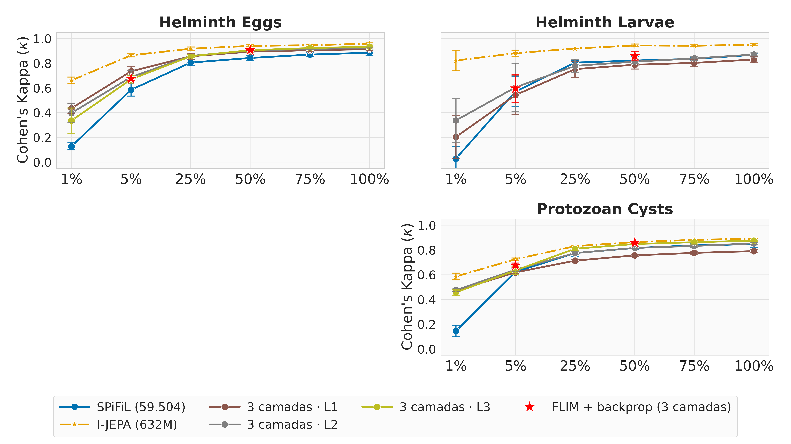
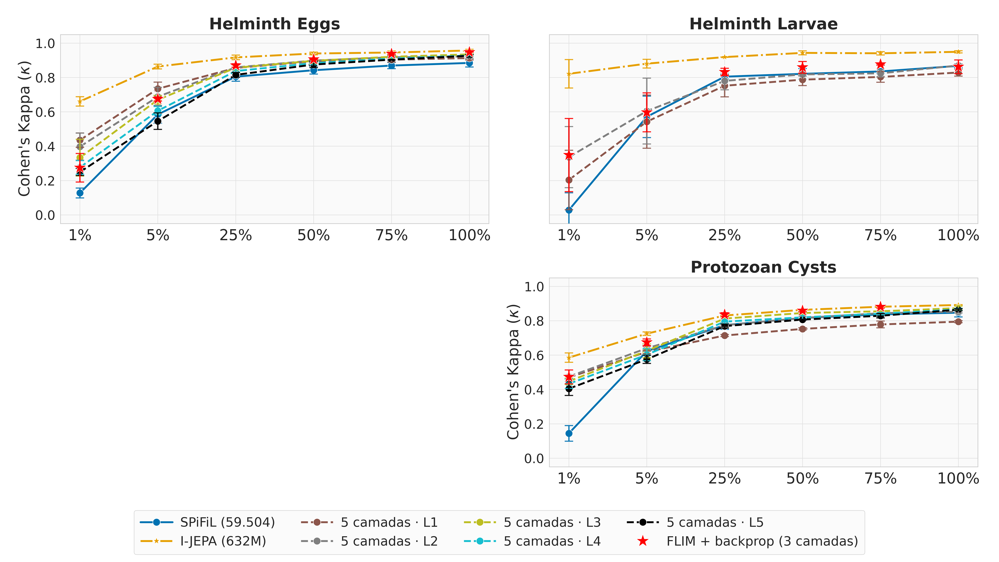
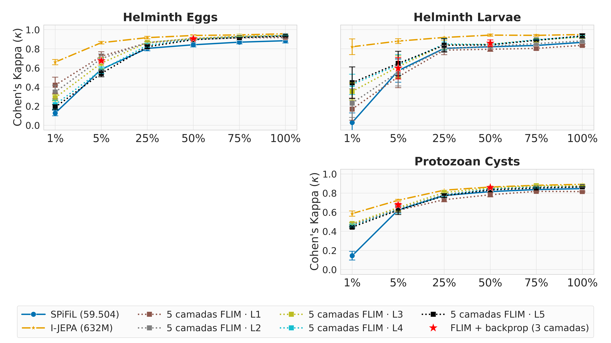
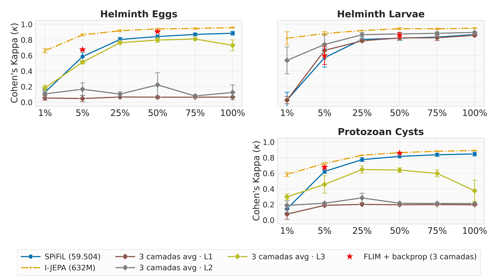
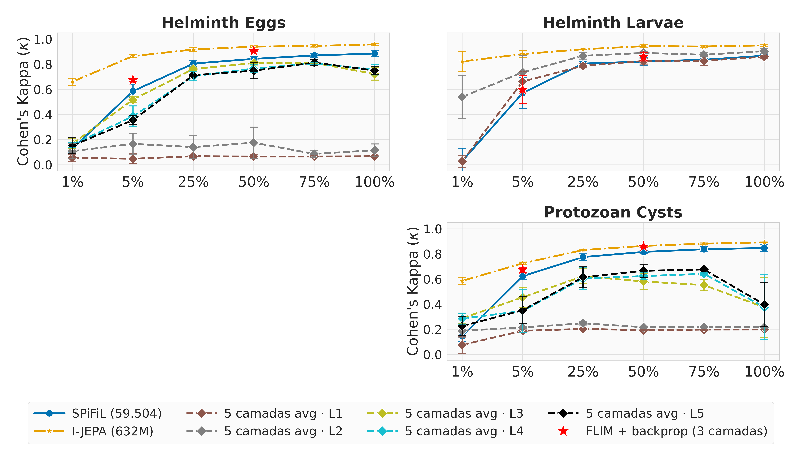
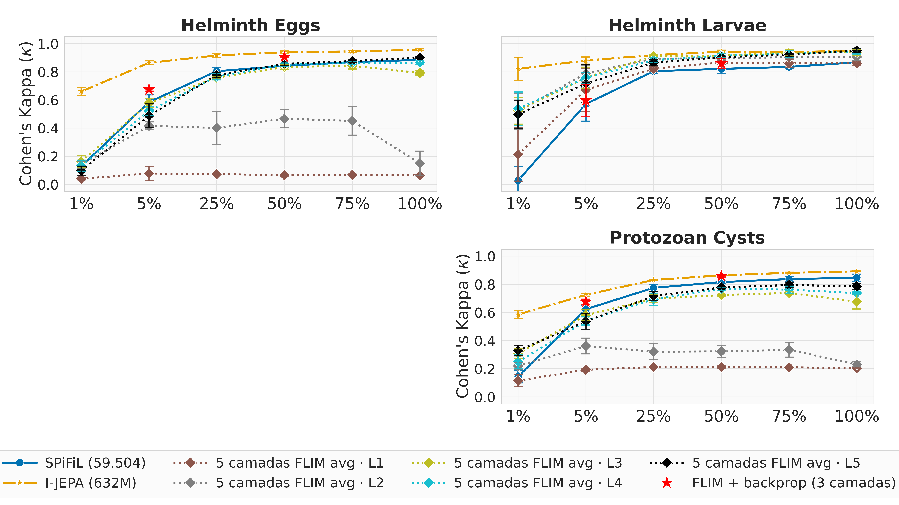

# Outubro 2026

## Crescer o encoder SPiFiL camada por camada (layerwise)

O encoder nasce do zero e cresce uma camada por vez. O SPiFiL corta cada camada nova, as camadas
antigas ficam congeladas e só a nova aprende por backprop, contra um decoder descartável
(reconstrução, sem rótulo). No fim de cada camada, o SVM oficial avalia o encoder congelado.

- **layerwise3** (L1 → L3): 54 células treinadas e avaliadas.
- **layerwise5** (L1 → L5): avaliação em andamento; faltam 2 células para treinar
  (`eggs s2 75%`, `eggs s3 5%`).
- Configurado por YAML: `experiments/autoencoder/growth_layerwise{3,5}.yaml` e
  `eval_svm_layerwise{3,5}.yaml`.
- Na tabela geral entra como `spifil_bckprop_L1/L2/L3`, em
  [`table_result_methods.md`](../2026/august/details_report/table_result_methods.md).

### Resultado do layerwise3

- **Ganha do SPiFiL quase sempre.** Com pouco dado o ganho é grande: em 1%, κ 0,44 contra 0,13
  em eggs e 0,47 contra 0,15 em protozoan.
- **A melhor camada depende da quantidade de dados.** Com pouco dado vence a L1; com muitos, a
  L3 (eggs 100%: 0,934).
- **Ganha dos Distill 3 e 4** em eggs e protozoan; perde em larvae, que para na L2.
- **O I-JEPA continua na frente**, mas por pouco com muitos dados (0,02 em eggs 100%).

Detalhes: [`details/layerwise3_parcial_2026-10-05.md`](details/layerwise3_parcial_2026-10-05.md)
(como foi treinado, tabela completa, ressalvas).

### Atenção: não é uma cópia fiel do SPiFiL original

O layerwise usou **uma foto a mais** para montar os filtros: a da **impureza**. Com isso o eggs
sai com 9/27/45 filtros em vez de 16/32/48, e o protozoan com 14/28/42 em vez de 12/30/48. Parte
dos filtros vem de sujeira, não de parasita. O superpixel também difere: SLIC/100 em vez de
DISF/50.

A divisão dos filtros é o padrão do SPiFiL; a foto a mais vem do nosso `train_samples`. Para
ficar fiel, basta tirar a classe de impureza da escolha de fotos e treinar de novo.

Detalhes: [`details/layerwise_vs_spifil_original.md`](details/layerwise_vs_spifil_original.md).

## SPiFiL + I-JEPA: resultados por porcentagem

Teste, SVM oficial sobre o encoder congelado, média ± desvio dos 3 splits. Negrito = maior κ do
dataset naquela porcentagem.

| nome | o que é |
|---|---|
| SPiFiL | o encoder SPiFiL/FLIM de 3 camadas, sem treino (`SVM_FLIM`) |
| SPiFiL + backprop (3 camadas) | o mesmo encoder: decoder adaptado com o encoder congelado, depois backprop no encoder inteiro (`grid4`, `stage2`; só 5% e 50%) |
| spifil_bckprop_L1…L3 | layerwise3: cresce do zero até a L3 |
| spifil_bckprop5_L1…L5 | layerwise5: cresce do zero até a L5 |
| spifil_flim_L1…L5 | layerwise5_flim: até a L5 como o FLIM de `data/` (classes sem impureza no eggs e protozoan, 24/32/48/64/96 filtros, kernel 5×5, DISF 50, sem a trava N ≤ D). `(n=…)` marca célula com menos de 3 splits |
| I-JEPA | referência, 632M parâmetros |

O `layerwise5_flim` está completo no eval flatten (269 camadas). Sem a trava, o larvae chega
até a L5.

**Leitura rápida**

- **L4 e L5 não ajudam.** Em 100% a L5 fica um pouco abaixo da L3 (eggs 0,927 contra 0,935;
  protozoan 0,864 contra 0,874). Com pouco dado piora: eggs 5% cai de 0,734 (L1) para 0,546 (L5).
- **A L1–L3 do layerwise5 repete o layerwise3** (mesmo processo, mesma semente): os números batem
  na terceira casa.
- **SPiFiL + backprop (estrela vermelha)** fica perto da melhor camada: em eggs 5%, 0,675 contra
  0,734 da L1; em protozoan 5% é o melhor dos SPiFiL (0,675).
- **flim (parcial): no larvae, empilhar ajuda.** Sem a trava, ele chega à L5, e o κ sobe a cada
  camada (5%: 0,51 na L1 e 0,65 na L5). No eggs acontece o contrário (0,72 na L1, 0,54 na L5).
- **I-JEPA continua na frente** em todas as células.

### Gráficos (κ)

3 camadas:

5 camadas:

5 camadas, como o FLIM:

### 1% dos dados

| Método | eggs κ | larvae κ | protozoan κ |
|---|---|---|---|
| SPiFiL | 0.1278 ± 0.0284 | 0.0284 ± 0.1004 | 0.1447 ± 0.0455 |
| spifil_bckprop_L1 | 0.4356 ± 0.0418 | 0.2038 ± 0.1731 | 0.4707 ± 0.0061 |
| spifil_bckprop_L2 | 0.3975 ± 0.0786 | 0.3367 ± 0.1778 | 0.4751 ± 0.0098 |
| spifil_bckprop_L3 | 0.3358 ± 0.1024 | - | 0.4573 ± 0.0251 |
| spifil_bckprop5_L1 | 0.4356 ± 0.0418 | 0.2038 ± 0.1731 | 0.4705 ± 0.0062 |
| spifil_bckprop5_L2 | 0.3975 ± 0.0786 | 0.3367 ± 0.1778 | 0.4748 ± 0.0103 |
| spifil_bckprop5_L3 | 0.3336 ± 0.1069 | - | 0.4476 ± 0.0181 |
| spifil_bckprop5_L4 | 0.2767 ± 0.0396 | - | 0.4331 ± 0.0272 |
| spifil_bckprop5_L5 | 0.2499 ± 0.0207 | - | 0.4046 ± 0.0395 |
| spifil_flim_L1 | 0.4192 ± 0.0845 | 0.1692 ± 0.1160 | 0.4702 ± 0.0017 |
| spifil_flim_L2 | 0.3478 ± 0.0711 | 0.2314 ± 0.1498 | 0.4791 ± 0.0120 |
| spifil_flim_L3 | 0.2878 ± 0.0337 | 0.3536 ± 0.0896 | 0.4808 ± 0.0088 |
| spifil_flim_L4 | 0.2154 ± 0.0462 | 0.4278 ± 0.1063 | 0.4571 ± 0.0100 |
| spifil_flim_L5 | 0.1897 ± 0.0255 | 0.4451 ± 0.1660 | 0.4435 ± 0.0088 |
| I-JEPA | **0.6608 ± 0.0273** | **0.8216 ± 0.0825** | **0.5855 ± 0.0273** |

### 5% dos dados

| Método | eggs κ | larvae κ | protozoan κ |
|---|---|---|---|
| SPiFiL | 0.5852 ± 0.0513 | 0.5712 ± 0.1208 | 0.6230 ± 0.0254 |
| SPiFiL + backprop (3 camadas) | 0.6749 ± 0.0120 | 0.5971 ± 0.1135 | 0.6746 ± 0.0199 |
| spifil_bckprop_L1 | 0.7344 ± 0.0386 | 0.5428 ± 0.1547 | 0.6184 ± 0.0112 |
| spifil_bckprop_L2 | 0.6879 ± 0.0546 | 0.6049 ± 0.1933 | 0.6402 ± 0.0150 |
| spifil_bckprop_L3 | 0.6699 ± 0.0296 | - | 0.6343 ± 0.0343 |
| spifil_bckprop5_L1 | 0.7344 ± 0.0386 | 0.5428 ± 0.1547 | 0.6187 ± 0.0107 |
| spifil_bckprop5_L2 | 0.6881 ± 0.0543 | 0.6045 ± 0.1917 | 0.6398 ± 0.0171 |
| spifil_bckprop5_L3 | 0.6704 ± 0.0251 | - | 0.6251 ± 0.0405 |
| spifil_bckprop5_L4 | 0.6062 ± 0.0243 | - | 0.6026 ± 0.0350 |
| spifil_bckprop5_L5 | 0.5461 ± 0.0482 | - | 0.5756 ± 0.0238 |
| spifil_flim_L1 | 0.7222 ± 0.0469 | 0.5069 ± 0.1141 | 0.6206 ± 0.0275 |
| spifil_flim_L2 | 0.6966 ± 0.0492 | 0.5553 ± 0.1437 | 0.6336 ± 0.0324 |
| spifil_flim_L3 | 0.6498 ± 0.0593 | 0.6134 ± 0.1152 | 0.6485 ± 0.0361 |
| spifil_flim_L4 | 0.5768 ± 0.0353 | 0.6321 ± 0.1081 | 0.6270 ± 0.0384 |
| spifil_flim_L5 | 0.5424 ± 0.0349 | 0.6478 ± 0.1265 | 0.6215 ± 0.0457 |
| I-JEPA | **0.8639 ± 0.0135** | **0.8807 ± 0.0251** | **0.7251 ± 0.0098** |

### 25% dos dados

| Método | eggs κ | larvae κ | protozoan κ |
|---|---|---|---|
| SPiFiL | 0.8050 ± 0.0263 | 0.8049 ± 0.0142 | 0.7750 ± 0.0248 |
| spifil_bckprop_L1 | 0.8558 ± 0.0249 | 0.7521 ± 0.0646 | 0.7135 ± 0.0075 |
| spifil_bckprop_L2 | 0.8585 ± 0.0131 | 0.7785 ± 0.0539 | 0.7749 ± 0.0126 |
| spifil_bckprop_L3 | 0.8562 ± 0.0120 | - | 0.8099 ± 0.0129 |
| spifil_bckprop5_L1 | 0.8558 ± 0.0249 | 0.7521 ± 0.0646 | 0.7143 ± 0.0061 |
| spifil_bckprop5_L2 | 0.8589 ± 0.0126 | 0.7803 ± 0.0516 | 0.7739 ± 0.0119 |
| spifil_bckprop5_L3 | 0.8567 ± 0.0142 | - | 0.8128 ± 0.0046 |
| spifil_bckprop5_L4 | 0.8375 ± 0.0083 | - | 0.7951 ± 0.0120 |
| spifil_bckprop5_L5 | 0.8152 ± 0.0138 | - | 0.7688 ± 0.0116 |
| spifil_flim_L1 | 0.8632 ± 0.0132 | 0.7860 ± 0.0474 | 0.7310 ± 0.0222 |
| spifil_flim_L2 | 0.8663 ± 0.0081 | 0.8011 ± 0.0372 | 0.7855 ± 0.0160 |
| spifil_flim_L3 | 0.8657 ± 0.0102 | 0.8416 ± 0.0485 | 0.8066 ± 0.0056 |
| spifil_flim_L4 | 0.8371 ± 0.0208 | 0.8499 ± 0.0598 | 0.7790 ± 0.0158 |
| spifil_flim_L5 | 0.8213 ± 0.0188 | 0.8373 ± 0.0683 | 0.7718 ± 0.0218 |
| I-JEPA | **0.9171 ± 0.0138** | **0.9190 ± 0.0005** | **0.8307 ± 0.0023** |

### 50% dos dados

| Método | eggs κ | larvae κ | protozoan κ |
|---|---|---|---|
| SPiFiL | 0.8423 ± 0.0222 | 0.8213 ± 0.0308 | 0.8158 ± 0.0128 |
| SPiFiL + backprop (3 camadas) | 0.9062 ± 0.0032 | 0.8593 ± 0.0336 | 0.8587 ± 0.0062 |
| spifil_bckprop_L1 | 0.8932 ± 0.0072 | 0.7875 ± 0.0349 | 0.7563 ± 0.0056 |
| spifil_bckprop_L2 | 0.9023 ± 0.0117 | 0.8124 ± 0.0149 | 0.8164 ± 0.0083 |
| spifil_bckprop_L3 | 0.9050 ± 0.0168 | - | 0.8480 ± 0.0031 |
| spifil_bckprop5_L1 | 0.8942 ± 0.0062 | 0.7875 ± 0.0349 | 0.7526 ± 0.0064 |
| spifil_bckprop5_L2 | 0.8986 ± 0.0066 | 0.8180 ± 0.0096 | 0.8165 ± 0.0099 |
| spifil_bckprop5_L3 | 0.8974 ± 0.0153 | - | 0.8453 ± 0.0083 |
| spifil_bckprop5_L4 | 0.8838 ± 0.0102 | - | 0.8199 ± 0.0112 |
| spifil_bckprop5_L5 | 0.8755 ± 0.0183 | - | 0.8070 ± 0.0022 |
| spifil_flim_L1 | 0.8993 ± 0.0120 | 0.7956 ± 0.0227 | 0.7826 ± 0.0216 |
| spifil_flim_L2 | 0.9064 ± 0.0030 | 0.8268 ± 0.0141 | 0.8395 ± 0.0031 |
| spifil_flim_L3 | 0.9094 ± 0.0098 | 0.8474 ± 0.0068 | 0.8544 ± 0.0074 |
| spifil_flim_L4 | 0.8995 ± 0.0114 | 0.8440 ± 0.0118 | 0.8425 ± 0.0069 |
| spifil_flim_L5 | 0.8959 ± 0.0063 | 0.8411 ± 0.0167 | 0.8336 ± 0.0079 |
| I-JEPA | **0.9397 ± 0.0081** | **0.9433 ± 0.0115** | **0.8636 ± 0.0032** |

### 75% dos dados

| Método | eggs κ | larvae κ | protozoan κ |
|---|---|---|---|
| SPiFiL | 0.8696 ± 0.0182 | 0.8353 ± 0.0132 | 0.8371 ± 0.0185 |
| spifil_bckprop_L1 | 0.9046 ± 0.0123 | 0.8024 ± 0.0306 | 0.7765 ± 0.0118 |
| spifil_bckprop_L2 | 0.9150 ± 0.0070 | 0.8387 ± 0.0134 | 0.8324 ± 0.0138 |
| spifil_bckprop_L3 | 0.9223 ± 0.0059 | - | 0.8627 ± 0.0147 |
| spifil_bckprop5_L1 | 0.9040 ± 0.0135 | 0.8034 ± 0.0307 | 0.7786 ± 0.0200 |
| spifil_bckprop5_L2 | 0.9178 ± 0.0070 | 0.8244 ± 0.0216 | 0.8440 ± 0.0049 |
| spifil_bckprop5_L3 | 0.9207 ± 0.0102 | - | 0.8552 ± 0.0032 |
| spifil_bckprop5_L4 | 0.9097 ± 0.0073 | - | 0.8416 ± 0.0072 |
| spifil_bckprop5_L5 | 0.9041 ± 0.0020 | - | 0.8292 ± 0.0132 |
| spifil_flim_L1 | 0.9154 ± 0.0031 | 0.8046 ± 0.0169 | 0.8184 ± 0.0054 |
| spifil_flim_L2 | 0.9288 ± 0.0036 | 0.8549 ± 0.0102 | 0.8652 ± 0.0071 |
| spifil_flim_L3 | 0.9304 ± 0.0051 | 0.8890 ± 0.0180 | 0.8768 ± 0.0082 |
| spifil_flim_L4 | 0.9212 ± 0.0024 | 0.8946 ± 0.0077 | 0.8596 ± 0.0055 |
| spifil_flim_L5 | 0.9170 ± 0.0013 | 0.8898 ± 0.0054 | 0.8527 ± 0.0086 |
| I-JEPA | **0.9455 ± 0.0087** | **0.9410 ± 0.0094** | **0.8817 ± 0.0049** |

### 100% dos dados

| Método | eggs κ | larvae κ | protozoan κ |
|---|---|---|---|
| SPiFiL | 0.8848 ± 0.0236 | 0.8677 ± 0.0106 | 0.8470 ± 0.0250 |
| spifil_bckprop_L1 | 0.9130 ± 0.0097 | 0.8297 ± 0.0206 | 0.7905 ± 0.0116 |
| spifil_bckprop_L2 | 0.9236 ± 0.0004 | 0.8701 ± 0.0121 | 0.8534 ± 0.0100 |
| spifil_bckprop_L3 | 0.9338 ± 0.0033 | - | 0.8754 ± 0.0040 |
| spifil_bckprop5_L1 | 0.9131 ± 0.0105 | 0.8289 ± 0.0205 | 0.7948 ± 0.0059 |
| spifil_bckprop5_L2 | 0.9227 ± 0.0101 | 0.8700 ± 0.0076 | 0.8530 ± 0.0078 |
| spifil_bckprop5_L3 | 0.9346 ± 0.0034 | - | 0.8736 ± 0.0123 |
| spifil_bckprop5_L4 | 0.9284 ± 0.0046 | - | 0.8659 ± 0.0063 |
| spifil_bckprop5_L5 | 0.9266 ± 0.0079 | - | 0.8644 ± 0.0059 |
| spifil_flim_L1 | 0.9181 ± 0.0056 | 0.8364 ± 0.0136 | 0.8159 ± 0.0061 |
| spifil_flim_L2 | 0.9340 ± 0.0076 | 0.8827 ± 0.0233 | 0.8629 ± 0.0046 |
| spifil_flim_L3 | 0.9410 ± 0.0024 | 0.9242 ± 0.0139 | 0.8759 ± 0.0048 |
| spifil_flim_L4 | 0.9373 ± 0.0053 | 0.9278 ± 0.0126 | 0.8664 ± 0.0014 |
| spifil_flim_L5 | 0.9320 ± 0.0048 | 0.9353 ± 0.0204 | 0.8652 ± 0.0005 (n=2) |
| I-JEPA | **0.9574 ± 0.0067** | **0.9495 ± 0.0065** | **0.8917 ± 0.0024** |

## SPiFiL + I-JEPA com avgpool2d

O mesmo SVM e os mesmos checkpoints, mas o SVM vê a **média de cada canal** (`avgpool2d`) em vez
do mapa achatado (`flatten`): de 9 a 96 números por imagem, contra dezenas de milhares.
Nomes com `_avg`. **SPiFiL e I-JEPA não têm versão avg**: são as mesmas linhas das tabelas acima,
repetidas como referência.

### Gráficos (κ, avgpool2d)

### 1% dos dados (avgpool2d)

| Método | eggs κ | larvae κ | protozoan κ |
|---|---|---|---|
| SPiFiL | 0.1278 ± 0.0284 | 0.0284 ± 0.1004 | 0.1447 ± 0.0455 |
| spifil_bckprop_avg_L1 | 0.0547 ± 0.0290 | 0.0270 ± 0.0467 | 0.0753 ± 0.0657 |
| spifil_bckprop_avg_L2 | 0.1079 ± 0.0586 | 0.5368 ± 0.1727 | 0.1876 ± 0.0578 |
| spifil_bckprop_avg_L3 | 0.1830 ± 0.0367 | - | 0.2970 ± 0.0374 |
| spifil_bckprop5_avg_L1 | 0.0547 ± 0.0290 | 0.0270 ± 0.0467 | 0.0756 ± 0.0659 |
| spifil_bckprop5_avg_L2 | 0.1079 ± 0.0587 | 0.5391 ± 0.1712 | 0.1885 ± 0.0556 |
| spifil_bckprop5_avg_L3 | 0.1677 ± 0.0412 | - | 0.2880 ± 0.0401 |
| spifil_bckprop5_avg_L4 | 0.1587 ± 0.0186 | - | 0.2854 ± 0.0439 |
| spifil_bckprop5_avg_L5 | 0.1520 ± 0.0632 | - | 0.2259 ± 0.0745 |
| spifil_flim_avg_L1 | 0.0399 ± 0.0077 | 0.2134 ± 0.1899 | 0.1153 ± 0.0414 |
| spifil_flim_avg_L2 | 0.1414 ± 0.0245 | 0.5185 ± 0.1282 | 0.2193 ± 0.0263 |
| spifil_flim_avg_L3 | 0.1634 ± 0.0429 | 0.5235 ± 0.0943 | 0.3068 ± 0.0347 |
| spifil_flim_avg_L4 | 0.1334 ± 0.0390 | 0.5379 ± 0.1198 | 0.2498 ± 0.0511 |
| spifil_flim_avg_L5 | 0.0977 ± 0.0324 | 0.4985 ± 0.1010 | 0.3285 ± 0.0375 |
| I-JEPA | **0.6608 ± 0.0273** | **0.8216 ± 0.0825** | **0.5855 ± 0.0273** |

### 5% dos dados (avgpool2d)

| Método | eggs κ | larvae κ | protozoan κ |
|---|---|---|---|
| SPiFiL | 0.5852 ± 0.0513 | 0.5712 ± 0.1208 | 0.6230 ± 0.0254 |
| SPiFiL + backprop (3 camadas) | 0.6749 ± 0.0120 | 0.5971 ± 0.1135 | 0.6746 ± 0.0199 |
| spifil_bckprop_avg_L1 | 0.0475 ± 0.0412 | 0.6644 ± 0.0803 | 0.1884 ± 0.0143 |
| spifil_bckprop_avg_L2 | 0.1671 ± 0.0809 | 0.7406 ± 0.1252 | 0.2161 ± 0.0108 |
| spifil_bckprop_avg_L3 | 0.5136 ± 0.0222 | - | 0.4562 ± 0.1117 |
| spifil_bckprop5_avg_L1 | 0.0475 ± 0.0412 | 0.6620 ± 0.0786 | 0.1882 ± 0.0140 |
| spifil_bckprop5_avg_L2 | 0.1660 ± 0.0829 | 0.7358 ± 0.1303 | 0.2150 ± 0.0094 |
| spifil_bckprop5_avg_L3 | 0.5175 ± 0.0236 | - | 0.4547 ± 0.0802 |
| spifil_bckprop5_avg_L4 | 0.3845 ± 0.0835 | - | 0.3462 ± 0.1712 |
| spifil_bckprop5_avg_L5 | 0.3543 ± 0.0373 | - | 0.3517 ± 0.1085 |
| spifil_flim_avg_L1 | 0.0782 ± 0.0514 | 0.6721 ± 0.1546 | 0.1924 ± 0.0087 |
| spifil_flim_avg_L2 | 0.4160 ± 0.0280 | 0.7888 ± 0.0585 | 0.3617 ± 0.0559 |
| spifil_flim_avg_L3 | 0.5780 ± 0.0304 | 0.7591 ± 0.0752 | 0.5802 ± 0.0395 |
| spifil_flim_avg_L4 | 0.5216 ± 0.0309 | 0.7573 ± 0.0402 | 0.5396 ± 0.0290 |
| spifil_flim_avg_L5 | 0.4883 ± 0.0834 | 0.7169 ± 0.1362 | 0.5365 ± 0.0567 |
| I-JEPA | **0.8639 ± 0.0135** | **0.8807 ± 0.0251** | **0.7251 ± 0.0098** |

### 25% dos dados (avgpool2d)

| Método | eggs κ | larvae κ | protozoan κ |
|---|---|---|---|
| SPiFiL | 0.8050 ± 0.0263 | 0.8049 ± 0.0142 | 0.7750 ± 0.0248 |
| spifil_bckprop_avg_L1 | 0.0674 ± 0.0069 | 0.7878 ± 0.0133 | 0.2008 ± 0.0026 |
| spifil_bckprop_avg_L2 | 0.1044 ± 0.0291 | 0.8662 ± 0.0278 | 0.2840 ± 0.0599 |
| spifil_bckprop_avg_L3 | 0.7631 ± 0.0144 | - | 0.6479 ± 0.0468 |
| spifil_bckprop5_avg_L1 | 0.0674 ± 0.0069 | 0.7870 ± 0.0171 | 0.2030 ± 0.0033 |
| spifil_bckprop5_avg_L2 | 0.1402 ± 0.0902 | 0.8670 ± 0.0266 | 0.2477 ± 0.0132 |
| spifil_bckprop5_avg_L3 | 0.7618 ± 0.0143 | - | 0.6220 ± 0.0597 |
| spifil_bckprop5_avg_L4 | 0.7045 ± 0.0359 | - | 0.6048 ± 0.0853 |
| spifil_bckprop5_avg_L5 | 0.7120 ± 0.0090 | - | 0.6148 ± 0.0832 |
| spifil_flim_avg_L1 | 0.0731 ± 0.0042 | 0.8228 ± 0.0173 | 0.2122 ± 0.0052 |
| spifil_flim_avg_L2 | 0.4018 ± 0.1164 | 0.8943 ± 0.0081 | 0.3208 ± 0.0560 |
| spifil_flim_avg_L3 | 0.7592 ± 0.0070 | 0.9122 ± 0.0085 | 0.6975 ± 0.0280 |
| spifil_flim_avg_L4 | 0.7667 ± 0.0232 | 0.8834 ± 0.0179 | 0.6938 ± 0.0429 |
| spifil_flim_avg_L5 | 0.7775 ± 0.0205 | 0.8659 ± 0.0235 | 0.7166 ± 0.0310 |
| I-JEPA | **0.9171 ± 0.0138** | **0.9190 ± 0.0005** | **0.8307 ± 0.0023** |

### 50% dos dados (avgpool2d)

| Método | eggs κ | larvae κ | protozoan κ |
|---|---|---|---|
| SPiFiL | 0.8423 ± 0.0222 | 0.8213 ± 0.0308 | 0.8158 ± 0.0128 |
| SPiFiL + backprop (3 camadas) | 0.9062 ± 0.0032 | 0.8593 ± 0.0336 | 0.8587 ± 0.0062 |
| spifil_bckprop_avg_L1 | 0.0652 ± 0.0152 | 0.8251 ± 0.0215 | 0.1957 ± 0.0027 |
| spifil_bckprop_avg_L2 | 0.2229 ± 0.1558 | 0.8762 ± 0.0176 | 0.2150 ± 0.0049 |
| spifil_bckprop_avg_L3 | 0.7973 ± 0.0290 | - | 0.6404 ± 0.0286 |
| spifil_bckprop5_avg_L1 | 0.0652 ± 0.0152 | 0.8253 ± 0.0237 | 0.1932 ± 0.0041 |
| spifil_bckprop5_avg_L2 | 0.1755 ± 0.1244 | 0.8893 ± 0.0142 | 0.2166 ± 0.0027 |
| spifil_bckprop5_avg_L3 | 0.8090 ± 0.0154 | - | 0.5807 ± 0.0637 |
| spifil_bckprop5_avg_L4 | 0.7651 ± 0.0321 | - | 0.6234 ± 0.0251 |
| spifil_bckprop5_avg_L5 | 0.7484 ± 0.0634 | - | 0.6655 ± 0.0502 |
| spifil_flim_avg_L1 | 0.0656 ± 0.0061 | 0.8664 ± 0.0149 | 0.2123 ± 0.0089 |
| spifil_flim_avg_L2 | 0.4671 ± 0.0635 (n=2) | 0.8962 ± 0.0104 | 0.3229 ± 0.0418 |
| spifil_flim_avg_L3 | 0.8343 ± 0.0145 | 0.9164 ± 0.0159 | 0.7235 ± 0.0070 (n=2) |
| spifil_flim_avg_L4 | 0.8507 ± 0.0127 | 0.9148 ± 0.0142 | 0.7687 ± 0.0112 (n=2) |
| spifil_flim_avg_L5 | 0.8570 ± 0.0135 | 0.9041 ± 0.0081 | 0.7774 ± 0.0046 (n=2) |
| I-JEPA | **0.9397 ± 0.0081** | **0.9433 ± 0.0115** | **0.8636 ± 0.0032** |

### 75% dos dados (avgpool2d)

| Método | eggs κ | larvae κ | protozoan κ |
|---|---|---|---|
| SPiFiL | 0.8696 ± 0.0182 | 0.8353 ± 0.0132 | 0.8371 ± 0.0185 |
| spifil_bckprop_avg_L1 | 0.0648 ± 0.0073 | 0.8265 ± 0.0358 | 0.1982 ± 0.0033 |
| spifil_bckprop_avg_L2 | 0.0807 ± 0.0110 | 0.8835 ± 0.0165 | 0.2129 ± 0.0105 |
| spifil_bckprop_avg_L3 | 0.8111 ± 0.0137 | - | 0.5981 ± 0.0452 |
| spifil_bckprop5_avg_L1 | 0.0652 ± 0.0066 | 0.8272 ± 0.0345 | 0.1976 ± 0.0041 |
| spifil_bckprop5_avg_L2 | 0.0859 ± 0.0263 | 0.8754 ± 0.0147 | 0.2180 ± 0.0052 |
| spifil_bckprop5_avg_L3 | 0.8105 ± 0.0048 | - | 0.5517 ± 0.0441 |
| spifil_bckprop5_avg_L4 | 0.8067 ± 0.0101 | - | 0.6414 ± 0.0106 |
| spifil_bckprop5_avg_L5 | 0.8129 ± 0.0214 | - | 0.6760 ± 0.0042 |
| spifil_flim_avg_L1 | 0.0674 ± 0.0058 | 0.8607 ± 0.0269 | 0.2104 ± 0.0005 (n=2) |
| spifil_flim_avg_L2 | 0.4513 ± 0.1009 | 0.9040 ± 0.0103 | 0.3342 ± 0.0523 (n=2) |
| spifil_flim_avg_L3 | 0.8429 ± 0.0226 | 0.9363 ± 0.0232 | 0.7385 ± 0.0120 (n=2) |
| spifil_flim_avg_L4 | 0.8629 ± 0.0110 | 0.9280 ± 0.0246 | 0.7621 ± 0.0250 (n=2) |
| spifil_flim_avg_L5 | 0.8764 ± 0.0108 | 0.9217 ± 0.0090 | 0.7949 ± 0.0203 (n=2) |
| I-JEPA | **0.9455 ± 0.0087** | **0.9410 ± 0.0094** | **0.8817 ± 0.0049** |

### 100% dos dados (avgpool2d)

| Método | eggs κ | larvae κ | protozoan κ |
|---|---|---|---|
| SPiFiL | 0.8848 ± 0.0236 | 0.8677 ± 0.0106 | 0.8470 ± 0.0250 |
| spifil_bckprop_avg_L1 | 0.0662 ± 0.0012 | 0.8584 ± 0.0133 | 0.1950 ± 0.0051 |
| spifil_bckprop_avg_L2 | 0.1263 ± 0.0958 | 0.8954 ± 0.0074 | 0.2114 ± 0.0023 |
| spifil_bckprop_avg_L3 | 0.7303 ± 0.0680 | - | 0.3750 ± 0.1364 |
| spifil_bckprop5_avg_L1 | 0.0672 ± 0.0006 | 0.8594 ± 0.0117 | 0.1984 ± 0.0024 |
| spifil_bckprop5_avg_L2 | 0.1152 ± 0.0495 | 0.9037 ± 0.0191 | 0.2160 ± 0.0022 |
| spifil_bckprop5_avg_L3 | 0.7220 ± 0.0485 | - | 0.3751 ± 0.2388 |
| spifil_bckprop5_avg_L4 | 0.7577 ± 0.0430 | - | 0.3756 ± 0.2591 |
| spifil_bckprop5_avg_L5 | 0.7494 ± 0.0307 | - | 0.3974 ± 0.1758 |
| spifil_flim_avg_L1 | 0.0645 ± 0.0042 | 0.8613 ± 0.0136 | 0.2046 ± 0.0027 |
| spifil_flim_avg_L2 | 0.1505 ± 0.0862 | 0.9061 ± 0.0250 | 0.2305 ± 0.0178 |
| spifil_flim_avg_L3 | 0.7928 ± 0.0145 | 0.9389 ± 0.0196 | 0.6766 ± 0.0521 |
| spifil_flim_avg_L4 | 0.8660 ± 0.0146 | 0.9471 ± 0.0200 | 0.7374 ± 0.0124 |
| spifil_flim_avg_L5 | 0.9014 ± 0.0070 | **0.9518 ± 0.0149** | 0.7860 ± 0.0219 (n=2) |
| I-JEPA | **0.9574 ± 0.0067** | 0.9495 ± 0.0065 | **0.8917 ± 0.0024** |

## Mudanças no repositório

- **`evaluate: {SVM: false}` no YAML** desliga a sonda SVM durante o treino; ela é que travava a
  grade. Sem ela, o melhor checkpoint e a parada passam a olhar a perda de reconstrução.
- **Runner `growth` pelo launcher Ray** consertado: GPU visível com
  `RAY_ACCEL_ENV_VAR_OVERRIDE_ON_ZERO=0`, caminho de saída do `grow` e atalhos para os
  checkpoints.
- **Plots** com uma curva por camada (`configs/eval/plots.yaml`). Gráficos só do layerwise3 em
  `artifacts/plots/layerwise3/`.
