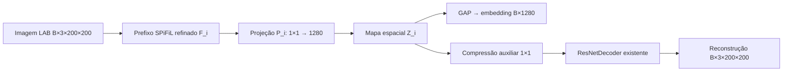

# NAS progressivo com SPiFiL

Implementação da branch `gpt_sol_G_A`. Extensão opcional do runner `growth` e da
entrada `ga_search.run_ga`; os experimentos anteriores mantêm suas avaliações e
seleção por kappa. Os contratos e a distribuição dos arquivos entre os agentes
estão em [PROGRESSIVE_CONTRACTS.md](PROGRESSIVE_CONTRACTS.md).

## Arquitetura e inicialização

Cada indivíduo cresce de uma até dez camadas evolutivas. Em cada profundidade,
`fit_new_block` reutiliza `Trunk`, `Cropped`, `build_layer0`, `GrowOneLayer`,
`Learner.fit_layer`, `ArchSpec` e uma única `LayerSpec` do fluxo existente.
Os filtros são recortes das ativações do prefixo treinado, congelado e em eval.
O prefixo não é ajustado novamente pelo SPiFiL. O orçamento N>D é verificado
antes do scoring e pela estratégia existente. Falhas são indivíduos inviáveis,
com motivo e penalidade registrados.

O espaço inicial validado contém Conv2d convencional 3×3/5×5, grupos 1,
conexões sequenciais, canais configuráveis, max-pooling stride 1/2, BN opcional,
dropout e ReLU/ReLU6/SiLU. O número de canais produzido pelo allocator SPiFiL
repara explicitamente o genoma efetivo; o pedido original permanece registrado.
Depthwise, pointwise/1×1 no encoder, soma residual e concatenação são rejeitados:
não foi comprovado suporte SPiFiL para essas operações. A biblioteca de apoio
foi somente lida.

Cada profundidade tem sua própria projeção Conv2d(C_real,1280,1) e decoder:



As projeções conservam a grade do encoder, sem upsample para obter 1280 canais.
Os exemplos reduzem a grade para 100×100 e 50×50. O decoder recebe o mapa
espacial completo, não o embedding após GAP. Projeções e decoder usam He ou
Xavier do módulo central; BN nasce com escala 1 e bias 0. O inicializador
auxiliar nunca visita filtros SPiFiL já montados.

Fase A treina bloco novo, projeção e decoder, mantendo pesos e estatísticas BN
do prefixo congelados. Fase B treina o prefixo todo com LR reduzido. Um AdamW
por indivíduo conserva os estados e recebe grupos novos explicitamente.
Cabeças antigas permanecem salvas e congeladas. A perda padrão é L1; SSIM local
3×3 com data range 1 é opcional (`ssim_weight`). A reconstrução não usa classes;
a inicialização SPiFiL exige classes e, na configuração padrão, máscaras.

## Dados e avaliação

Os mesmos loaders IFT/LAB e transforms de teste do projeto são usados para
obtenção dos filtros e reconstrução. A resolução padrão é 200×200. O contrato
de entrada validado tem três canais; outros valores são rejeitados, em vez de
aplicar silenciosamente uma conversão incompatível com LAB/SPiFiL.

Os splits reais e a seleção híbrida de doadores SPiFiL são reutilizados.
Treino/validação devem ser disjuntos em IDs e paths, e os doadores devem pertencer
ao treino. O teste não é carregado. A validação completa permanece fixa entre
indivíduos. `spifil_in_image=true` é o padrão; superpixels em features exigem
outro experimento com os modos exclusivos. Sementes, IDs, hashes de conteúdo,
classes, máscaras, canais, versões e tempos estão nos artefatos.

HDBSCAN encontra os grupos sem K. DBI usa apenas amostras agrupadas; cobertura
mínima padrão 0,8 controla o descarte de ruído. Hoyer é calculado no embedding
bruto, por amostra, com média/desvio. Vetores zero ou não finitos invalidam a
seleção. O fitness minimizado é
`J=(1-lambda)*DBI/(1+DBI)+lambda*(1-Hoyer)`, lambda padrão 0,004; 0,04 é outra
configuração, com outro diretório. Inválidos recebem penalidade fixa padrão
1e12, nunca DBI zero artificial. DBCV é complementar; falha/indisponibilidade
é registrada. `min_samples` inclui a própria amostra; o valor passado ao pacote
contrib é ajustado para manter a convenção do sklearn. Valor mínimo: 2.

O pacote `hdbscan` fornece também DBCV. Sem ele, o HDBSCAN nativo do sklearn
continua funcionando e DBCV fica explicitamente indisponível. Em embeddings de
alta dimensão a implementação DBCV pode emitir overflow; o resultado é validado
e fica `dbcv_status=invalid` se não for finito. Nenhum ruído é acrescentado.

`complementary_svm=true` executa o protocolo central `core.svm.fit_svm`,
registrando kappa, acurácia macro, F1 e diagnósticos. Esses valores não selecionam
arquiteturas ou checkpoints deste experimento.

## Genética, cache e retomada

Há seleção por torneio, crossover de blocos, mutação/inserção/remoção, elitismo,
limite de gerações e paciência. Cada indivíduo preserva seus pesos entre suas
próprias profundidades. Herança entre indivíduos está desabilitada e a opção
não validada é rejeitada. Modificações de prefixo recomeçam seu ajuste; shapes
compatíveis não autorizam transferência de filtros.

Cache é separado do legado. A chave inclui genoma efetivo, conteúdo dos dados e
splits, configuração completa, seeds, doadores, versões/fontes e identidade do
checkpoint do prefixo. Um checkpoint de cache só é usado se existe e seu hash
confere. Reutilização registra o checkpoint de origem e mantém a proveniência
do pedido atual. Arquitetura sozinha não identifica uma avaliação.

`experiment.json` fixa a identidade; `data_identity.json` registra os dados.
Por indivíduo: `history.json`, `last.ckpt`, inicializações e, em cada `depth_i`,
`best_J.ckpt`, `selected.ckpt`, `embeddings.npz` e `result.json`.
Checkpoints guardam modelo, genomas, projeções, decoders, grupos/estados do
otimizador, fase/época e RNGs Python/NumPy/Torch/CUDA. A retomada é na última
época concluída; uma interrupção durante a época repete essa época. Loaders têm
ordem fixa, sem augmentation aleatória ou shuffle. A busca guarda população,
resultados parciais, histórico, geração e RNG dos operadores.

O checkpoint escolhido em cada profundidade minimiza J na validação, inclusive
entre fases A/B; empates conservam o primeiro. A fase B é sempre executada.
Alterações de código, configuração ou conteúdo dos dados exigem outro
`output_dir`, evitando continuação e cache com identidades incompatíveis.

## Execução

Na raiz do repositório, use o ambiente PyTorch existente:

```bash
export PY=/dados/home/moliveira/miniforge3/envs/scalable_FLIM/bin/python
export OMP_NUM_THREADS=1 OPENBLAS_NUM_THREADS=1 MKL_NUM_THREADS=1
export MPLCONFIGDIR=/tmp/mpl-progressive
# Nesta sessão hdbscan foi instalado em /tmp, sem alterar a env existente:
export PYTHONPATH=/tmp/flim_nas_deps:$PWD
```

Em outro ambiente, instale as dependências de `env/requirements.txt`, inclusive
SPiFiL conforme a instalação existente. `device:auto` detecta CPU/GPU;
`--nas-device cpu` ou `--nas-device cuda:0` fixa a escolha.

Treinamento progressivo de um genoma configurado:

```bash
"$PY" -m ga_search.run_ga --progressive-nas ga_search/config/progressive_nas.yaml --nas-mode train --nas-output results/progressive_train
```

Busca genética com os dados reais:

```bash
"$PY" -m ga_search.run_ga --progressive-nas ga_search/config/progressive_nas.yaml --nas-output results/progressive_search
```

Demonstração sintética de duas profundidades e duas gerações:

```bash
"$PY" -m ga_search.run_ga --progressive-nas ga_search/config/progressive_nas_synthetic.yaml --nas-device cpu --nas-output results/progressive_demo
```

Retome repetindo **o mesmo comando**, acrescentando `--resume`. Exemplo:

```bash
"$PY" -m ga_search.run_ga --progressive-nas ga_search/config/progressive_nas_synthetic.yaml --nas-device cpu --nas-output results/progressive_demo --resume
```

O launcher Ray usa o scheduler existente e um braço por GPU, indivíduos
sequenciais dentro do braço:

```bash
"$PY" -m experiments.ray.launch experiments/autoencoder/progressive_nas.yaml --dry-run
"$PY" -m experiments.ray.launch experiments/autoencoder/progressive_nas.yaml
```

O YAML Ray aponta para a configuração NAS; `progressive_nas` é exclusivo dos
demais `runner_args` de crescimento. Ray conserva o contrato GPU do launcher;
a entrada direta oferece execução CPU. `artifacts` neste checkout é um link
para fora do repositório; os comandos acima usam `results` para saída local.

## Inferência

Cada indivíduo exporta `encoder_embedding.pt`, contendo somente o encoder até
a profundidade escolhida, sua projeção de 1280 canais, GAP e flatten. O caminho
está em `result.json` (`best.result.inference_path` na busca). Dez blocos são
suportados, mas a busca pode escolher uma profundidade menor.

```python
import json
import numpy as np
import torch
from core.data.loaders import ift_lab_loader
from core.data.transforms import build_test

result = json.load(open("results/progressive_demo/result.json"))
candidate = result["best"]["result"] if "best" in result else result
encoder = torch.load(candidate["inference_path"], map_location="cpu", weights_only=False).eval()
lab = np.ascontiguousarray(ift_lab_loader("/caminho/imagem.png"))
x = build_test(200, imagenet_norm=False)(torch.from_numpy(lab).permute(2, 0, 1).float())
with torch.no_grad():
    embedding = encoder(x.unsqueeze(0))
assert embedding.shape == (1, 1280)
```

Para reconstrução/retomada pelo checkpoint completo:

```python
from methods.autoencoder.progressive import EvolutionaryCNN, ProgressiveTrainer
trainer = ProgressiveTrainer(EvolutionaryCNN({"device": "cpu"}), {"device": "cpu"})
metadata = trainer.load_checkpoint(candidate["checkpoint"])
model = trainer.model.eval()  # load substitui trainer.model
```

Esses arquivos serializam módulos Python e devem vir de experimentos confiáveis.

## Arquivos e validação

| Responsabilidade | Arquivos |
| --- | --- |
| Ajuste incremental | `flim/progressive.py` |
| Modelo, auxiliares, treino e checkpoint | `methods/autoencoder/progressive.py` |
| Orquestração | `ga_search/progressive.py` |
| Dados e custos | `ga_search/progressive_data.py`, `progressive_cost.py` |
| Genética e métricas | `ga_search/progressive_genetics.py`, `progressive_metrics.py` |
| Entradas existentes modificadas | `ga_search/run_ga.py`, `experiments/ray/runners/growth.py`, `experiments/ray/schema.py` |
| Configurações novas | `ga_search/config/progressive_nas*.yaml`, `experiments/autoencoder/progressive_nas.yaml` |
| Dependências e documentação | `env/requirements.txt`, este guia, contratos e link no README |
| Testes novos | `analysis/checks/test_progressive_{spifil,model,metrics,genetics,pipeline,config}.py` |
| Check legado corrigido | `analysis/checks/check_spifil_growth.py` |

Execute a suíte:

```bash
"$PY" -m unittest analysis.checks.test_progressive_spifil analysis.checks.test_progressive_model analysis.checks.test_progressive_metrics analysis.checks.test_progressive_genetics analysis.checks.test_progressive_pipeline analysis.checks.test_progressive_config -v
"$PY" -m analysis.checks.check_spifil_growth
"$PY" -m analysis.checks.check_refactor_equivalence
```

Os testes de integração fazem ajuste SPiFiL real em imagens/máscaras/classes
sintéticas. Os testes de mecânica do modelo usam convoluções locais,
explicitamente sem alegar inicialização SPiFiL. Há smoke de formatos com dez
blocos; não foi feito treinamento de dez profundidades com dados reais.

Os resultados medidos e as limitações estão em
[reports/progressive_nas_validation.md](../reports/progressive_nas_validation.md).
