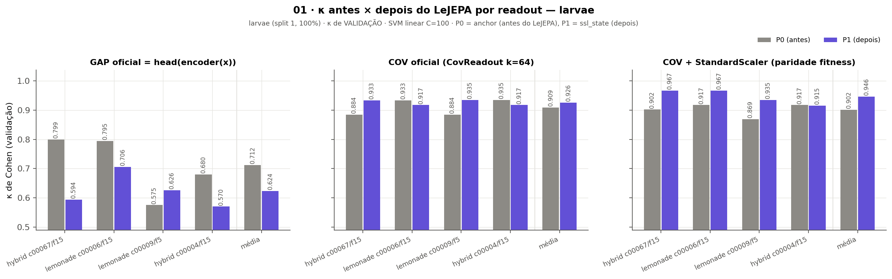
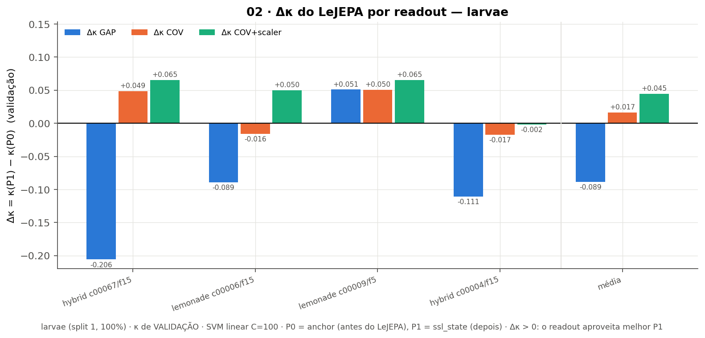
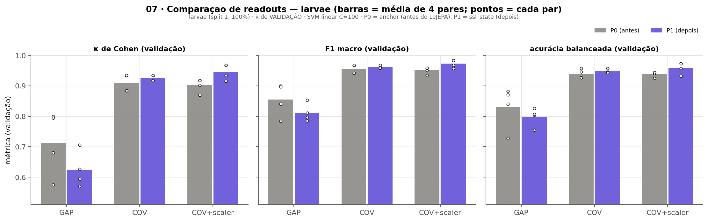
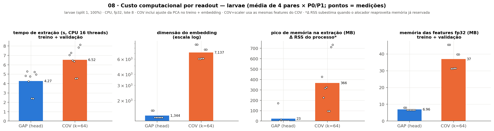
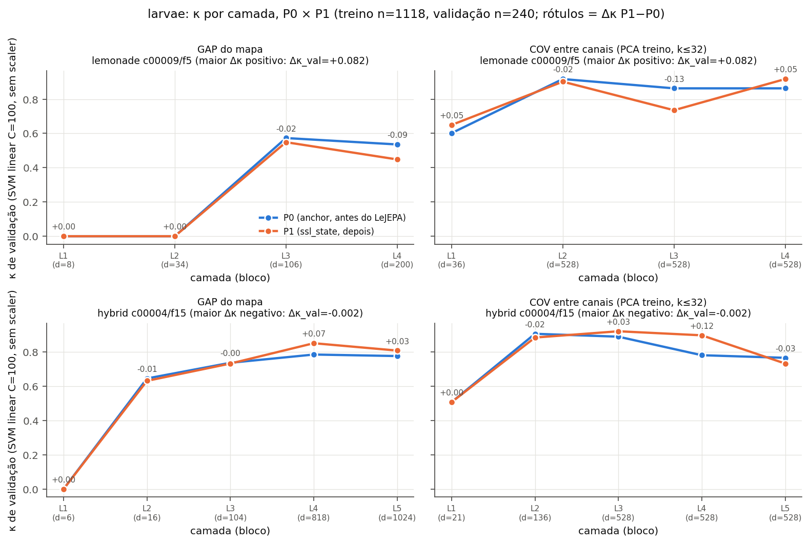
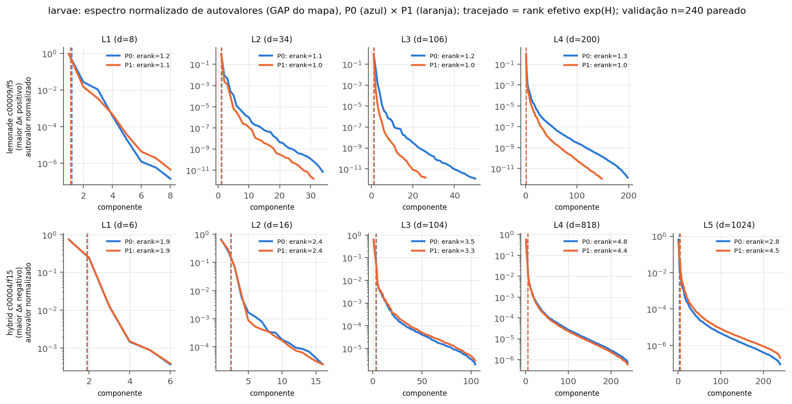
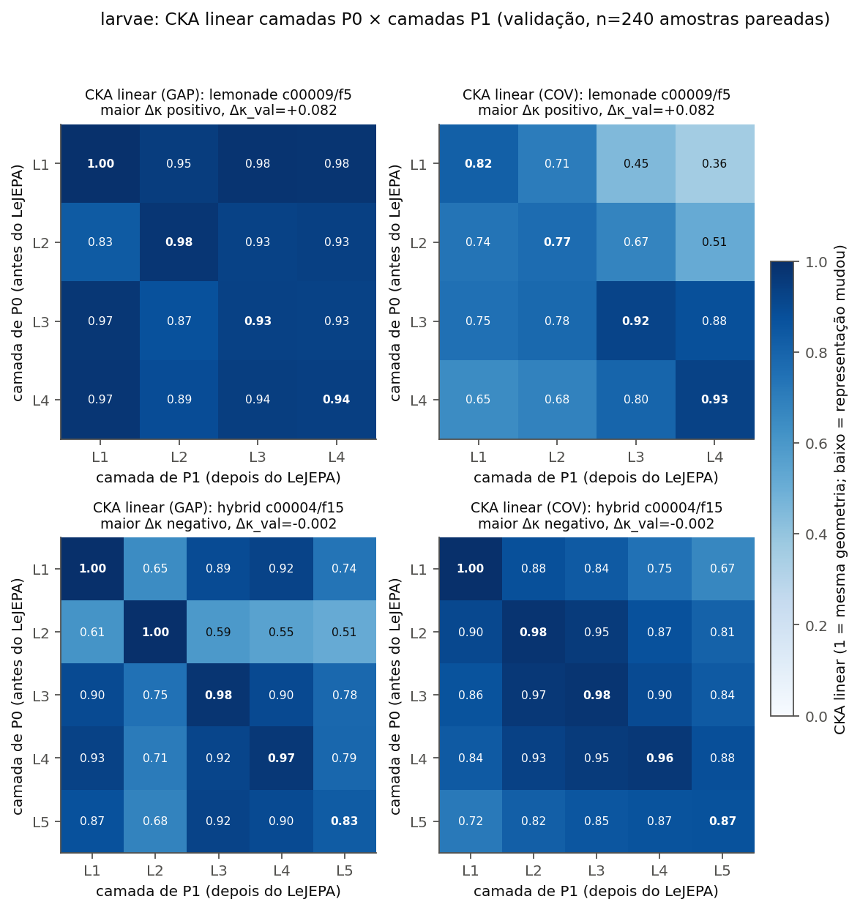

## Matriz 2×2 (etapa 2)

**O que é.** São os 4 pares de larvae do `data/checkpoint_manifest.json`. P0 = `ck['anchor']` (antes do LeJEPA) e P1 = `ck['ssl_state']` (depois do LeJEPA), ambos do mesmo `encoder.pt`. Cruzamos dois readouts oficiais com os dois checkpoints:
- **GAP** é o embedding oficial `head(encoder(x))` do checkpoint. O pooling do genoma é `gem` (hybrid c00067, lemonade c00009), `gap` (lemonade c00006) ou `moments` (hybrid c00004).
- **COV** é o `pooling_head.CovReadout` oficial: k=64, PCA ajustada **só nos pixels do treino**, seed 42, concatenado ao head.

A SVM é a do repo (`core.svm.fit_svm`, linear, C=100, **sem scaler**), reajustada para cada representação no treino completo (n=1118) e avaliada **só na validação** (n=240; 2 classes: *S. stercoralis* × impurezas). O teste não é lido. A coluna **COV+scaler** aparece à parte e serve só para paridade com o fitness. Rodamos na CPU da Jaci (16 threads, `nice`), com `eval()`, `no_grad()` e fp32 estrito, usando os splits do `config_resolved.yaml` de cada busca (hash `dc68b5d0eff6`, igual ao da busca). O driver é `research/lejepa_diag/matrix_2x2.py`. Os dados estão em `data/metrics.csv` e `data/delta_kappa.csv`.

**Paridade com a busca.** A coluna COV+scaler reproduz o κ de fitness do `result.json` (α=0 e α=1) **exatamente em 7 de 8 pontos**. A exceção é P1 de lemonade c00009: 0.935 aqui contra 0.952 na busca. A diferença de −0.017 vem do eigh na CPU contra a GPU/AMP.

| par | κ GAP P0→P1 | Δκ_GAP | κ COV P0→P1 | Δκ_COV | Δκ_COV − Δκ_GAP | κ COV+scaler P0→P1 (Δ) |
|---|---|---|---|---|---|---|
| hybrid c00067/f15 (gem) | 0.799→0.594 | **−0.206** | 0.884→0.933 | +0.049 | **+0.255** | 0.902→0.967 (+0.065) |
| lemonade c00006/f15 (gap) | 0.795→0.706 | −0.089 | 0.933→0.917 | −0.016 | +0.073 | 0.917→0.967 (+0.050) |
| lemonade c00009/f5 (gem) | 0.575→0.626 | +0.051 | 0.884→0.935 | +0.050 | −0.001 | 0.869→0.935 (+0.065) |
| hybrid c00004/f15 (moments) | 0.680→0.570 | −0.111 | 0.935→0.917 | −0.017 | +0.093 | 0.917→0.915 (−0.002) |
| **média** | **0.712→0.624** | **−0.089** | **0.909→0.926** | **+0.017** | **+0.105** | 0.902→0.946 (+0.045) |

F1 macro e acurácia balanceada (médias P0→P1, figura 07):
- GAP: F1 0.855→0.811, bacc 0.830→0.798.
- COV: F1 0.955→0.963, bacc 0.939→0.947.

(Todas as figuras também existem em SVG, e os dados de cada gráfico estão no `.csv` com o mesmo nome em `figures/larvae/`.)

**Como ler.**
- **01** mostra P0 (cinza) e P1 (violeta) por par e a média, um painel por readout.
- **02** mostra Δκ = κ(P1) − κ(P0) por readout, com a linha do zero. Uma barra negativa só diz que *aquele* readout linear separa pior a validação com P1. Não diz que a informação sumiu do encoder.
- **07** mostra κ, F1 e bacc médios; os pontos são os pares.
- **08** mostra o custo: tempo de extração (no COV inclui o ajuste da PCA), dimensão, pico de memória (Δ RSS) e memória das features em fp32.

**Interpretação.**
- **Larvae é o caso em que os dois readouts divergem.** O κ do GAP oficial cai em 3 dos 4 pares (−0.206, −0.111, −0.089; média −0.089). Essas quedas ficam acima do ruído: com n_val=240, o erro-padrão é ≈ 0.03–0.05. No **mesmo P1**, o COV fica entre 0.917 e 0.935 (média +0.017). Em média, Δκ_COV − Δκ_GAP = **+0.105**, e chega a +0.255 no hybrid c00067.
- **A queda do GAP não é destruição de informação.** Com o mesmo encoder P1, um readout de 2ª ordem (covariância entre canais por bloco) separa as classes tão bem quanto, ou melhor do que, com P0. A informação discriminativa continua no encoder. O que piora é o resumo de 1ª ordem que o head produz. O head `EmbeddingHead` também é treinado pelo LeJEPA, então a queda pode estar no head e não nas convs. Separar as duas coisas é tarefa da análise por camada.
- **Colapso dimensional do GAP.** O rank efetivo do embedding GAP na validação já era muito baixo e cai ainda mais nos pares com queda: hybrid c00067 vai de 4.4 para **1.2** (praticamente uma direção) e hybrid c00004 vai de 38 para 24. No lemonade c00006, o rank efetivo sobe de 1.5 para 2.5 e o κ GAP cai mesmo assim; nesse par, a variância dominante mudou de direção, não de quantidade. O único par em que o GAP melhora (lemonade c00009, +0.051) parte do GAP mais fraco (0.575).
- **Comparação com remote_sensing.** Lá o LeJEPA melhora levemente o GAP em todos os pares (+0.019) e o COV tem sinal misto. Aqui o GAP piora e o COV se mantém ou melhora. O efeito do LeJEPA **depende do readout e da base**: um mesmo P1 parece pior ou melhor conforme a forma de leitura.
- **Fitness × readout de produção.** Como a busca seleciona pelo `cov_head` com scaler (+0.045 em média aqui), ela vê o LeJEPA como ganho em larvae. Um pipeline que use o embedding GAP oficial perderia em média −0.089 de κ com o mesmo checkpoint. O StandardScaler pesa: no lemonade c00006, o Δκ do COV vai de −0.016 sem scaler para +0.050 com scaler.
- **Custo.** O COV tem dimensão 5.3× maior (7 137 contra 1 344) e 5.3× mais memória de features (37 MB contra 7 MB para 1 358 imagens). O tempo de extração aumenta 1.5× (6.5 s contra 4.3 s na CPU, incluindo o ajuste da PCA). O pico Δ RSS foi de ~366 MB contra ~23 MB, valor que subestima o GAP por reuso do alocador.

## Por camada (etapa 3)

**Pares** (escolhidos no `data/checkpoint_manifest.json` pelo Δκ_val = κ(α=1) − κ(α=0) da fitness): `modehb_lemonade:c00009/f5` (maior Δκ positivo, **+0.082**; 4 blocos) e `modehb_hybrid:c00004/f15` (o "mais negativo" de larvae, **−0.002**, ou seja, Δκ ≈ 0: nenhum par de larvae perde κ de verdade; 5 blocos). P0 = `ck['anchor']` e P1 = `ck['ssl_state']`.

**Protocolo.** É o mesmo da seção "Por camada" de remote_sensing. Rodamos na CPU (fp32, eval, no_grad) com hooks em L1..Ln. Há duas features por camada: GAP do mapa, e COV entre canais com PCA ajustada só no treino e k = 32 fixo (k_eff = min(32, C_l), igual em P0 e P1). O κ vem de `core.svm.fit_svm` (C=100, sem scaler), com o treino completo (n=1118) e a validação completa (n=240; binária, 37 da classe minoritária contra 203). Rank efetivo, espectro e CKA linear usam a validação inteira, pareada (n=240 < 500); o controle no treino, com n=500, concorda. Driver: `research/lejepa_diag/layer_diag.py`. Dados: `data/layer_metrics.csv`.

**Ruído e um caveat.** Com 37 exemplos minoritários na validação, o erro-padrão de um κ por camada é ≈ 0.05. O **κ = 0** no GAP de L1 (nos dois pares) e de L2 (par lemonade) significa que o SVM prevê sempre a classe majoritária. Em L1 isso é real: κ = 0 também com StandardScaler. Em L2 há um efeito de escala: com scaler, o κ vai a 0.45. Lá o GAP é praticamente uma direção só (1º autovalor ≥ 96% da variância). O κ por camada não é o κ da fitness, que usa `cov_head`: todos os blocos, k=64, head e scaler.

(Espectro do COV: `figures/larvae/04_eigenvalue_spectrum_cov.png`. Há SVG de todas. As curvas do espectro param em 1e-12, o piso numérico.)

| par | camada | CKA diag GAP / COV | κ GAP P0→P1 | κ COV P0→P1 | erank GAP P0→P1 | 1º autovalor GAP P0→P1 |
|---|---|---|---|---|---|---|
| lemonade c00009 (+0.082) | L1 | 1.00 / 0.82 | 0→0 | 0.602→0.649 | 1.21→1.11 | 0.961→0.981 |
| | **L2** | 0.98 / **0.77** | 0→0 | 0.917→0.902 | 1.09→1.03 | 0.986→0.996 |
| | L3 | 0.93 / 0.92 | 0.573→0.549 | **0.863→0.735** | 1.19→1.00 | 0.960→**1.000** |
| | L4 | 0.94 / 0.93 | 0.536→0.448 | 0.863→0.917 | 1.29→1.05 | 0.944→0.994 |
| hybrid c00004 (−0.002) | L1 | 1.00 / 1.00 | 0→0 | 0.507→0.507 | 1.89→1.90 | 0.744→0.739 |
| | L2 | 1.00 / 0.98 | 0.646→0.632 | 0.906→0.884 | 2.41→2.44 | 0.658→0.628 |
| | L3 | 0.98 / 0.98 | 0.737→0.733 | 0.889→0.921 | 3.50→3.28 | 0.569→0.638 |
| | L4 | 0.97 / 0.96 | 0.785→0.851 | **0.781→0.897** | 4.85→4.44 | 0.503→0.576 |
| | **L5** | **0.83** / 0.87 | 0.776→0.808 | 0.766→0.733 | 2.82→**4.45** | 0.672→0.496 |

**Interpretação.**
- **Par positivo (lemonade c00009).** Aqui a mudança **não** está no fim. O menor CKA aparece no COV de **L2** (0.77) e de L1 (0.82). Em L3 e L4 o CKA continua em 0.92–0.94. **A camada que mais muda a representação é L2.** A maior variação de κ isolada é no COV de L3 (−0.128) e é contrária ao ganho da fitness. Já o COV de L4 (+0.054) e o de L1 (+0.048) sobem. O +0.082 do `cov_head` vem, portanto, da combinação de blocos e não de uma camada isolada. No GAP, o LeJEPA leva o rank efetivo a ≈ 1 em L2–L4: o 1º autovalor passa de 96% para 99.96% da variância em L3. É um **colapso dimensional do GAP**, e o κ GAP de L4 cai junto (−0.087). A informação discriminativa sobrevive na covariância entre canais, que mantém um rank efetivo de 4–7 e sobe em L4 (4.6→6.3). Também aqui, CKA alto no GAP (0.93) não significa "nada mudou": P0 já era quase 1-D, e o CKA linear é dominado por essa direção.
- **Par Δκ≈0 (hybrid c00004).** O LeJEPA quase não mexe nas camadas L1–L4 (CKA 0.96–1.00) e muda sobretudo **L5**, a última (GAP 0.83; debiased 0.76; COV 0.87). Em L5 o espectro do GAP se **espalha**: o rank efetivo sobe de 2.8 para 4.5 e o 1º autovalor cai de 67% para 50%, o efeito esperado do SIGReg. Ainda assim, há ganhos claros de κ numa camada intermediária: COV de L4 +0.116 (0.78→0.90) e GAP de L4 +0.066. O COV de L5 perde −0.033. O Δκ ≈ 0 da fitness esconde, portanto, melhora em L4 e leve perda em L5, que se compensam no readout concatenado.
- **Leitura geral em larvae.** Os dois pares contam histórias opostas no espectro do GAP: colapso para ~1-D no par positivo e expansão em L5 no par neutro. **Não** existe uma relação monotônica entre "espalhar o espectro" e ganhar κ. Nos dois casos, o ganho aparece no **COV** de um bloco (L4), não no GAP.

## Textura (etapa 4)

**O que é.** O protocolo é o mesmo de `results_remote_sensing.md` (seção Textura). Perturbamos **só a validação** (n=240): blur gaussiano σ ∈ {0, 0,5, 1, 2, 4} px, com dois controles:
- ruído gaussiano de mesma energia (MSE) que o blur remove;
- down-up, com fator 1+2σ.

A SVM original (C=100, sem scaler) é ajustada no treino **limpo** (n=1118). Usamos dois readouts: GAP = `head(encoder(x))` oficial; COV = `CovReadout` oficial (k=64, seed 42). Medimos o cosseno limpo × perturbado (centrado na média da validação limpa; a coluna `cos_mean` guarda o cru) e a distância de Frobenius normalizada da covariância de canais da última camada. Usamos dois pares:
- o de maior Δκ de fitness positivo, **lemonade c00009/f5** (+0.082, pooling `gem`, 200 canais na última camada);
- o de Δκ "mais negativo", **hybrid c00004/f15** (−0.002, pooling `moments`, 1024 canais). Em larvae não existe par com perda real: este é, na prática, um par **neutro**.

O driver é `research/lejepa_diag/texture_min.py`. Os dados estão em `data/texture_metrics.csv` e a figura em `figures/larvae/06_texture_sensitivity.{png,svg}`. O desvio bootstrap do κ é ≈ 0.035 no COV e ≈ 0.075 no GAP. O GAP oficial é fraco em larvae (κ ≈ 0.6) e ruidoso.

| par | readout | κ limpo P0→P1 | κ blur σ=1 P0/P1 | κ blur σ=2 P0/P1 | κ blur σ=4 P0/P1 | κ ruído σ=4 P0/P1 | cos centr. blur σ=4 P0/P1 | cos centr. ruído σ=4 P0/P1 |
|---|---|---|---|---|---|---|---|---|
| lemonade c00009 (Δκ+) | GAP | 0.575→0.626 | 0.536/0.674 | 0.507/0.622 | 0.602/0.409 | 0.000/0.000 (σ=1: 0.000/0.448) | 0.91/0.71 | 0.36/0.96 |
| lemonade c00009 (Δκ+) | COV | 0.884→0.935 | 0.735/0.840 | 0.209/0.170 | 0.000/0.000 | 0.696/0.820 | 0.63/0.62 | 0.60/0.89 |
| hybrid c00004 (Δκ≈0) | GAP | 0.680→0.570 | 0.565/0.641 | 0.313/0.584 | 0.147/0.495 | 0.020/0.245 | 0.38/0.43 | 0.07/0.70 |
| hybrid c00004 (Δκ≈0) | COV | 0.935→0.917 | 0.805/0.820 | 0.170/0.385 | 0.000/0.000 | 0.364/0.574 | 0.43/0.43 | 0.43/0.66 |

Frobenius normalizado da covariância da última camada, P0/P1:

| par | blur σ=2 | blur σ=4 | down-up σ=2 | ruído σ=2 | ruído σ=4 | seletividade blur/ruído (σ=2) P0→P1 |
|---|---|---|---|---|---|---|
| lemonade c00009 | 0.011/0.165 | 0.034/0.484 | 0.017/0.256 | 0.149/0.096 | 0.255/0.156 | 0.07→1.72 |
| hybrid c00004 | 0.240/0.690 | 0.385/1.007 | 0.296/0.822 | 0.730/0.456 | 0.849/0.719 | 0.33→1.51 |

**Interpretação.**
- **Larvae depende muito da escala fina, nos dois checkpoints.** Com blur σ=2, o COV cai de ≈0.9 para 0.17–0.39. Com σ=4, os dois vão a κ=0 (a SVM limpa passa a prever uma única classe). O down-up é ainda mais destrutivo (σ=1 já leva o COV a 0.21–0.54). Como ele preserva a forma global, a perda vem da textura/detalhe e não do contorno grosseiro.
- **Par Δκ+ (c00009): o ganho do LeJEPA sobrevive a blur leve e vira robustez ao ruído.** Em σ=1, P1 mantém COV 0.840 contra 0.735 de P0 e GAP 0.674 contra 0.536. Em σ ≥ 2, os dois colapsam juntos no COV. A diferença maior está no controle de ruído: o GAP de P0 vai a κ≈0 já com ruído σ=0.5, cuja energia é minúscula (≈0.013% da energia da imagem), enquanto P1 mantém 0.54. No COV com ruído σ=4, P1 fica em 0.82 e P0 em 0.70. O cosseno centrado do GAP sob ruído σ=4 é 0.36 em P0 e 0.96 em P1. O LeJEPA tornou a representação **invariante a ruído i.i.d.** sem torná-la invariante ao blur.
- **Par Δκ≈0 (c00004/f15): κ limpo igual, comportamento sob perturbação bem diferente.** Limpo, o COV fica em 0.935/0.917. Sob blur σ=2, P1 retém mais (COV 0.385 contra 0.170; GAP 0.584 contra 0.313), e sob ruído também (COV σ=4 0.574 contra 0.364; cosseno centrado do GAP 0.70 contra 0.07). O "Δκ≈0" da fitness esconde, portanto, uma representação **mais robusta** em P1, coerente com a etapa 3 (L4 melhora e L5 piora levemente).
- **2ª ordem da última camada: o LeJEPA a torna mais sensível ao blur e menos ao ruído (2/2 pares, e também nos 2 de RS).** No c00009, a Σ da última camada de P0 é quase cega ao blur (muda 3% em σ=4), enquanto a de P1 muda 48%. Sob ruído, P0 muda mais (0.26 contra 0.16). A razão blur/ruído sobe de 0.07 para 1.72 (c00009) e de 0.33 para 1.51 (c00004). P1 trata o conteúdo de alta frequência como **sinal** e o ruído i.i.d. como **perturbação**; P0 fazia o contrário.
- **GAP × COV.** O COV tem muito mais informação limpa (0.88–0.94 contra 0.57–0.68) e perde quase tudo com o blur. O GAP oficial perde pouco κ com o blur: no c00009, o P0 chega a 0.60 em σ=4. **Isso não é robustez:** esse GAP já estava perto de 1-D (etapa 3, colapso dimensional) e carrega pouca informação para perder. No mesmo checkpoint, ele vai a κ=0 com o ruído mais fraco. O cosseno cru do GAP no c00009 fica ≈1.000 em todas as perturbações por causa de um offset comum enorme, e só o cosseno centrado mostra o efeito. Menor sensibilidade ao blur no GAP, sozinha, **não** indica preservação de informação. O que indica é o κ mantido junto com o controle de ruído.
- **Contraste com RS.** Em RS, o ganho do LeJEPA (par Δκ+) some com blur σ=1: ele **depende** de detalhe fino. Em larvae, o ganho persiste em σ=1 e se manifesta sobretudo como **robustez ao ruído**. Nas duas bases, o mecanismo comum é a seletividade blur/ruído da 2ª ordem, que sobe de P0 para P1.
